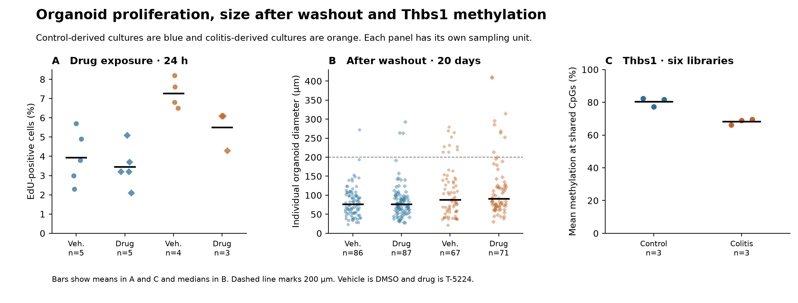
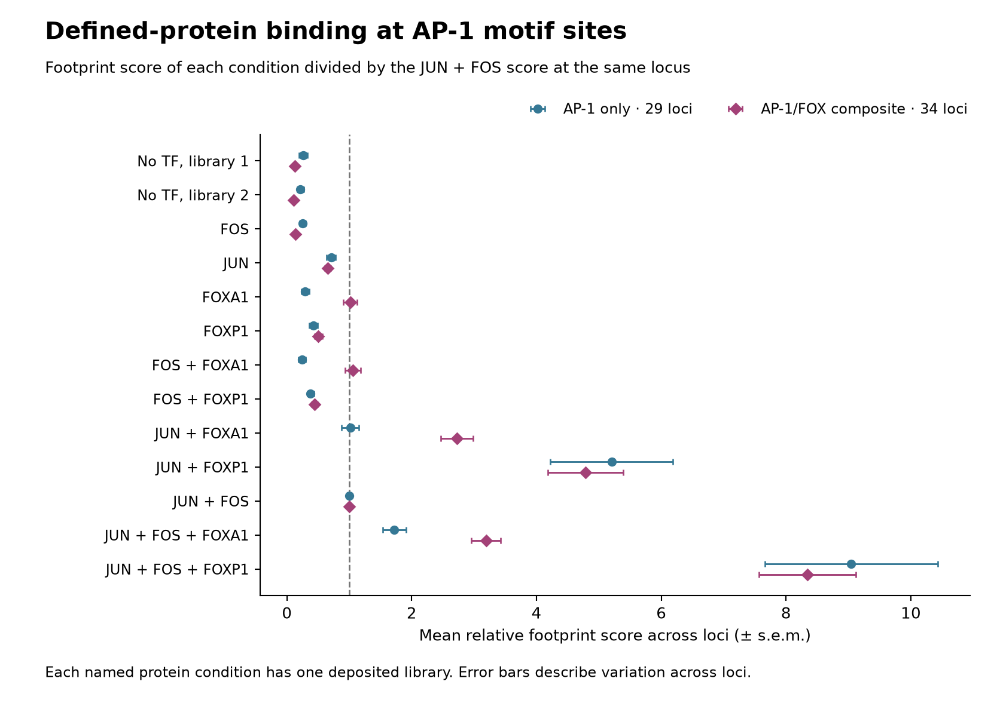
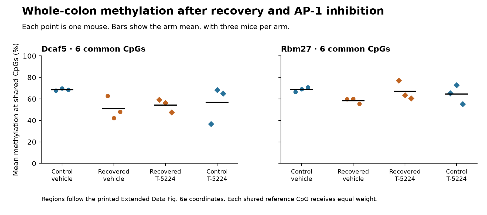
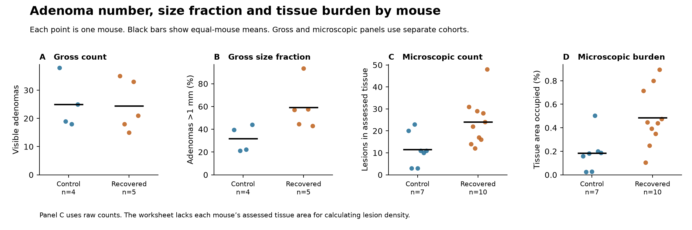
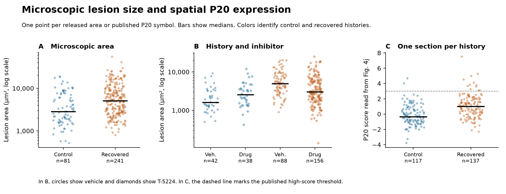
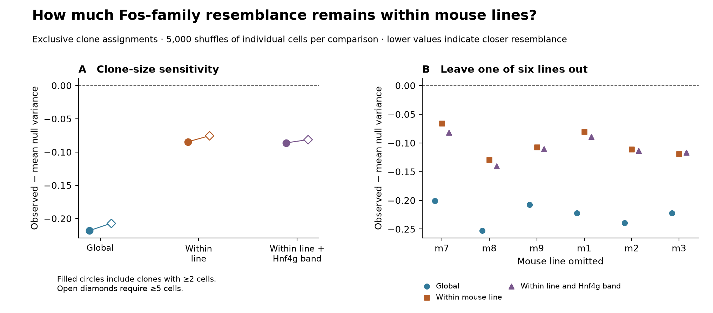
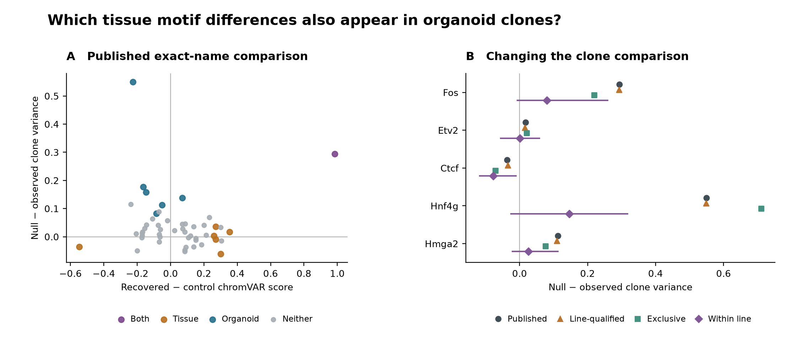

# Nagaraja figure gallery

The ten current figures follow the biological comparisons in the [final S6 synthesis](SYNTHESIS.md). Each caption links its PDF and underlying measurements. The gallery follows tissue recovery and clonal resemblance through the drug, binding and methylation assays to early adenomas. The final two figures show how donor line and clone sampling affect the motif-family evidence.

## S1 · Colonic epithelial recovery after colitis

The 19 staining samples are displayed individually. Sequencing stages use author summaries and have their own axes and mouse counts. The [S1 result](s1/RESULTS.md) explains the denominators, inference limits and difference between the published and released-table RNA gene sets.

| Export or source | Location |
|---|---|
| Current figure | [PNG](../../analysis/research/runs/ng26_s1_figure_v3/fig1_recovery_v3.png) · [PDF](../../analysis/research/runs/ng26_s1_figure_v3/fig1_recovery_v3.pdf) |
| Figure data | [Mouse counts and clocks](../../analysis/research/runs/ng26_s1_v1/fos_mice.tsv) · [Primary contrast](../../analysis/research/runs/ng26_s1_v1/fos_primary.tsv) · [Motif deltas](../../analysis/research/runs/ng26_s1_v1/fos_motif_by_state.tsv) · [RNA stage summary](../../analysis/research/runs/ng26_s1_v1/rna_stages.tsv) |
| Provenance | [Numerical receipt and original export hashes](../../analysis/research/runs/ng26_s1_v1/receipt.json) · [Display amendment](../../analysis/research/contracts/Ng26-P01.s1_figure_v3.json) · [Current display receipt](../../analysis/research/runs/ng26_s1_figure_v3/receipt.json) |

## S2 · Organoid clones and the six mouse lines

**Fig. 2h.** The left panel shows the 280 motifs with defined replay FDRs, with the dashed line at .05. In the right panel, “Exclusive” keeps only cells assigned to one clone in the full cleaned map and qualifies clone IDs by line. The global null preserves the clone sizes in each variant. [Vector PDF](../../analysis/research/runs/ng26_s2_v1/fig2h_dispersion.pdf) · [Figure values and original Table 4 columns](../../analysis/research/runs/ng26_s2_v1/dispersion.tsv) · [Membership denominators](../../analysis/research/runs/ng26_s2_v1/membership_coverage.tsv)

**Fig. 2i.** The left panel includes every released history–clone group, with unclipped scores. The original published plot contains 74 control and 49 colitis symbols, matching the five-cell minimum. The right panel shows equal-weight clone means of the per-clone medians for three control lines (blue, m7–m9) and three colitis lines (orange, m1–m3). Clone counts under the ticks refer to all line-qualified groups. [Vector PDF](../../analysis/research/runs/ng26_s2_v1/fig2i_history.pdf) · [Clone scores](../../analysis/research/runs/ng26_s2_v1/fos_clones.tsv) · [Line scores](../../analysis/research/runs/ng26_s2_v1/fos_by_line.tsv) · [Published plot-coordinate comparison](../../analysis/research/runs/ng26_s2_fig2i_audit_v1/ranked_glyphs.tsv)

[S2 checkpoint and interpretation](s2/RESULTS.md) · [Calculation and figure receipt](../../analysis/research/runs/ng26_s2_v1/receipt.json) · [Published-point audit receipt](../../analysis/research/runs/ng26_s2_fig2i_audit_v1/receipt.json)

## S3 · Drug exposure, binding and methylation

[Vector PDF](../../analysis/research/runs/ng26_s3_v1/organoid_phenotypes_and_thbs1.pdf) · [EdU percentages and diameters](../../analysis/research/runs/ng26_s3_v1/function_measurements.tsv) · [Thbs1 library means](../../analysis/research/runs/ng26_s3_v1/thbs1_libraries.tsv) · [Per-site fractions](../../analysis/research/runs/ng26_s3_v1/thbs1_cpg_fractions.tsv)

[Vector PDF](../../analysis/research/runs/ng26_s3_v1/fig3i_defined_protein.pdf) · [All locus and library values](../../analysis/research/runs/ng26_s3_v1/binding_loci.tsv) · [Table 6 comparisons](../../analysis/research/runs/ng26_s3_v1/binding_summary.tsv)

[Vector PDF](../../analysis/research/runs/ng26_s3_ed6_v1/ed6e_tissue_methylation.pdf) · [Mouse values](../../analysis/research/runs/ng26_s3_ed6_v1/tissue_libraries.tsv) · [CpG values](../../analysis/research/runs/ng26_s3_ed6_v1/tissue_cpg_fractions.tsv) · [Arm contrasts](../../analysis/research/runs/ng26_s3_ed6_v1/tissue_contrasts.tsv) · [S3 interpretation and both receipts](s3/RESULTS.md)

## S4 · Adenoma burden and spatial P20

[Vector PDF](../../analysis/research/runs/ng26_s4_v1/mouse_adenoma_burden.pdf) · [Gross mice](../../analysis/research/runs/ng26_s4_v1/gross_mice.tsv) · [Microscopic mice](../../analysis/research/runs/ng26_s4_v1/microscopic_mice.tsv) · [Equal-mouse contrasts](../../analysis/research/runs/ng26_s4_v1/mouse_contrasts.tsv)

[Vector PDF](../../analysis/research/runs/ng26_s4_v1/lesion_areas_and_p20.pdf) · [Lesion area values](../../analysis/research/runs/ng26_s4_v1/lesion_measurements.tsv) · [Plotted P20 scores](../../analysis/research/runs/ng26_s4_v1/p20_plotted_points.tsv) · [S4 checkpoint](s4/RESULTS.md) · [Receipt](../../analysis/research/runs/ng26_s4_v1/receipt.json)

## S5 · Conditional Fos-family dispersion

[Vector PDF](../../analysis/research/runs/ng26_s5_v1/fos_conditional_dispersion.pdf) · [Estimates for every panel](../../analysis/research/runs/ng26_s5_v1/conditional_estimates.tsv) · [Exchange opportunities](../../analysis/research/runs/ng26_s5_v1/permutation_opportunities.tsv) · [Eligible cells](../../analysis/research/runs/ng26_s5_v1/exclusive_cells.tsv) · [S5 checkpoint](s5/RESULTS.md) · [Receipt](../../analysis/research/runs/ng26_s5_v1/receipt.json)

## Post-S5 · Tissue and clonal motif evidence

Panel A uses the 50 exact reporter matches and each assay's native scale. In panel B, purple segments summarize the central 90% of 64 half-clone estimates. Purple diamonds use all 121 eligible clones from six mouse lines. The full caption and denominators accompany the results. [Family checkpoint](post_s5/RESULTS.md) · [PDF](../../analysis/research/runs/ng26_post_s5_v1/family_evidence.pdf) · [Family values](../../analysis/research/runs/ng26_post_s5_v1/family_evidence.tsv) · [Conditional full panel and clone samples](../../analysis/research/runs/ng26_post_s5_v1/conditional_draws.tsv) · [Resampling values](../../analysis/research/runs/ng26_post_s5_v1/stability.tsv) · [Figure and table receipt](../../analysis/research/runs/ng26_post_s5_v1/receipt.json)

## Display and provenance

All ten frozen figure pairs are shown in their current versions. The S1 composite uses version 3. Data marks and scales retain their original colors and all visible PDF text is black. The receipts cited above bind the exports to their source runs. [S1 render checks](../../analysis/research/runs/ng26_s1_figure_v3/render_checks.json) · [Stage status](ANALYSIS_PLAN.md)

## JUN–FOXP1 extension · 63 selected amplicons

The Stage 2 figure shows paired biochemical footprints, mouse-weighted epithelial accessibility differences, separate organoid and tissue-vehicle regional methylation, and all specimens at the sole scored-motif CpG. [Figure, caption and source tables](jun_foxp1/stage2/MEASUREMENTS.md) · [PDF](../../analysis/research/runs/ng26_jf_measurements_v1/locus_measurements.pdf)

The Stage 3 figures show the frozen binding–accessibility comparison, separate regional methylation estimates, and mouse/locus omission sensitivity. The secondary figure compares native methylation and accessibility across genomic loci in separate cohorts. [Results and source tables](jun_foxp1/stage3/RESULTS.md) · [Binding comparisons PDF](../../analysis/research/runs/ng26_jf_binding_display_v2/binding_associations.pdf) · [Native comparisons PDF](../../analysis/research/runs/ng26_jf_native_secondary_v1/native_associations.pdf)
