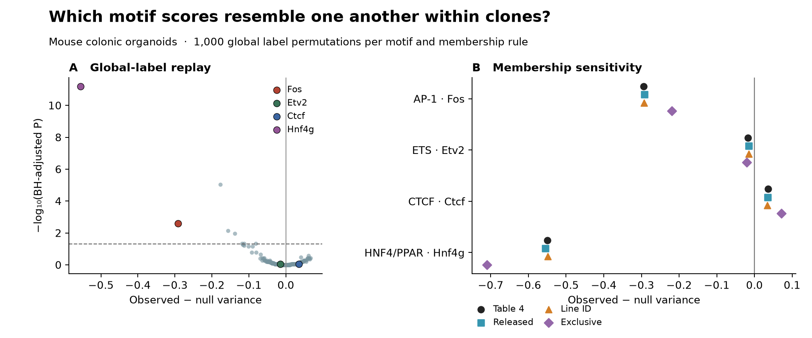
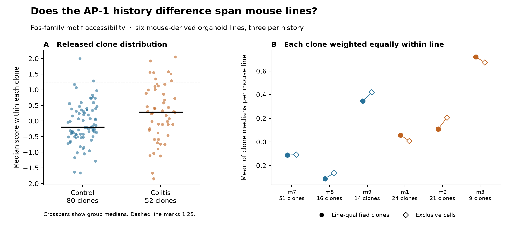

# Nagaraja figure gallery

## S1 · Colonic epithelial recovery after colitis

The 19 staining samples are displayed individually. Sequencing stages use author summaries and have their own axes and mouse counts. The [S1 result](s1/RESULTS.md) explains the denominators, inference limits and difference between the published and released-table RNA gene sets.

| Export or source | Location |
|---|---|
| Current figure | [PNG](../../analysis/research/runs/ng26_s1_figure_v3/fig1_recovery_v3.png) · [PDF](../../analysis/research/runs/ng26_s1_figure_v3/fig1_recovery_v3.pdf) |
| Figure data | [Mouse counts and clocks](../../analysis/research/runs/ng26_s1_v1/fos_mice.tsv) · [Primary contrast](../../analysis/research/runs/ng26_s1_v1/fos_primary.tsv) · [Motif deltas](../../analysis/research/runs/ng26_s1_v1/fos_motif_by_state.tsv) · [RNA stage summary](../../analysis/research/runs/ng26_s1_v1/rna_stages.tsv) |
| Provenance | [Numerical receipt and original export hashes](../../analysis/research/runs/ng26_s1_v1/receipt.json) · [Display amendment](../../analysis/research/contracts/Ng26-P01.s1_figure_v3.json) · [Current display receipt](../../analysis/research/runs/ng26_s1_figure_v3/receipt.json) |

## S2 · Organoid clones and the six mouse lines

**Fig. 2h.** The left panel shows the 280 motifs with defined replay FDRs, with the dashed line at .05. In the right panel, “Exclusive” keeps only cells assigned to one clone in the full cleaned map and qualifies clone IDs by line. The global null preserves the clone sizes in each variant. [Vector PDF](../../analysis/research/runs/ng26_s2_v1/fig2h_dispersion.pdf) · [Figure values and original Table 4 columns](../../analysis/research/runs/ng26_s2_v1/dispersion.tsv) · [Membership denominators](../../analysis/research/runs/ng26_s2_v1/membership_coverage.tsv)

**Fig. 2i.** The left panel includes every released history–clone group, with unclipped scores. The original published plot contains 74 control and 49 colitis symbols, matching the five-cell minimum. The right panel shows equal-weight clone means of the per-clone medians for three control lines (blue, m7–m9) and three colitis lines (orange, m1–m3). Clone counts under the ticks refer to all line-qualified groups. [Vector PDF](../../analysis/research/runs/ng26_s2_v1/fig2i_history.pdf) · [Clone scores](../../analysis/research/runs/ng26_s2_v1/fos_clones.tsv) · [Line scores](../../analysis/research/runs/ng26_s2_v1/fos_by_line.tsv) · [Published plot-coordinate comparison](../../analysis/research/runs/ng26_s2_fig2i_audit_v1/ranked_glyphs.tsv)

[S2 checkpoint and interpretation](s2/RESULTS.md) · [Calculation and figure receipt](../../analysis/research/runs/ng26_s2_v1/receipt.json) · [Published-point audit receipt](../../analysis/research/runs/ng26_s2_fig2i_audit_v1/receipt.json)

## Figure style for subsequent stages

Use the academic-plotting data-figure guidance and DejaVu Sans throughout this package. Render all figure text in black, including facet headings, axes, tick labels, annotations, legends and colorbar labels. Choose scientifically appropriate colors for data marks, groups, lines and heatmaps. Use a continuous scale for magnitude or a diverging scale when a meaningful midpoint separates directions. Keep the meaning of group colors consistent across related panels. Show units and biological sample sizes, align panels, and inspect both PNG and rendered PDF for readability and clipping at final size. In the current S1 export, all 107 PDF text spans use black DejaVu Sans, are within the page bounds and are at least 8 pt. [Render checks](../../analysis/research/runs/ng26_s1_figure_v3/render_checks.json)
