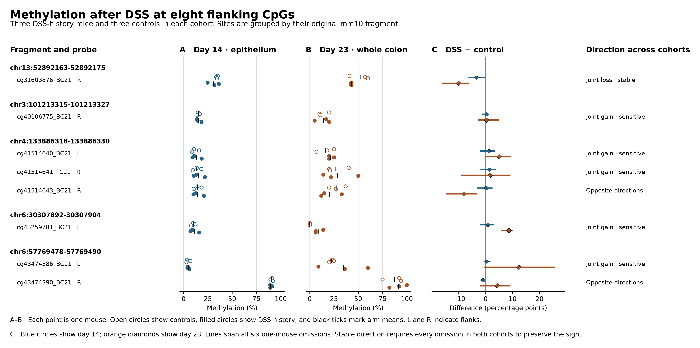

# Eight flanking CpGs after DSS · Numerical checkpoint

**One joint loss, five omission-sensitive joint gains and two opposite-direction sites.** The right-flank probe **cg31603876_BC21** had lower mean methylation after DSS in both studies, by **3.496 percentage points** in day-14 isolated colonic epithelium and **10.000 points** in day-23 whole-colon tissue. Its sign survived each of the six one-mouse omissions separately in each cohort. This is the only site meeting the frozen directional criterion for marker-level follow-up. The assayed cytosine belongs to a dyad 209 bp downstream of the sole scored-motif CpG. The owner’s scientific review is pending. [Frozen design](DESIGN.md) · [Specimens and exact strand](CHECKPOINT.md) · [All eight paired observations](../../../../analysis/research/runs/ng26_saline_markers_v1/site_comparison.tsv)

**Figure.** The fragment headers use the original mm10 scored-interval identifiers. The plotted probes are in their surrounding amplicon flanks. Panels A and B show three mice per arm per study, including measured zeroes. Black ticks give arm means. Panel C gives the full DSS-minus-control difference and the range after omitting each mouse once; these ranges measure dependence on the observed mice. Control treatments were saline in GSE283386 and DMSO in GSE316762. The two cohorts are unpaired. [Vector PDF](../../../../analysis/research/runs/ng26_saline_marker_figure_v1/saline_markers.pdf) · [Figure data by mouse](../../../../analysis/research/runs/ng26_saline_markers_v1/mouse_values.tsv) · [Figure checks](../../../../analysis/research/runs/ng26_saline_marker_figure_v1/render_checks.json)

## Differences and stability

Values are DSS-history minus control group means in percentage points, rounded for display. Each bracket gives the one-mouse omission range in that study. The unrounded rational effects, deposited mouse values and omission records are linked below. Site order was fixed before analysis; adjacent rows from the same fragment use the same mice.

| Fragment (scored interval) | Flank probe | Day 14, epithelium Δ [range] | Day 23, whole colon Δ [range] | Frozen classification |
|---|---|---:|---:|---|
| chr13:52892163–52892175 | cg31603876_BC21 · R | −3.496 [−6.18, −0.36] | −10.000 [−15.83, −6.33] | Joint loss, stable |
| chr3:101213315–101213327 | cg40106775_BC21 · R | +0.304 [−1.16, +1.15] | +0.333 [−2.67, +4.83] | Joint gain, omission-sensitive |
| chr4:133886318–133886330 | cg41514640_BC21 · L | +1.176 [−1.65, +3.23] | +5.000 [+0.17, +9.17] | Joint gain, omission-sensitive |
| chr4:133886318–133886330 | cg41514641_TC21 · R | +1.377 [−1.99, +3.78] | +1.667 [−9.00, +9.00] | Joint gain, omission-sensitive |
| chr4:133886318–133886330 | cg41514643_BC21 · R | +0.182 [−3.01, +2.34] | −8.000 [−14.50, −3.50] | Opposite directions |
| chr6:30307892–30307904 | cg43259781_BC21 · L | +0.901 [−1.70, +2.77] | +8.667 [+6.00, +10.00] | Joint gain, omission-sensitive |
| chr6:57769478–57769490 | cg43474386_BC11 · L | +0.377 [−0.36, +1.60] | +12.333 [−0.17, +25.33] | Joint gain, omission-sensitive |
| chr6:57769478–57769490 | cg43474390_BC21 · R | −0.887 [−1.60, −0.41] | +4.333 [−1.67, +9.00] | Opposite directions |

**Magnitude against mouse variation.** At cg31603876_BC21, external arm means were 34.33% in controls (33.58–35.09%) and 30.84% after DSS (24.57–36.21%). The whole-colon means were 52.67% in controls (41–60%) and 42.67% after DSS (42–43%). The individual arm ranges overlap in each cohort, and one external omission reduced the loss to 0.36 points. The five joint gains ranged from +0.304 to +1.377 points in external epithelium. Every one of those five changed sign under at least one external mouse omission. The whole-colon +12.333-point estimate at cg43474386_BC11 included DSS-history mice spanning 9–60%. One omission at cg43474390_BC21 gave an exact zero in whole colon. No full-sample difference was exactly zero. [Both arm means, minima, maxima and exact signed effects](../../../../analysis/research/runs/ng26_saline_markers_v1/study_differences.tsv) · [All 96 one-mouse omissions and exact signs](../../../../analysis/research/runs/ng26_saline_markers_v1/mouse_omissions.tsv)

**Verification.** Using the qualified chip-position map, an independent calculation reread the six saline columns at the eight fixed probes and the 48 verified same-strand Nagaraja fractions. Integer arithmetic on the deposited decimals reproduced all 96 mouse values, 16 study effects, 96 omitted-mouse effects, arm ranges, omission sign counts and eight directional classifications. Panel C uses the saved numerical outputs. [Numerical receipt](../../../../analysis/research/runs/ng26_saline_markers_v1/receipt.json) · [Figure receipt](../../../../analysis/research/runs/ng26_saline_marker_figure_v1/receipt.json) · [GSE283386](https://www.ncbi.nlm.nih.gov/geo/query/acc.cgi?acc=GSE283386) · [GSE316762](https://www.ncbi.nlm.nih.gov/geo/query/acc.cgi?acc=GSE316762)
