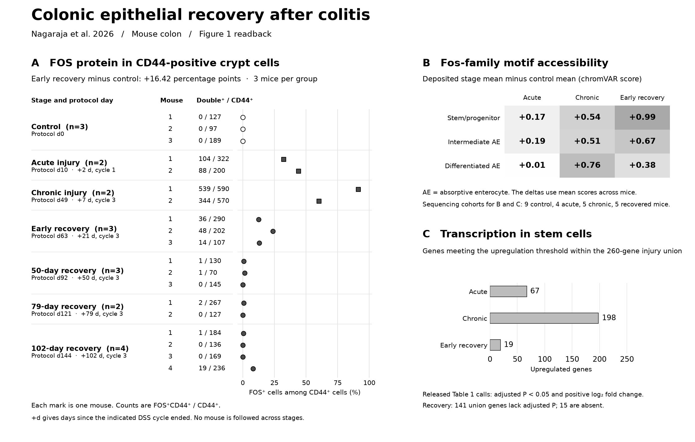

# S1 · Colonic epithelial recovery after colitis

**The early-recovery mice averaged 16.42% FOS-positive cells among CD44-positive crypt epithelial cells, compared with 0.00% in controls.** The unpaired, mouse-weighted difference was **+16.42 percentage points** at protocol day 63 (21 days after the final DSS withdrawal) versus day 0. The six source counts were 36/290, 48/202 and 14/107 at recovery, and 0/127, 0/97 and 0/189 in controls. Each mouse contributes one percentage. Omitting any one mouse gives differences from +12.75 to +18.42 points; this is an influence check with three mice per group. [Primary estimate](../../../analysis/research/runs/ng26_s1_v1/fos_primary.tsv) · [Mouse-level figure data](../../../analysis/research/runs/ng26_s1_v1/fos_mice.tsv)

**Figure 1 readback.** A shows counted protein-positive cells per mouse. The numerator is FOS⁺CD44⁺, and the denominator is CD44⁺. B shows the authors’ mean Fos-family chromVAR score differences against control within epithelial states. C counts calls in the fixed acute-or-chronic upregulated set derived from the released stem-cell RNA table. The axes and biological units are specific to each assay. [Figure PDF](../../../analysis/research/runs/ng26_s1_figure_v2/fig1_recovery_v2.pdf) · [Protein data](../../../analysis/research/runs/ng26_s1_v1/fos_mice.tsv) · [Motif data, including original P and BH values](../../../analysis/research/runs/ng26_s1_v1/fos_motif_by_state.tsv) · [RNA plot data](../../../analysis/research/runs/ng26_s1_v1/rna_stages.tsv)

## Protein staining through extended recovery

| Stage | Workbook protocol day | Days after indicated withdrawal | Mice | Mean mouse % | Mouse range % |
|---|---:|---|---:|---:|---:|
| Control | 0 | No exposure | 3 | 0.00 | 0.00–0.00 |
| Acute injury | 10 | 2 after cycle 1 | 2 | 38.15 | 32.30–44.00 |
| Chronic injury | 49 | 7 after cycle 3 | 2 | 75.85 | 60.35–91.36 |
| Early recovery | 63 | 21 after cycle 3 | 3 | 16.42 | 12.41–23.76 |
| 50-day recovery | 92 | 50 after cycle 3 | 3 | 0.73 | 0.00–1.43 |
| 79-day recovery | 121 | 79 after cycle 3 | 2 | 0.37 | 0.00–0.75 |
| 102-day recovery | 144 | 102 after cycle 3 | 4 | 2.15 | 0.00–8.05 |

The staining samples are independent cross-sectional harvests. The day-102 mean includes one mouse at 19/236 (8.05%) and three at 0/136, 0/169 and 1/184. That spread matters with four mice. The elapsed times use the Fig. 1a schedule, with withdrawal on protocol days 8 and 42. The general Methods describe collection windows of day 11 for acute and days 51–53 for chronic; the protein workbook itself labels those samples days 10 and 49. The table retains its labels. [Stage means and ranges](../../../analysis/research/runs/ng26_s1_v1/fos_stages.tsv) · [Nagaraja et al., Fig. 1 and Methods](https://pmc.ncbi.nlm.nih.gov/articles/PMC13083248/#Fig1)

## Motif accessibility depends on which state is summarized

At early recovery, the deposited mean Fos-family motif delta was **+0.986** in stem/progenitor cells (author BH-adjusted P = 0.00128), **+0.666** in intermediate absorptive enterocytes (0.00431), and **+0.382** in differentiated absorptive enterocytes (0.907). The recovered point estimates are ordered across differentiation. The differentiated-cell estimate remains uncertain, and no between-state interaction was estimated. The stage ordering also varies: chronic differentiated cells had a larger point estimate (+0.759) than chronic stem/progenitor cells (+0.537). [All nine Table 3 rows](../../../analysis/research/runs/ng26_s1_v1/fos_motif_by_state.tsv)

The authors first summarized cells by replicate and state, then contrasted stage and control means for each family. Fig. 1g reports 9 control, 4 acute, 5 chronic and 5 recovered mice. These group-level values reuse the published fit. We did not recover the replicate-level values underlying Table 3 or establish a mouse or cell crosswalk to the stained sections. The stronger recovered mean in stem/progenitor cells leaves open whether more cells crossed a high threshold, scores rose within a pre-existing subset, or cell-state composition changed. [Author motif comparison code](https://github.com/snagaraja13/colitis_memory/blob/v1.0.1/2_SHAREseq_testing/02a_diff_motifs.R)

## Stem-cell RNA and the published 246-gene set

The supplement identifies Table 1 as differential expression within stem cells. We retained unique released gene symbols for the acute, chronic and early-recovery comparisons with control. An up call requires positive DESeq2 log₂ fold change and deposited adjusted P < 0.05. The RNA model used cell-type pseudobulks within animals. The available adjusted-P denominator changes substantially between stages. [Supplementary Information, p. 10](https://pmc-oa-opendata.s3.amazonaws.com/PMC13083248.1/41586_2026_10258_MOESM1_ESM.pdf) · [Tables 1–6 archive](https://pmc-oa-opendata.s3.amazonaws.com/PMC13083248.1/41586_2026_10258_MOESM5_ESM.zip)

| Stage | Genes on sheet | With adjusted P | All up / down calls | Up within 260-gene injury union | Union genes on sheet with adjusted P |
|---|---:|---:|---:|---:|---:|
| Acute | 13,440 | 11,876 | 67 / 51 | 67 | 247 |
| Chronic | 13,919 | 9,601 | 198 / 36 | 198 | 240 |
| Early recovery | 13,682 | 3,867 | 62 / 102 | 19 | 104 |

The injury union contains 260 genes up at either injury stage, with five shared between the two. Of those 260, **19 were up at recovery, one was down, 84 had a usable result that missed the threshold, 141 lacked an adjusted P and 15 were absent**. Their median recovery log₂ fold change was −0.132 across 245 available estimates. Selection on the two injury comparisons and changing test coverage both affect this summary. Fewer injury-associated genes met the up threshold in early recovery; the proportion biologically back at baseline remains unestimated. [Per-gene membership, effect and missingness](../../../analysis/research/runs/ng26_s1_v1/rna_injury_union.tsv)

Nagaraja et al. show 66 acute, 184 chronic and 7 recovered up calls in a 246-gene set in Fig. 1e. The Methods describe 14 suspected multimappers, and the archived code excludes genes whose raw total in a `counts` matrix exceeds 150,000 before selecting the injury union. The workbook lacks those raw totals, exclusion flags and the identities of the excluded genes. The tagged script refers to `counts` without defining the exact input object. The numerical difference of 14 between the two unions does not identify which genes to remove. The released-table readback therefore cannot directly verify the paper’s “more than 97%” return-to-baseline interpretation. [Published Fig. 1e and Methods](https://pmc.ncbi.nlm.nih.gov/articles/PMC13083248/#Fig1) · [Tagged RNA analysis](https://github.com/snagaraja13/colitis_memory/blob/v1.0.1/2_SHAREseq_testing/01_diff_genes.R)

For Fig. 1f’s named markers, the early-recovery RNA log₂ fold changes were −0.986 for *Lgr5* (adjusted P = 0.0544) and +0.622 for *Mki67* (0.212). These are gene-level contrasts. The individual-animal expression heatmap in Fig. 1d and the cell embedding and neighbourhood enrichment in Fig. 1f still require original pseudobulks, cell assignments or graph inputs. [Six marker contrasts](../../../analysis/research/runs/ng26_s1_v1/rna_fig1f_markers.tsv)

## Interpretation and stage decision

Nagaraja et al. directly report persistent FOS staining and elevated recovered motif accessibility in Fig. 1g,k,l. The Ravel staining calculation recovers the group contrast from the same counted material; the RNA and motif readbacks reuse author estimates. Together they support residual early-recovery protein staining alongside an elevated mean motif score in sampled stem/progenitor cells, while many injury-associated RNA calls no longer meet threshold or cannot be evaluated. None of these three endpoints follows an individual cell through recovery. The original per-cell Fos deviations with the `stem_prog` gate remain unavailable for Fig. 1i. Fig. 1l’s extended **protein** series is qualified, while its original extended **chromatin** curve remains held. [S0 source findings](../s0/CHECKPOINT.md) · [Published Fig. 1](https://pmc.ncbi.nlm.nih.gov/articles/PMC13083248/#Fig1)

**Proposed S2, pending review.** Move to the separate lineage-barcoded organoid specimens. First replay the deposited Fig. 2h global clone-label shuffle against Table 4 and Fig. 2i clone medians by history. Use the published membership convention for that replay. Report contributions of the six independently derived lines, the four clone names shared across histories, 585 multiply assigned scored cells, and feature-specific nonfinite scores. Keep any exclusive-membership or line-aware sensitivity separate. Independent differentiation labels and matched P20 scores are still unresolved. This comparison asks whether ex-vivo relatives resemble one another; it cannot identify which recovered tissue cells founded those clones. [S2 source and donor qualification](../s0/PANEL_ELIGIBILITY.md) · [Staged analysis plan](../ANALYSIS_PLAN.md)

**Verification.** The exposed descriptive [contract](../../../analysis/research/contracts/Ng26-P01.s1_v1.json) and both code files were frozen at `6df7086`. A separate XLSX XML parser read the source archives directly. It checked all 19 mice’s counts, days and percentages, the primary contrast using exact rational arithmetic, all nine motif deltas and both P columns, and the RNA union, stage coverage, calls and medians. The [execution receipt](../../../analysis/research/runs/ng26_s1_v1/receipt.json) verifies nine output hashes. The displayed grayscale rendering uses the same frozen tables. Both PNG and rendered PDF were visually inspected, and all PDF text is black DejaVu Sans at 8 pt or larger within the page bounds. [Figure receipt](../../../analysis/research/runs/ng26_s1_figure_v2/receipt.json) | [Figure gallery](../FIGURES.md). S1 stops here for review.
