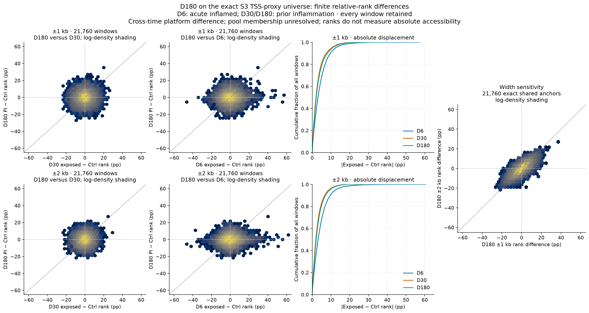

# Naik 2017 — inflammatory memory in epidermal stem cells

## Organizing biological question

What persists in epidermal stem cells after skin inflammation resolves, and how does that history change their response to a later wound?

Naik and colleagues found that previously inflamed mouse skin re-epithelialized faster after wounding. Some chromatin regions that opened during inflammation remained accessible after recovery, and perturbations implicated AIM2 signaling in the repair response. These experiments connect inflammatory history to repair. They leave a distinct question about which regulatory elements carry that history through recovery. [Naik et al., *Nature* (2017), Figs. 1, 3–5](https://doi.org/10.1038/nature24271) · [Paper review and Fig. 2g correction](PAPER_REVIEW.md)

**Ravel result.** Acute RNA differences generally diminished by day 30. Near annotated gene starts, almost half of the windows changed the direction of their history–control accessibility rank difference between days 30 and 180. At a different set of sites, Cowley’s published distal Memory regions showed a larger accessibility difference between previously inflamed and control mouse skin at 24 months than did regions classified as Resolved. The estimated difference between the class changes was +0.117 fragment CPM. Accounting for day-6 control accessibility, acute induction and region width gave +0.116 CPM. [Day-180 gene-start analysis](S6C_RESULTS_V1.md) · [Source scan](DISTAL_SKIN_SOURCE_SCAN_20261119.md) · [M24 result](distal_m24_outcome_v1/RESULTS_V1.md) · [D6 control sensitivity](distal_m24_baseline_v1/RESULTS_V1.md)

**Status.** The original Naik stages, the S7 human RNA comparison and the mouse-skin distal chromatin extension are complete under article-local candidate `Nk17-P01`. [Original S0–S7 synthesis](S6_SYNTHESIS_V3.md) · [Figure gallery](FIGURES.md) · [Literature context](LITERATURE_CONTEXT.md)

## Data and comparisons

| Source | What Ravel compared | Biological unit and limit |
|---|---|---|
| Naik mouse epidermis, GSE92967 | Acute inflammation versus control at day 6, previous inflammation versus control at days 30 and 180, and wound-induced RNA contrasts at 6 and 12 hours. S3 and S6C rank deposited ATAC signal within each library at fixed gene-start windows. | Deposited RNA libraries and pooled ATAC preparations. Exact animal membership and cross-assay pairing are unresolved. Within-library ranks measure relative ordering. [Sample qualification](S1M_RESULTS_V2.md) · [ATAC qualification](S3Q_RESULTS_V1.md) |
| Cowley mouse epidermis, GSE299177, with day-6 controls from Naik and Larsen | Compared 24-month accessibility at published Memory and Resolved regions lying outside a ±2 kb window around every annotated transcript start. Used four accession-linked day-6 vehicle-control tracks to assess baseline accessibility. | Two pooled libraries per 24-month group. Each history group was compared with the other using per-pool class summaries. Day-6 control ranks describe earlier experimental pools. [Source scan](DISTAL_SKIN_SOURCE_SCAN_20261119.md) · [M24 result](distal_m24_outcome_v1/RESULTS_V1.md) · [D6 control sensitivity](distal_m24_baseline_v1/RESULTS_V1.md) |
| Naik figure source data | Re-epithelialization, proliferation, explant outgrowth, molecular readouts and wound area in the available functional panels. | The workbook supplies observations or group summaries, depending on the panel. Daily columns do not establish longitudinal animal identities. [Functional source map](S5F_SOURCE_MAP_V1.json) · [Daily-area source map](S6A_SOURCE_MAP_V1.json) |
| Hamdan human colonic organoids, GSE282444 | Within each of two ulcerative colitis donors, compared the 24-hour TNF RNA response of inflamed-derived and noninflamed-derived organoids using concurrent controls. | Sixteen libraries across two donors. Each donor contributes a separate descriptive result. Site of origin, cell composition and culture history can contribute to the contrast. [S7 sample selection and method](S7_HAMDAN_RESPONSE_METHOD_V1.md) |

## What the analyses changed

| Comparison | Observation and biological interpretation |
|---|---|
| Acute and recovered RNA (S2) | For 11,108 of 13,452 genes eligible at either time (82.58%), the absolute history–control RNA difference was smaller at day 30. Individual genes and libraries varied, and the day 6 and day 30 RNA series differ technically. [RNA results](S2_RESULTS_V1.md) |
| Accessibility through recovery (S3, S6C) | Across 21,760 fixed windows, median absolute rank differences were 3.067, 1.995 and 2.167 percentile points at days 6, 30 and 180. Between days 30 and 180, 45.55% shrank and 47.92% changed sign. A single decay trajectory would miss this heterogeneity. [Day 6 and day 30](S3_RESULTS_V1.md) · [Day 180](S6C_RESULTS_V1.md) |
| Distal accessibility at 24 months | Previously inflamed pools averaged +0.090 fragment CPM at 791 Memory regions and −0.027 CPM at 784 Resolved regions relative to age-matched controls. The class contrast was +0.117 CPM, +0.121 after balancing acute induction and width, and +0.116 after also balancing day-6 control rank on shared support (768 Memory, 757 Resolved). [M24 comparison](distal_m24_outcome_v1/RESULTS_V1.md) · [Baseline sensitivity](distal_m24_baseline_v1/RESULTS_V1.md) |
| Wound-response RNA and baseline choice (S4, S4B, S6B) | Changing the baseline reference changed the sign of roughly 15–17% of the adjusted contrasts. Two baseline libraries had discordant source labels and marker profiles. The same marker pattern was absent from the four acute libraries. [Recall components](S4_RESULTS_V1.md) · [Reference sensitivity](S4B_RESULTS_V1.md) · [Acute marker check](S6B_RESULTS_V1.md) |
| RNA and local accessibility (S5M) | The primary across-gene correlation between RNA contrasts and gene-start rank contrasts was 0.425 at day 6 and 0.144 at day 30. Subtracting a shared baseline accounted for small negative adjusted recall associations. Exact animal-level RNA–ATAC pairing remains unknown. [Corrected molecular results](S5M_RESULTS_V2.md) |
| Repair and its component measurements (S5F, S6A) | Previously inflamed skin had longer epithelial tongues at all three measured times. EdU differences changed direction across days, limiting a proliferation-only explanation. Five daily-area panels retain their source-specific interpretation. Conflicting workbook and figure labels leave the group assignment in Extended Data Fig. 6g unresolved. [Functional results](S5F_RESULTS_V1.md) · [Daily areas and label conflict](S6A_RESULTS_V1.md) |
| Human RNA response (S7) | Among genes with higher post-TNF RNA in inflamed-derived organoids, 36.29% in donor 4 and 31.80% in donor 83 had a smaller signed TNF response after accounting for concurrent controls. Baseline differences can therefore change the reading of a post-challenge comparison. Each percentage describes genes within one donor. [S7 results and denominators](S7_RESULTS_V1.md) |

## Measured figures

Three figures are shown here alongside the findings they support. The [figure gallery](FIGURES.md) includes these three and the other 22 figures, with captions and PDF exports.

**Individual windows change in opposing directions.** The day 180 distribution covers the same gene-start windows used at days 6 and 30. A window's relative rank can shift as other windows change. Estimating persistence at the original distal domains requires their coordinates and region definitions. [S6C figure interpretation](S6C_RESULTS_V1.md)

**Baseline RNA differences usually shrink during recovery.** Each gene contributes a history–control contrast at each time. The distribution narrows by day 30, even as some genes retain differences. The wound series introduces a separate question about how baseline choice affects the estimated response. [S2 figures](FIGURES.md#acute-and-recovered-baseline-rna) · [S4 wound-response figures](FIGURES.md#wound-response-rna) · [S4B baseline sensitivity](FIGURES.md#sensitivity-to-the-baseline-reference)

**Why the patient panels spread out.** Each panel counts genes within one donor. Two genes can end at the same inflamed-minus-noninflamed difference after TNF while starting at different control differences. Subtracting each gene's control difference gives different response contrasts. The scatter describes that gene-level variation. A single time point leaves response speed unresolved. [S7 figure interpretation](S7_RESULTS_V1.md) · [Figure gallery of all 25 measured figures](FIGURES.md)

## Literature context and next biological decision

Naik established that inflammatory history can change how epidermal stem cells respond to wounding. Larsen examined how accessibility is established and recalled. Cowley tracked the longevity of regulatory domains, including DNA methylation and H2A.Z. Cowley Fig. 1 already shows the 24-month accessibility pattern in these pooled samples. Ravel’s extension measures the size of the late difference in a consistently defined distal subset and shows how much earlier accessibility and the choice of comparison regions affect it. [Naik, Figs. 3–5](https://doi.org/10.1038/nature24271) · [Larsen, Figs. 3–6](https://doi.org/10.1016/j.stem.2021.07.001) · [Cowley, Fig. 1 and Methods](https://doi.org/10.1126/science.adz6830)

The [literature and deposit scan](DISTAL_SKIN_SOURCE_SCAN_20261119.md) located Cowley’s region coordinates and a Resolved comparator among regions that opened during acute inflammation. The published classes use day-6 and day-30 data, and the underlying peak universe incorporates month 12. Month 24 was outside region selection. Naik’s original genome-wide retained and transient coordinate lists remain unresolved. The [source qualification](distal_m24_qualification_20261119/SOURCE_QUALIFICATION.md) records which definitions and samples could be carried forward, including reused libraries.

**What the result leaves open.** Balancing the day-6 control accessibility ranks changed the induction- and width-weighted estimate by −0.0054 fragment CPM in these four pools. Baseline-rank balance improved, while the residual standardized difference in acute induction increased from 0.093 to 0.142. The comparison describes sorted populations at two years. Cell-state composition and continuous maintenance within the same cells require different evidence. Whether regions selected *solely during acute inflammation* show a similar late difference is a separate question. The source scan identifies Larsen’s acute peak calls and their limits for defining a quantitative comparator. [M24 result](distal_m24_outcome_v1/RESULTS_V1.md) · [Baseline sensitivity](distal_m24_baseline_v1/RESULTS_V1.md) · [Ravel question-development rules](../../AGENTS.md#biological-screening-and-question-progression)

## Execution history and provenance

[Original plan](ANALYSIS_PLAN.md) · [Stage history](STAGE_STATUS.md) · [S3 endpoint amendment](S3_AMENDMENT_V1.md) · [S5M correction](S5M_AMENDMENT_V2.md) · [Pre-S7 decision](S6_DECISION_V2.md) · [Original S6/S7 disposition](S6_SYNTHESIS_V3.md). The stage reports link the methods, frozen inputs, calculations and receipts. For the closest Ravel intestinal comparison, see the [Arozamena paper package](../ungated_arozamena_2026_inflammatory_memory/README.md).
