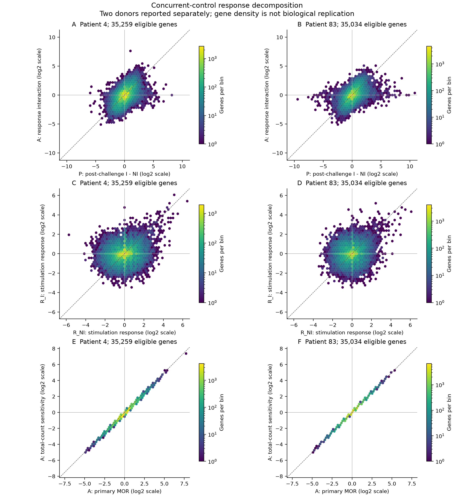
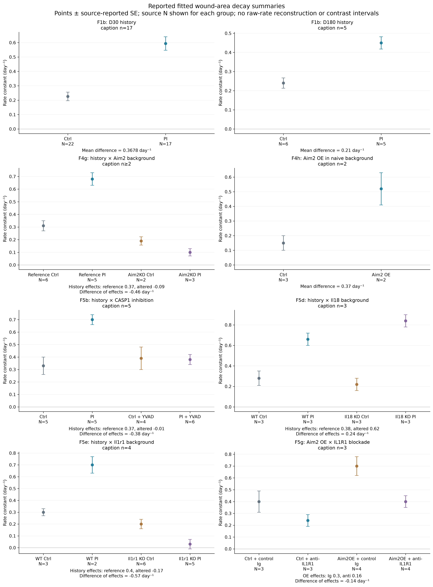
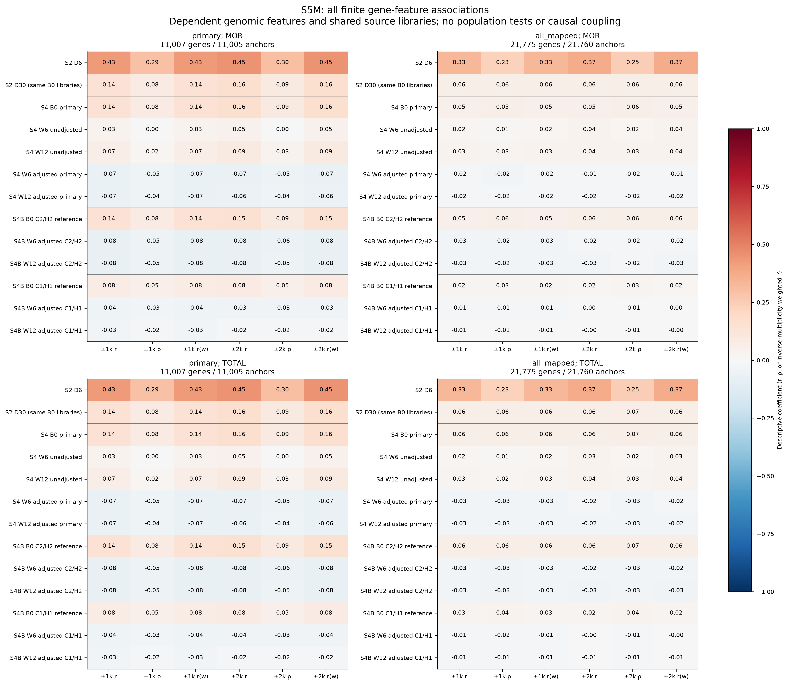
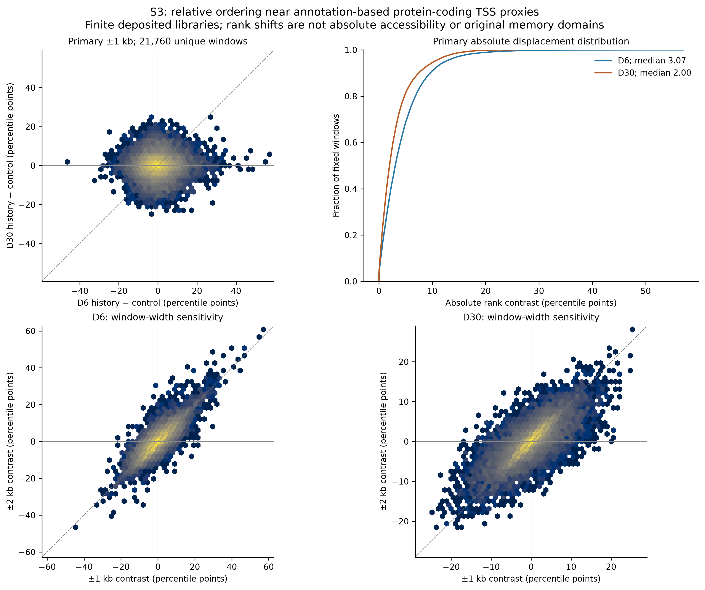
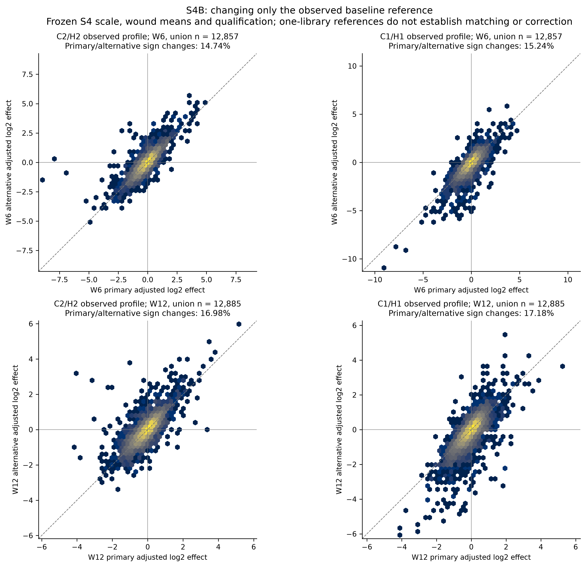
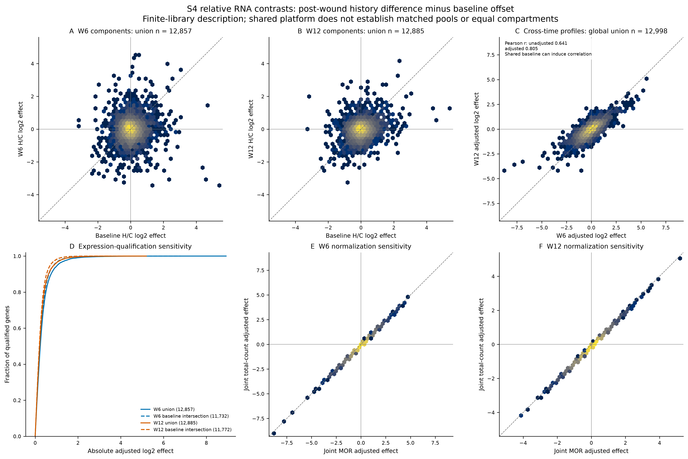

# Naik 2017: from inflammatory history to epithelial recall

19 November 2026. Article-local research package, informed by the owner's
Naik Results/Discussion notes. This source sits outside the ordered roadmap;
existing gates and RQs retain their status. Owner `Nk17-P01` follows Ravel's
paper-driven workflow. Execution and coordinator review confer no human
scientific acceptance.

**Current result:** [S7 Hamdan response contrasts](S7_RESULTS_V1.md) executed from
frozen `a7be7f8` with 15,807,848 independent checks and receipt integrity passed.
All 64,253 genes are exported. Under primary MOR, 36.29%/31.80% of post-positive
records in patients 4/83 have negative response interaction A after subtracting
the concurrent-control contrast. The distinction persists without raw zero counts
(45.50%/37.45% within those post-positive strata). Normalization changes its extent;
positive A can also describe less repression. This is a finite-source response
estimand result, not a patient-population, causal memory, kinetics or repair claim.

The [final S6/S7 synthesis](S6_SYNTHESIS_V3.md) records the original S0–S6
disposition, completed justified extensions and the precise unresolved routes.
The coordinator reviewed the full S7 result and all six actual panels without
revision. This bounded assignment is complete with local preservation and passed checks;
no automatic score, pathway, cohort or raw-read pipeline is added.

All eligible genes are displayed; density counts genes, not independent patients.
The full report retains both raw-zero strata and both normalizations. The
[pre-execution rationale](S6_DECISION_V2.md) remains unchanged.

The latest measured [S6C D180 result](S6C_RESULTS_V1.md) retains the exact S3
universe: median absolute rank difference 2.167 pp (D30 1.995, D6 3.067), only
45.55% smaller than D30 and 47.92% with opposite signs. This is heterogeneous
relative ordering, not uniform decay or original retained-domain reproduction.
All 7,009,534 independent checks, 296 interval readbacks and receipt integrity
passed; the complete report and both figures were reviewed without revision.

Every window is retained at both widths. Mean rank50 and whole-universe mean
contrast0 are structural. The report includes all five anchors, complete zero/tie
semantics, platform/pooling limits and the separately archived pre-signal WSL
launch failure; the successful retry used unchanged frozen code/inputs.

[S6B D6 QC](S6B_RESULTS_V1.md), reviewed/preserved at `ba5afa4`, does not repeat
the specific S4 baseline marker pattern in the four acute libraries. All twenty
profiles retain Xist in the thousands, three Y-linked markers at zero and Uty at
0–1 read. This narrows the observed discrepancy without assigning sex, certifying
D6 as unconfounded or establishing RNA–ATAC matching.

[S6A daily areas](S6A_RESULTS_V1.md), reviewed/preserved at `ccc91cd`, keeps all
six panels and the mixed raw/day0-subtracted comparisons. **EDF6g biological
mapping remains held**: exact source headers disagree with the published final-
PDF curve labels and related summary Ns. No group swap/refit or Aim2 repair
reversal claim follows. The other five panels retain their finite-source scope.
S5F remains preserved at `2514379`; all earlier functional endpoints remain separate.

The progression is explicit: published recall → baseline/reference-dependent
Naik contrasts → a separate within-donor response estimand in Hamdan. S7 reports
both constituent responses, both normalizations and raw-zero strata, without
converting genes/libraries into patients or RNA into repair. Published STEM
condition ordering, normalization ambiguities and the exact source discrepancies
remain visible in the [current rationale](S6_DECISION_V2.md).

[S5M v2](S5M_RESULTS_V2.md) preserves the 312 RNA–ATAC associations and 96
covariance records while correcting its count-zero warnings. Primary ±1 kb MOR
Pearson is 0.425 at D6 and 0.144 at D30; small negative adjusted associations
reflect subtraction of a larger positive baseline covariance. They do not show
chromatin repression. The [S3 result](S3_RESULTS_V1.md) describes relative ranks
near 21,760 boundary proxies; original retained domains and absolute opening
remain unestimated.

The [S2 baseline](S2_RESULTS_V1.md), [S4 recall](S4_RESULTS_V1.md) and
[S4B sensitivity](S4B_RESULTS_V1.md) retain mixed relative RNA effects and
baseline-reference dependence. Recorded female metadata and Xist/Y-marker
profiles disagree for two baseline libraries; no sex assignment, correction or
pairing was made. [S1M](S1M_RESULTS_V2.md) owns assay-specific units: D6 is acute
inflammation, D30 recovered-baseline history. RNA cross-time technical differences
must not be transferred to ATAC, whose eight D6/D30 tracks share platform/layout.
Exact pool/animal and cross-assay membership remain unresolved.

**Organizing question:** after inflammation resolves, what remains in epithelial
stem cells, and how does that history alter a subsequent tissue-damage response?

Naik's published result connects persistent accessibility with altered wound
response in mouse epidermis. The first computational purpose here is exposed
reproduction and qualification of that connection: distinguish acute RNA,
recovery-stage RNA, persistent accessibility and wound-induced transcription.
These are different measurements. Population selection, continuing local input,
sampling and processing can coexist with intrinsic regulatory persistence.

[Stepwise plan](ANALYSIS_PLAN.md) · [Paper evidence and corrections](PAPER_REVIEW.md)
· [Literature context and search record](LITERATURE_CONTEXT.md)
· [Execution checkpoint](STAGE_STATUS.md)

The published biological argument is that inflammation leaves regulatory
changes in long-lived epithelial populations, which can alter a later response
and repair outcome. The RNA, chromatin and functional experiments support
different parts of that argument. Ravel's analysis will reconstruct the eligible
comparisons, examine their robustness and use any remaining discrepancy to
develop a specific follow-up. The [stage table](ANALYSIS_PLAN.md#stage-sequence-and-decisions)
describes computational order, not a cellular trajectory or established causal chain.

## What the current evidence changes

- S5F supplies distinct measured functional/source endpoints. Tongue length,
  EdU, outgrowth, expression, activity, protein and reported decay constants
  cannot substitute for one another or identify memory storage. The residual
  within-blockade F5g contrast motivated completed S6A daily-area qualification.
  EDF6g mapping is held for the exact source-label conflict; the other panels
  remain descriptive. Naik Fig. 5c already supplies the transcript/protein distinction.
- S5M connects the measured RNA and TSS-proxy descriptions: acute alignment is
  larger than recovered/recall alignment, with baseline subtraction shaping the
  small adjusted associations. Shared libraries, baseline coupling and differing
  biological layers remain limits. S5F now describes the separate source
  functional endpoints without a combined memory score. Naik Fig5c
  already reports IL-1beta protein without an Il1b transcript increase.
- S3 adds a qualified relative-ordering measurement in a protein-coding boundary
  universe. Smaller aggregate D30 displacement survives the two widths, while
  individual signs/magnitudes and library support can vary. Aim2's positive D30
  average has a cross-library range including zero; Iigp1 is width-sensitive.
  None reconstructs the published distal retained-domain classification.
- The S2 distribution supports smaller recovered-baseline relative RNA contrasts
  within this source, including the both-time expression-qualified subset.
  Residual gene differences are heterogeneous and sometimes driven by one
  library or zeros. Neither attenuation nor a small group mean establishes
  equivalence, absolute RNA recovery, intrinsic regulatory memory or repair.
- S4 decomposes baseline and post-wound contrasts and exposes a source/marker
  discrepancy. Adjusted W6/W12 correlations share baseline estimation error:
  global-union Pearson correlation rises from 0.641 unadjusted to 0.805 adjusted,
  which is not independent temporal corroboration. Negative adjusted effects can
  coexist with increases in both histories; component contrasts remain essential.
- S4B adds reference dependence: median absolute shifts of about 0.11 log2 units
  accompany 15–17% union sign changes. Two one-library references diagnose
  sensitivity without correcting source identity or replacing the primary result.
  The shift is identical at W6/W12 for each gene by construction, not replication.
- The annotated version-of-record PDF includes a correction to Figure 2g.
  Figure 3 reports pooled ATAC preparations; Figure 4 and the final RNA Methods
  report four animals per condition in duplicate. Manuscript wording differs.
  Biological units must therefore be qualified by assay and source version.
- The inspected GEO metadata snapshot lists 16 RNA and 12 ATAC libraries.
  It offers RNA at D6, unwounded D30 and 6/12 hours after wounding, and ATAC at
  D6/D30/D180. It does not list wound ATAC or D180 RNA-seq. Separate assays are
  not established same-animal or same-cell pairs.
- Published outcomes and some D6 RNA profiles were inspected before the S2
  specification. S2 is exposed shared-source description; its later freeze
  does not turn the work into independent confirmation or biological replication.
- Larsen 2021 already investigates establishment, maintenance and recall in this
  system. Rediscovering AP-1 enrichment or proposing that homeostatic factors
  maintain accessible regions is not, by itself, a new mechanistic contribution.

## Measured functional-source evidence

[S5F results and all five figures](S5F_RESULTS_V1.md) retain every assigned
comparison, including unfavorable and mixed results. Points and bars above are
reported rate means and SEs, not reconstructed animal rates or contrast intervals.
Source Ns and caption Ns remain separate. The normalized-reference labels in
Figure 3 count spreadsheet entries, not biological cells.

## Measured RNA–ATAC integration

All widths, universes, normalization contexts, statistics and baseline references
remain on one fixed coefficient scale. Gene features are dependent, and shared
source libraries are not replication. [S5M result and covariance components](S5M_RESULTS_V2.md)
and [corrected fixed-anchor figure](../../analysis/research/runs/naik2017_s5m_molecular_integration_v2/fig02_published_anchors.png)
retain the distinct RNA, ATAC, count-zero and range-inclusion meanings.

## Measured TSS-proxy evidence

[S3 result and captions](S3_RESULTS_V1.md) ·
[Overview PDF](../../analysis/research/runs/naik2017_s3_tss_rank_v1/fig01_relative_rank_overview.pdf) ·
[All fixed example libraries](../../analysis/research/runs/naik2017_s3_tss_rank_v1/fig02_fixed_examples.png) ·
[Examples PDF](../../analysis/research/runs/naik2017_s3_tss_rank_v1/fig02_fixed_examples.pdf).
Colours show within-panel log counts with separate scales. Ranks describe relative
ordering; every library's mean rank is fixed. Xist is explicitly unassayed in this
protein-coding universe. Both widths, all libraries and original means remain saved.

## Measured RNA evidence

[S4B result and caption](S4B_RESULTS_V1.md) ·
[PDF](../../analysis/research/runs/naik2017_s4b_baseline_reference_v1/fig01_baseline_reference.pdf).
All four panels retain the primary result and frozen gene universes. Colours show
within-panel log density; axis and colour ranges differ between panels. The two
alternative references each have one library per history and assign no sex or matching.

S4 Figure 2 retains baseline/post-wound components and the comparison-specific
union/intersection sensitivities. Both adjusted profiles subtract the same
estimated baseline; the figure and [result](S4_RESULTS_V1.md) retain that
correlation limitation. With two libraries/group, all-combination ranges remain
spread diagnostics, not confidence intervals or paired trajectories. Expression
qualification is not reliable expression in each history group or identity validation.

| S4 measured figure | What to inspect | Export |
|---|---|---|
| [1. Library and marker QC](../../analysis/research/runs/naik2017_s4_recall_description_v1/fig01_sample_marker_qc.png) | The two baseline Xist/Y profiles, preserved source labels and common normalization | [PDF](../../analysis/research/runs/naik2017_s4_recall_description_v1/fig01_sample_marker_qc.pdf) |
| [2. Recall components](../../analysis/research/runs/naik2017_s4_recall_description_v1/fig02_recall_effects.png) | Baseline offsets, mixed adjusted effects, shared-baseline correlation and normalization sensitivity | [PDF](../../analysis/research/runs/naik2017_s4_recall_description_v1/fig02_recall_effects.pdf) |
| [3. Selected library examples](../../analysis/research/runs/naik2017_s4_recall_description_v1/fig03_library_examples.png) | Positive/negative adjustments, sparse baselines, Iigp1 direction discordance and Xist spread | [PDF](../../analysis/research/runs/naik2017_s4_recall_description_v1/fig03_library_examples.pdf) |

S4's complete [marker table](../../analysis/research/runs/naik2017_s4_recall_description_v1/marker_qc.tsv)
and [verification](../../analysis/research/runs/naik2017_s4_recall_description_v1/verification.json)
support the readout; validation supplies no biological acceptance. Earlier S2
figures remain available below, with their original method and receipt.

| Measured figure | What to inspect | Export |
|---|---|---|
| [1. Library diagnostics](../../analysis/research/runs/naik2017_s2_rna_description_v1/fig01_sample_qc.png) | Deposited count totals, detection, normalization and union-gene profile correlation; not raw-read QC | [PDF](../../analysis/research/runs/naik2017_s2_rna_description_v1/fig01_sample_qc.pdf) |
| [2. Continuous effects](../../analysis/research/runs/naik2017_s2_rna_description_v1/fig02_effect_profiles.png) | Smaller D30 magnitudes, weak direction correspondence and normalization sensitivity | [PDF](../../analysis/research/runs/naik2017_s2_rna_description_v1/fig02_effect_profiles.pdf) |
| [3. Selected library examples](../../analysis/research/runs/naik2017_s2_rna_description_v1/fig03_library_examples.png) | Every library shown; Col1a2's single-library influence, Defb3's zeros, Scand1's normalization sign change and Xist's large spread | [PDF](../../analysis/research/runs/naik2017_s2_rna_description_v1/fig03_library_examples.pdf) |

Figure 3's six extremes follow the frozen rank rules within the union; they are
illustrations, not biological classes or the basis of the aggregate fractions.
Points are control-relative log counts within each timepoint; bars transform
the arithmetic count-scale group means. See the
[method](S2_METHOD_V1.md), [complete results and limits](S2_RESULTS_V1.md),
[independent arithmetic verification](../../analysis/research/runs/naik2017_s2_rna_description_v1/verification.json)
and [run receipt](../../analysis/research/runs/naik2017_s2_rna_description_v1/receipt.json).

## How neighboring Ravel work informs the pipeline

| Owning evidence inspected at main `d0429d0` | Consequence for this package |
|---|---|
| [Arozamena current synthesis](../ungated_arozamena_2026_inflammatory_memory/README.md), RNA/accessibility results and v2 amendment | Carry forward separate units, source-reference checks, explicit region definitions and unfavorable QC-sensitive results. Its intestinal libraries are not skin replication. |
| [DuPage S0–S6 results](../gate3_09_dupage_2015/RESULTS.md) and [AM01](../gate3_09_dupage_2015/ANALYSIS_AMENDMENT_V2.md) | Read current results before plans; label adapted reconstructions; permit a justified stop when another analysis would add no information. |
| [Wang results](../gate3_10_wang_2018_ezh2/RESULTS_V1.md), [execution amendment](../gate3_10_wang_2018_ezh2/EXECUTION_AMENDMENT_V1.md) and [original plan](../gate3_10_wang_2018_ezh2/ANALYSIS_PLAN.md) | Separate library-level RNA, robustness, biological synthesis and genuinely measured functional outcomes. |
| [A1 current interpretation](../../RQ_Specified/A1_transitional_epithelial_state_distinction/README.md) | Regulatory context and later function remain distinct; Naik is conceptual context, not automatic evidence for the registered early-feature/later-output question. |

The reusable sequence is source reading → sample/assay qualification → bounded
reproduction → informative sensitivity → biological interpretation → literature-
qualified follow-up. Each stage may finish with a negative, mixed or held result.
As in DuPage and Wang, the next comparison follows from what the preceding
evidence changes, rather than from a requirement to complete every available method.

## Current disposition and immediate next step

All S1M–S6C numerical records remain preserved; [STAGE_STATUS](STAGE_STATUS.md)
and the reports own their exact historical setup/results/reviews. S6C and its
separate failed-launch archive are preserved at `3c60839`. No frozen historical
script, result, source contract or unfavorable observation was overwritten.

The [S7 frozen contract](../../analysis/research/contracts/Nk17-P01.s7_hamdan_response_v1.json)
binds nine inputs and six execution dependencies (five Python files plus the exact
map). Ten outputs and the executed receipt are registered. The full actual six-
panel figure was inspected; the complete report retains all full/stratified sign
tables, zeros, quantiles and normalizations. Runtime 519.572 seconds; main/verifier
peaks 376.570/177.273 MiB. Coordinator full-result/figure review is complete.
Final research gate, 20,462 repository checks, receipt integrity and whitespace
passed against refreshed main `d0429d0`; the local preservation commit completes
this bounded assignment. No new scientific analysis is queued.

Original retained domains, exact animal/culture joins, track scale and EDF6g
mapping remain specific unresolved comparisons. They do not justify a blanket
source hold or automatic new analysis queue. A1/Arz1 and all existing RQs retain
their ownership. No claim promotion, publication or external inquiry is made.

The earlier source restriction and later usage-limit interruption are historical,
separate events in [RECOVERY_CHECKPOINT](RECOVERY_CHECKPOINT.md); neither is a
scientific finding. The independent learning exercise supplies no task dependency.
Current main was refreshed at `d0429d0` on 19 November. The older root progress
entry about PR #182 awaiting merge is historical; no integration action is taken here.
