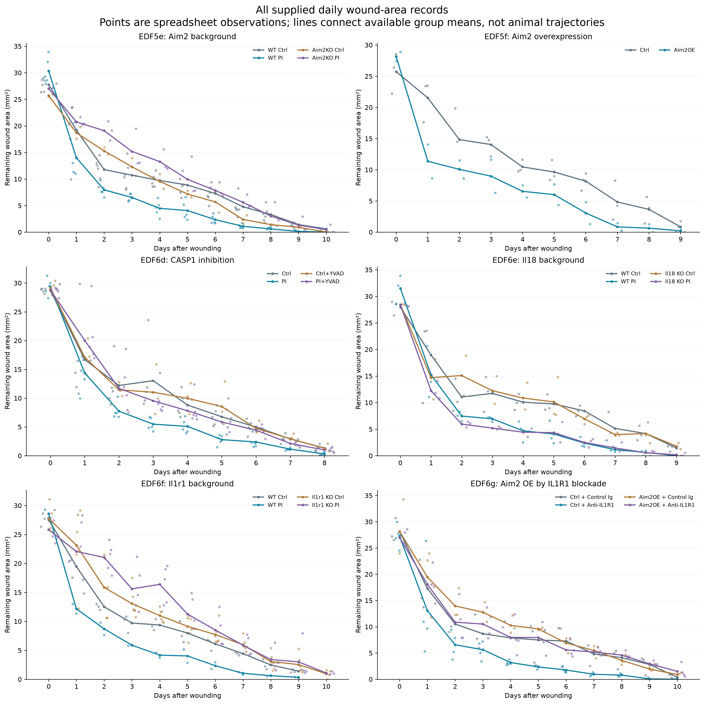
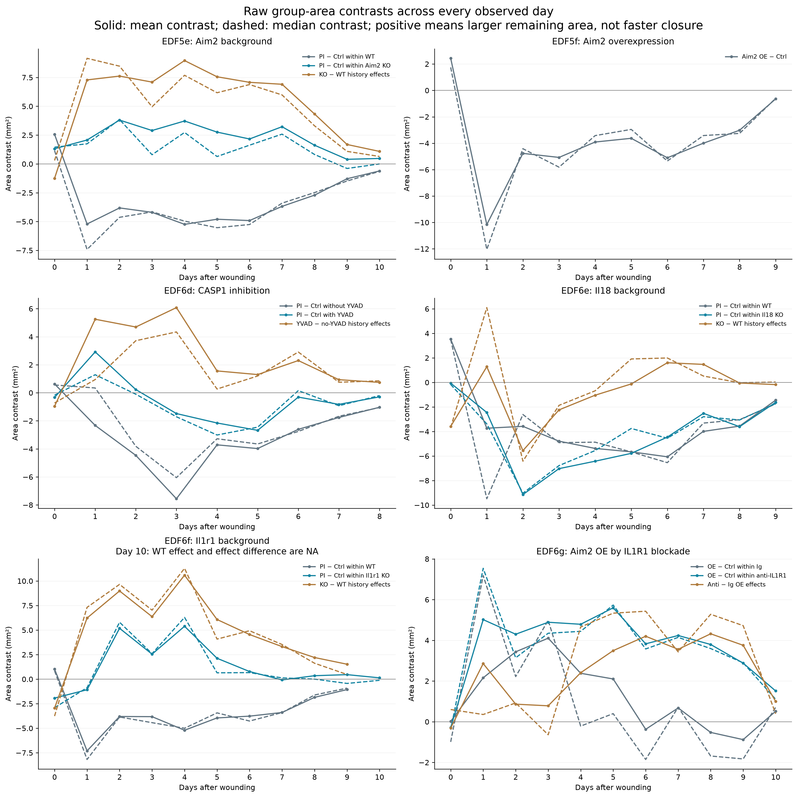
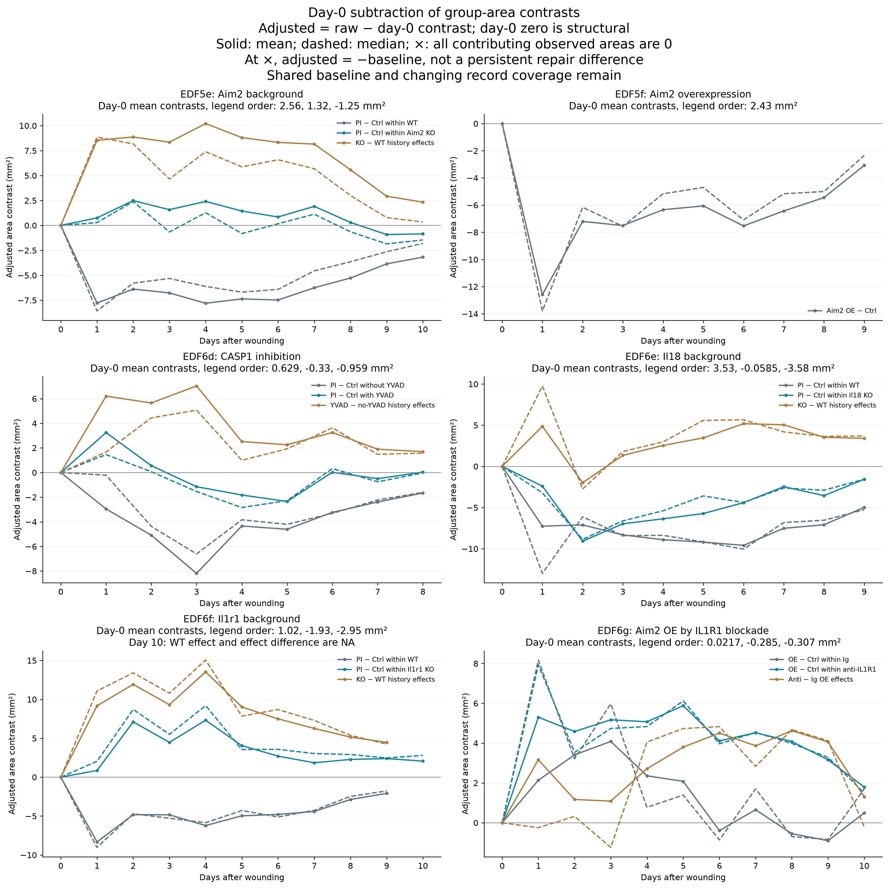
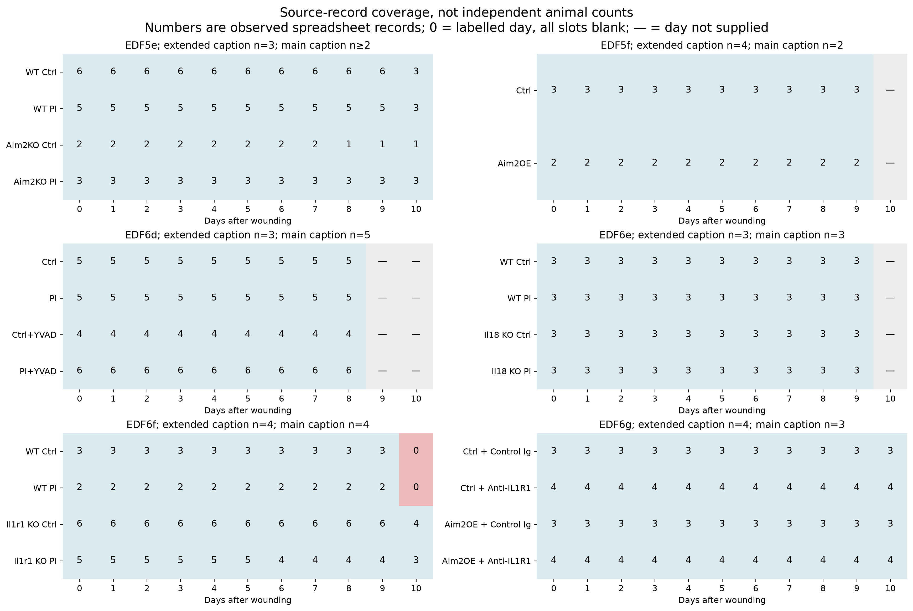

# S6A v1: all-day wound-area contrasts and an unresolved EDF6g source discrepancy

19 November 2026. Owner `Nk17-P01`. The exposed descriptive run executed from
frozen setup `815541190a2f5f9ec1f96d7022bd6e4b811395f1` under the
[approved design](S6A_DAILY_AREA_DESIGN_V1.md), [exact source map](S6A_SOURCE_MAP_V1.json)
and [contract](../../analysis/research/contracts/Nk17-P01.s6a_daily_area_v1.json).
The [receipt](../../analysis/research/runs/naik2017_s6a_daily_area_v1/receipt.json) records execution with exit code 0;
27,894 independent ZIP/XML/Decimal checks and receipt integrity passed. All four
actual figures and the complete result report were coordinator-reviewed without
further numerical, figure or report revision. S6A stage review is complete;
execution and agent review are not human scientific acceptance.

## What this comparison changed

The organizing question is how prior inflammation changes a later epithelial
response. Naik et al. (2017), Figs. 4g/h and 5b/d–g with Extended Data Figs. 5e/f
and 6d–g, already reports the relevant repair comparisons. [S5F](S5F_RESULTS_V1.md)
reconstructed reported fitted constants and separate functional measurements.
S6A asks what every supplied daily area comparison shows under its own source
labels, retaining starting-area differences and changing source coverage. It is
shared-source reconstruction, not independent replication or a new mechanism.

The area records generally retain negative post-day-0 PI−Ctrl contrasts in WT
and in the untreated inhibitor reference, and negative Aim2OE−Ctrl in EDF5f.
Aim2/Il1r1 KO-minus-WT history-effect differences are positive where available;
within-altered-condition contrasts are more mixed than a uniform absence of any
repair response. Il18 WT and KO both retain negative post-day-0 area contrasts,
while their relative effect changes with day and baseline subtraction.

**EDF6g has an unresolved label/figure/source-summary inconsistency. Its
biological interpretation is held pending an authoritative group mapping.**
Under its literal worksheet headers, OE−Ctrl area within anti-IL1R1 is positive
on every day 1–10, and the Ig comparison is mixed/mostly positive early. This
cannot be presented as confirmation of the reported positive decay-rate
advantage. The primary-source audit below identifies conflicting group labels.
No corrected mapping, repaired numerical result, refit, Aim2-mediated reversal
of repair or refutation of the published biology is inferred. The other five
panels remain descriptively interpretable within their own stated limits.

## Source scope, unit and completeness

The original [MOESM16](https://static-content.springer.com/esm/art%3A10.1038%2Fnature24271/MediaObjects/41586_2017_BFnature24271_MOESM16_ESM.xlsx)
and [MOESM17](https://static-content.springer.com/esm/art%3A10.1038%2Fnature24271/MediaObjects/41586_2017_BFnature24271_MOESM17_ESM.xlsx)
bytes match the frozen hashes in the design/map/receipt. Source-header/day guards
and ten exact final-PDF caption-line guards passed. Published link-title
misnumbering is retained separately from the actual EDF5/6 worksheet identities.

The computational unit is a numeric spreadsheet record within panel/group/day;
the measured endpoint is remaining wound area (mm²). Positive treatment-minus-
control area means larger remaining area, opposite to a positive fitted decay-
rate advantage. Captions identify biologically independent animals, but exact
IDs, aggregation, column trajectories and source-to-fit membership are unknown.
Source records, days and panels are not independent animal replicates.

| Prespecified coverage | Actual output |
|---|---:|
| Six panels, full supplied day grids | 62 panel/day endpoints |
| Group/day summaries and baseline-component rows | 228 each |
| Contrast/day rows | 166, including 2 required NA rows |
| Distinct requested workbook cells, including guards | 972 |
| Observation slots | 875: 835 numeric records and 40 blanks |
| Measured zero records | 28 |
| Structural day-0 adjusted zero contrasts | 16 |
| Contrasts with all contributing measured areas exactly zero | 0 |

The two all-blank group/days are EDF6f WT Ctrl and WT PI on day 10. Its WT
history contrast and KO-minus-WT contrast are therefore NA, with the exact
missing-group reason retained; the KO contrast remains available. EDF6e has no
day-10 row. Nothing is filled forward or replaced by zero.

Three measured all-zero group/days occur: EDF5e day10 WT PI (n=3), EDF5e day10
Aim2KO Ctrl (n=1), and EDF6g day10 Ctrl+Anti-IL1R1 under its supplied label (n=4).
None makes an entire declared contrast an all-contributing-group area-floor case.
The floor guard is retained and tested; no floor markers occur in the actual
adjusted figure. At a true floor, adjustment would be mechanically minus the
day-0 contrast and could not establish a persistent repair/rate difference.

Daily source Ns differ from the extended-caption count in 148 group/day rows,
from the main-caption count/relation in 92, and from the related main fitted-
summary N in 35. These are repeated count-comparison rows, not 148/92/35
independent discrepancies or animal exclusions. EDF6g daily Ns are 3/4/3/4 in
literal source order versus 3/3/4/4 for the corresponding S5F fitted summaries.
Both remain unchanged. Full counts, source coordinates and comparison flags are
in [groups.tsv](../../analysis/research/runs/naik2017_s6a_daily_area_v1/groups.tsv) and the coverage figure.

## Complete panel interpretation

All raw mean and median contrasts, all baseline components and all adjusted
contrasts are retained; no favorable day or statistic is selected as the result.
These are finite contrasts, without p-values, CIs, equivalence margins, pooling,
individual trajectories, source-rate refits or population inference.

| Panel | Raw post-day-0 comparison across the complete grid | What baseline/median checks limit |
|---|---|---|
| EDF5e, Aim2 backgrounds | WT PI−Ctrl mean and median are negative on days1–10. KO means are positive on days1–10. KO-minus-WT means and medians are positive on days1–10. | KO median becomes negative on day9 and zero on day10; KO mean adjustment becomes negative on days9–10 after subtracting its +1.3158 starting contrast. These do not recover a WT-sized history advantage or establish corrected healing kinetics. |
| EDF5f, Aim2 OE | OE−Ctrl mean and median are negative on days1–9. | The starting mean contrast is +2.4311; its subtraction makes later contrasts more negative. Same-day area and baseline-subtracted group changes remain distinct endpoints. |
| EDF6d, YVAD | Without YVAD, raw mean PI−Ctrl is negative on days1–8. With YVAD, it is positive on days1–2 and negative on days3–8. With-minus-without mean and median contrasts are positive on all days1–8. | Day1 untreated median is +0.3431 despite mean −2.3272. YVAD raw medians differ in sign from means on days2 and6. Adjusted YVAD means remain mixed, including small positives on days6 and8. No claim of complete loss of every history-associated area difference. |
| EDF6e, Il18 backgrounds | Both WT and KO raw mean/median PI−Ctrl contrasts are negative on days1–9. KO-minus-WT raw mean is positive on days1,6,7 and negative on days2–5,8,9. | The effect-difference baseline is −3.5843; after subtraction its mean is positive on days1,3–9 and negative on day2. Medians retain a mixed raw comparison. This is reference dependence, not evidence that one genotype uniformly improves repair relative to the other. |
| EDF6f, Il1r1 backgrounds | WT raw means/medians are negative on days1–9; day10 is NA. KO raw means are negative on days1,7 and positive on days2–6,8–10. KO-minus-WT mean/median is positive on days1–9; day10 NA. | KO baseline is −1.9280, making every available post-day-0 adjusted mean positive. Raw medians differ from means on days7,9,10. Missing WT day10 cannot be filled with zero; changing Ns are retained. |
| EDF6g, literal source labels only | OE−Ctrl within anti has positive raw means/medians on every day1–10. Within Ig, raw means are positive on days1–5,7,10 and negative on days6,8,9. Anti-minus-Ig mean is positive on every day1–10. | Raw median effect difference is negative on day3; baseline-adjusted median difference is negative on days1,3,10. More importantly, the source-label/figure inconsistency below prevents biological interpretation of these group names. |

## Day-0 components and exact-zero guard

For each vector, `A(d)=C(d)-C(0)`. The sixteen day-0 adjustments are exactly zero
by construction. All later adjustments share their estimated baseline and may
compare different observed record coverage. They are not within-animal changes,
ANCOVA or corrected kinetics. Finite dispersion is source SD only; n=1 SD is NA
and n=0 summaries are NA. A measured constant-zero group may have SD zero.

| Panel | Contrast, in figure legend order | Day-0 mean contrast (mm²) | Day-0 median contrast (mm²) |
|---|---|---:|---:|
| EDF5e | PI − Ctrl within WT | +2.5635 | +1.1539 |
| EDF5e | PI − Ctrl within Aim2 KO | +1.3158 | +1.4541 |
| EDF5e | KO − WT history effects | -1.2478 | +0.3002 |
| EDF5f | Aim2 OE − Ctrl | +2.4311 | +1.7454 |
| EDF6d | PI − Ctrl without YVAD | +0.6288 | +0.5572 |
| EDF6d | PI − Ctrl with YVAD | -0.3301 | -0.1698 |
| EDF6d | YVAD − no-YVAD history effects | -0.9589 | -0.7269 |
| EDF6e | PI − Ctrl within WT | +3.5258 | +3.5017 |
| EDF6e | PI − Ctrl within Il18 KO | -0.0585 | -0.1674 |
| EDF6e | KO − WT history effects | -3.5843 | -3.6692 |
| EDF6f | PI − Ctrl within WT | +1.0188 | +0.8551 |
| EDF6f | PI − Ctrl within Il1r1 KO | -1.9280 | -2.9069 |
| EDF6f | KO − WT history effects | -2.9468 | -3.7620 |
| EDF6g | OE − Ctrl within Ig | +0.0217 | -0.9907 |
| EDF6g | OE − Ctrl within anti-IL1R1 | -0.2851 | -0.3905 |
| EDF6g | Anti − Ig OE effects | -0.3068 | +0.6002 |

These components explain why EDF6e's relative raw and adjusted signs often
change, why late Aim2-KO adjusted means become negative despite positive raw
means, and why Il1r1-KO adjusted means remain positive. They do not remove
baseline measurement error or unknown animal membership. Complete
[group components](../../analysis/research/runs/naik2017_s6a_daily_area_v1/group_baseline_components.tsv) and
[contrast components](../../analysis/research/runs/naik2017_s6a_daily_area_v1/contrasts.tsv) preserve the unrounded values.

## EDF6g provenance issue: retain the source, hold the biological mapping

The coordinator performed a targeted read-only original-source audit on
19 November after the numerical result appeared. Original MOESM17 `EDF6g`
merged headers are exactly:

| Header range | Explicit workbook label | Area columns / observed N each day |
|---|---|---|
| B2:D2 | Ctrl + Control Ig | B:D / 3 |
| E2:H2 | Ctrl + Anti-IL1R1 | E:H / 4 |
| I2:K2 | Aim2OE + Control Ig | I:K / 3 |
| L2:O2 | Aim2OE + Anti-IL1R1 | L:O / 4 |

The frozen map uses those headers; no hidden merged-cell span explains a
reconstruction error. In the supplied final publication PDF, **PDF page 15,
Extended Data Fig. 6g**, the low-area curve has the label **Aim2OE Isotype**
with open black markers. Under the workbook's explicit labels the low-area
series is **Ctrl + Anti-IL1R1**. The coordinator visually reviewed that original
panel; no pixels were extracted for numerical fitting. The private source
rendering was retained locally, byte-preserved, at
`raw_data/naik2017_s6_preparation/final_pdf_page15_edf6_coordinator.png`, SHA-256
`109752f9bf03f0d2dbf031e93cd3104e99e5aafa4397202eb19963a4cbe52037`. This locates the audit; it is not an independent biological study.

An interchange of the two middle labels is compatible with the qualitative
pattern and would also align the discrepant Ns, but remains an **unverified
provenance hypothesis**. No labels, group assignments, frozen values or S5F
summary values were changed, and no alternate remapped result was computed.
Unknown fitted-record membership/constraints are additional unresolved limits.
The result is an unreconciled source-level inconsistency, not proof that Aim2
reverses repair or that the paper's biological conclusions are false.

For transparency, all literal-label EDF6g raw contrasts are reproduced below.
Values are rounded only for display; the tables and figures retain every day.
Positive values mean larger area remaining under the source's encoded contrast.

| Day | OE−Ctrl within Ig mean | OE−Ctrl within anti mean | Anti−Ig OE effect mean | Anti−Ig OE effect median |
|---:|---:|---:|---:|---:|
| 0 | +0.0217 | -0.2851 | -0.3068 | +0.6002 |
| 1 | +2.1595 | +5.0171 | +2.8575 | +0.3549 |
| 2 | +3.4365 | +4.3000 | +0.8635 | +0.9235 |
| 3 | +4.1055 | +4.8882 | +0.7827 | -0.6395 |
| 4 | +2.3810 | +4.7893 | +2.4083 | +4.6551 |
| 5 | +2.1024 | +5.5968 | +3.4945 | +5.3348 |
| 6 | -0.3720 | +3.8289 | +4.2009 | +5.4300 |
| 7 | +0.6771 | +4.2369 | +3.5599 | +3.4322 |
| 8 | -0.5249 | +3.7961 | +4.3210 | +5.2791 |
| 9 | -0.8784 | +2.8781 | +3.7565 | +4.7222 |
| 10 | +0.5164 | +1.5129 | +0.9964 | +0.3931 |

## Figures and verification

All four actual PNGs were inspected: complete panels/days, source labels, units,
legends, baseline components, observed-N coverage and the two NA contrasts are
visible. Lines join group summaries, not individual animals. **EDF6g in every
figure retains literal workbook labels and its biological mapping is held.**

[Figure 1 PDF](../../analysis/research/runs/naik2017_s6a_daily_area_v1/fig01_daily_area_groups.pdf).

[Figure 2 PDF](../../analysis/research/runs/naik2017_s6a_daily_area_v1/fig02_raw_area_contrasts.pdf).

[Figure 3 PDF](../../analysis/research/runs/naik2017_s6a_daily_area_v1/fig03_day0_components.pdf). There are no actual
all-contributing-record floor cases, so no × markers appear. All day-0 adjusted
zeros are structural.

[Figure 4 PDF](../../analysis/research/runs/naik2017_s6a_daily_area_v1/fig04_source_coverage.pdf). Zero coverage is a labelled
all-blank group/day, not measured zero area; a dash is a day not supplied.

The independent [verification](../../analysis/research/runs/naik2017_s6a_daily_area_v1/verification.json) uses stdlib ZIP/XML
and 50-digit Decimal separately from the main read-only openpyxl reader. Its
27,894 checks reconstruct source cells/blank roles, group/day membership, Ns,
means/medians/extrema/SD, coefficient meanings, baseline components, NA reasons,
zero/floor flags and metadata. Maximum scaled error is **3.06e-15**, within the
frozen 1e-10 computational tolerance. Ten PDF caption guards and the S5F
main-caption/fitted-N references also passed. Receipt integrity passed separately.
This is numerical verification, not biological replication. The result-stage
research gate against refreshed main `d0429d0`, all 20,334 repository checks
(including local links) and whitespace passed.

Six artificial tests passed before freeze, including baseline offsets, changing
coverage, singleton/zero/blank distinctions, missing baseline, nonzero cancellation,
exact versus tiny positive area, malformed inputs and tampered output rejection.
No actual area effect was calculated before freeze; prior published/source
exposure remains explicit. Runtime was 15.656 seconds before verification and
15.969 seconds for the entrypoint. Sixteen declared outputs plus receipt/stdout/
stderr total 19 files and 4,171,135 bytes. The read-only openpyxl extension warning
was retained; no workbook was saved/modified. No actual run failed or earlier
biological analysis was rerun.

## Literature connection and next decision

The closest primary precedent is [Naik et al. 2017](https://doi.org/10.1038/nature24271),
Figs. 4g/h, 5b/d–g and Extended Data Figs. 5e/f, 6d–g. Those experiments already
address inflammatory-history repair and Aim2/CASP1/cytokine-receptor perturbations.
This analysis qualifies the finite daily comparisons and their provenance; it
does not discover those mechanisms. The [19 November literature refresh](LITERATURE_CONTEXT.md#s6-targeted-literature-refresh--19-november-2026)
remains applicable: closure, remodeling and chromatin persistence are different
endpoints. Neither this area analysis nor the related Walton oral-wound study
identifies the Naik record mapping or supplies independent confirmation.

Coordinator review of the complete report is complete without further revision.
Preserve all outputs after required checks and continue the approved bounded D6 QC.
Keep EDF6g biological interpretation on hold for authoritative mapping, without
holding the other five panels or unrelated molecular source qualification.
Fixed five-marker D6 QC can localize or broaden the existing source discrepancy;
D180 file qualification can establish whether the fixed S3 proxy endpoint is
executable. Each numerical extension needs its separate reviewed contract.
[D180 acquisition](D180_ACQUISITION_V1.md) is complete, but no D180 effects or new
D6 marker values have been calculated. Final S6 synthesis remains unfinished.
No human retain/reject decision, global RQ change, external inquiry or publication
is created by this report.
