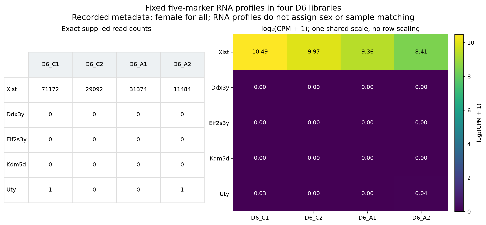

# S6B: the fixed D6 marker display does not repeat the observed S4 baseline pattern

19 November 2026. Owner `Nk17-P01`. Exposed source-consistency description,
executed from frozen setup `f92cf2126fb8be5456c5e5b58226581457e6f679`.
All four original D6 RNA libraries have Xist counts in the thousands; Ddx3y,
Eif2s3y and Kdm5d are zero in every library, and Uty is zero or one read.
The near-zero-Xist/high-four-Y-marker profile observed in two S4 D30 baseline
libraries is not repeated in these four D6 profiles. This localizes the observed
discrepancy within the inspected sources; it does not assign sex, establish the
cause of the earlier discrepancy or certify that D6 is free of confounding.

The independent calculation passed **191,370 checks**, maximum scaled error
**1.18728e-16**. Receipt integrity passed and the actual figure was visually
inspected without a layout or numeric problem. The coordinator reviewed the full report, all twenty rows, independent
verification and actual figure without a numeric, layout or interpretation
revision request. This is progression review, not human scientific acceptance.

## Question and source evidence

The organizing purpose remains qualification of the evidence connecting
inflammatory history to later epithelial responses. [S4](S4_RESULTS_V1.md)
raised a source-metadata question; the bounded comparison here asks whether
that same fixed marker readout also raises it in the acute D6 RNA sources used
by [S2](S2_RESULTS_V1.md) and [S5M v2](S5M_RESULTS_V2.md). Consistency can narrow
where the observed discrepancy occurs; discordance would have widened it.
Neither outcome determines biological sex, pooled-animal identity, RNA–ATAC
matching, contamination, a normalization correction or the mechanism of memory.

The unit is the deposited library, with published pooling evidence but unresolved
exact animal membership and overlap. These are the same [GSE92967 sources](https://www.ncbi.nlm.nih.gov/geo/query/acc.cgi?acc=GSE92967)
used earlier, not independent replication. Original sex metadata is female for
all four; the exact recorded characteristics, run/BioSample/platform/layout and
filename joins are retained in [sample QC](../../analysis/research/runs/naik2017_s6b_d6_marker_qc_v1/sample_qc.tsv).
The two exposed D6 libraries are acute inflamed, despite the `Postinflamed`
source filenames. No recovered-state or cross-assay pairing inference follows.

The [frozen method](S6B_D6_QC_METHOD_V1.md) binds the exact five M9 versioned
identities, four count files and frozen S2 factors. The prior S2/Xist and S4
outcome exposure is explicit. All four files retained the same ordered 47,729
unique versioned genes and the original full-library totals. A separately parsed
GENCODE M9 gene feature confirmed each fixed marker's name, ID, chromosome and
type. No marker, factor, library or source label was replaced or fitted anew.

## Complete fixed marker results

Raw supplied counts; the twenty rows and all normalizations are in the
[complete marker table](../../analysis/research/runs/naik2017_s6b_d6_marker_qc_v1/marker_qc.tsv).

| Marker | D6_C1 / GSM2440985 | D6_C2 / GSM2440986 | D6_A1 / GSM2440987 | D6_A2 / GSM2440988 |
|---|---:|---:|---:|---:|
| Xist | 71,172 | 29,092 | 31,374 | 11,484 |
| Ddx3y | 0 | 0 | 0 | 0 |
| Eif2s3y | 0 | 0 | 0 | 0 |
| Kdm5d | 0 | 0 | 0 | 0 |
| Uty | 1 | 0 | 0 | 1 |

All fourteen measured zeros remain numeric zeros, including log2(CPM+1)=0.
The two Uty counts of one are retained: CPM 0.0201864 and 0.0296131, respectively,
and log2(CPM+1) 0.0288328 and 0.0421023. They are not rounded to absence in the
data export. No high/low threshold, marker ratio or classifier was fitted.

| Library | Full-library total | Xist / frozen MOR factor | Xist / frozen total factor | Xist CPM | Xist log2(CPM+1) |
|---|---:|---:|---:|---:|---:|
| D6_C1 | 49,538,267 | 54,323.8162 | 56,133.9918 | 1,436.7075 | 10.4895545 |
| D6_C2 | 29,050,534 | 37,631.6116 | 39,127.0428 | 1,001.4274 | 9.9692820 |
| D6_A1 | 47,953,381 | 25,096.6510 | 25,562.7884 | 654.2604 | 9.3559246 |
| D6_A2 | 33,768,837 | 14,540.7553 | 13,287.2359 | 340.0769 | 8.4139531 |

The libraries do differ in Xist abundance, but this fixed diagnostic has no
group-effect test or biological expression margin. CPM uses each entire
library's gene-count total, not the five-marker subtotal. MOR and total-count
factors are reused exactly from S2; no upstream analysis was rerun.

[Vector PDF](../../analysis/research/runs/naik2017_s6b_d6_marker_qc_v1/fig01_fixed_d6_markers.pdf).
Every fixed marker and library is shown. The right panel uses one shared
log2(CPM+1) color scale without row scaling, clustering or significance symbols.
The displayed female label is recorded metadata, not an inferred assignment.

## What changed and what remains unresolved

This result does **not extend the specific S4 baseline marker discrepancy to
the four D6 libraries**. It supplies a narrower source-consistency observation
for the D6 description. It does not explain the stronger acute RNA–ATAC proxy
association, remove platform/mixture/pooled-unit alternatives, establish an
unconfounded D6 contrast or validate RNA–ATAC pairing. The original S4/S4B
uncertainty remains and no samples were reclassified, excluded or corrected.

The published Naik repair and chromatin-memory findings remain premises;
this QC does not test a new biological mechanism. The [19 November literature
refresh](LITERATURE_CONTEXT.md#s6-targeted-literature-refresh--19-november-2026)
is reused; a new mechanistic literature claim or scan is unnecessary for this
fixed source check. The EDF6g source-label hold from [S6A](S6A_RESULTS_V1.md)
is unchanged and confined to that panel's biological mapping.

The separately approved [S6C D180 method](S6C_D180_METHOD_V1.md) addresses
longer-term relative proxy displacement, a different unresolved measurement.
It requires its own exact frozen input/code contract and fail-closed track
qualification before any D180 window values. Its authorization does not depend
on declaring this QC a sex validation. After actual D180 review, the final S6
synthesis can distinguish qualified observations from the remaining original-
domain, mapping, individual-animal and functional interpretation limits.

## Execution and verification evidence

- [Contract](../../analysis/research/contracts/Nk17-P01.s6b_d6_marker_qc_v1.json),
  eight exact inputs and three code dependencies, committed before execution.
- [Receipt](../../analysis/research/runs/naik2017_s6b_d6_marker_qc_v1/receipt.json),
  eight declared outputs plus receipt/stdout/stderr; receipt verification passed.
- [Independent verification](../../analysis/research/runs/naik2017_s6b_d6_marker_qc_v1/verification.json):
  separate stdlib gzip/CSV and GTF readers and 50-digit Decimal arithmetic,
  including logarithms. All count rows/totals, exact joins, identities, factors,
  normalized values, zeros and metadata semantics checked; no biological replication.
- [Runtime](../../analysis/research/runs/naik2017_s6b_d6_marker_qc_v1/runtime.json):
  7.265 seconds before independent verification; full entrypoint 11.812 seconds.
  Windows Python 3.12.10, pandas 3.1.1, NumPy 2.5.1, Matplotlib 3.11.1.
  No actual analysis failure or stderr warning.
- Before freeze: five artificial tests passed, including a 477-check independent
  fixture; artificial layout inspected; input preflight, research gate against
  main `d0429d0`, all 20,347 repository checks and whitespace passed.

All prior frozen scripts, outputs and decisions remain preserved. Coordinator
progression review is separate from human scientific acceptance, and no external
inquiry, publication or global question-status change is implied.
