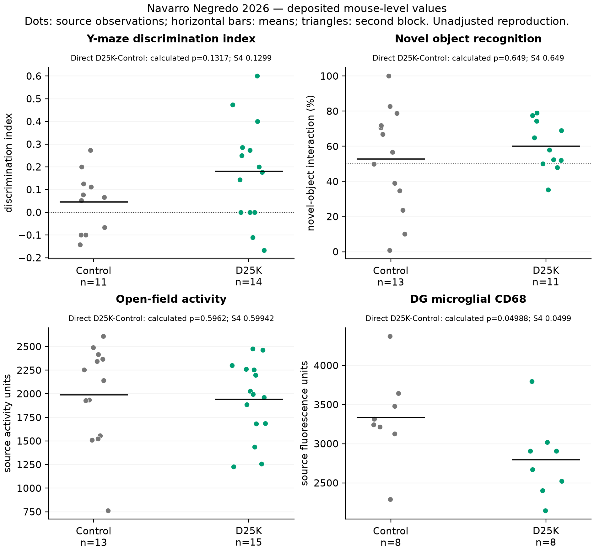
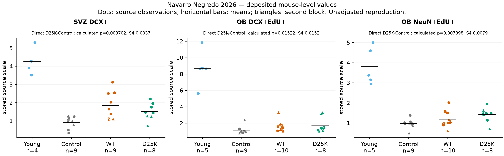
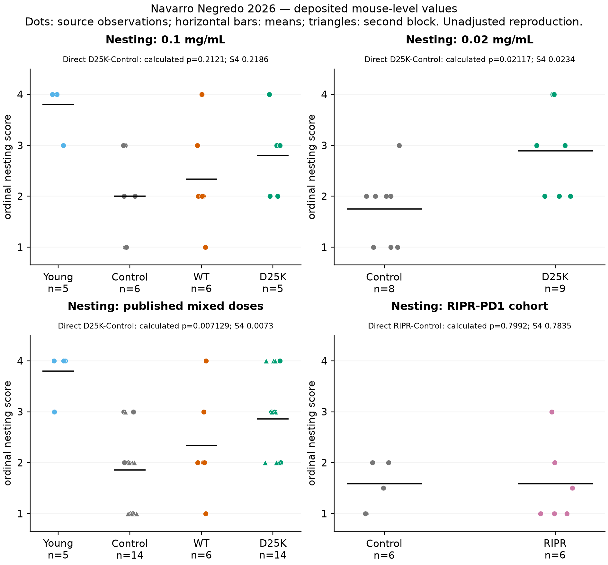
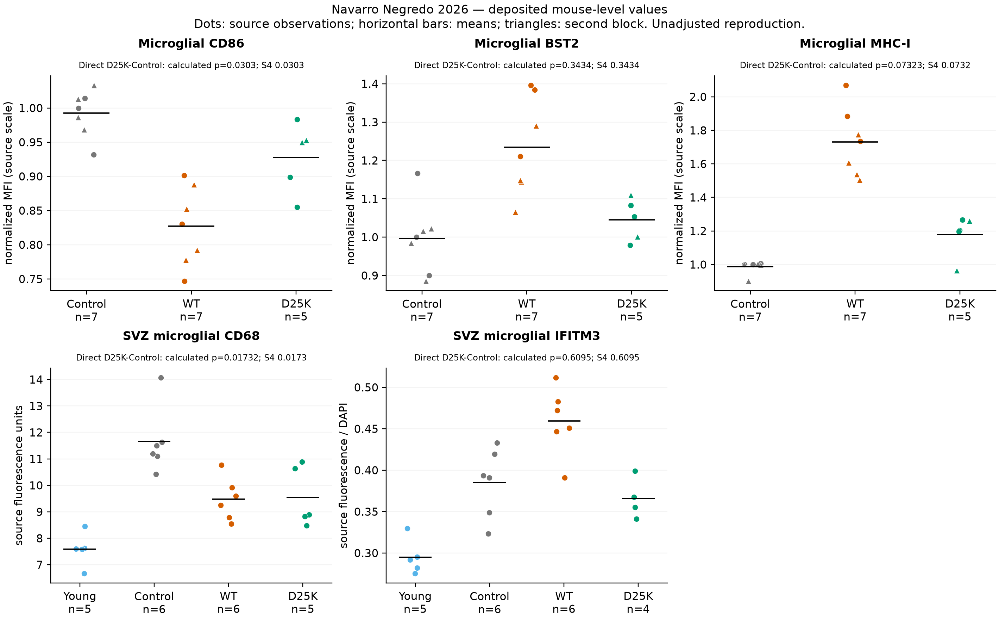
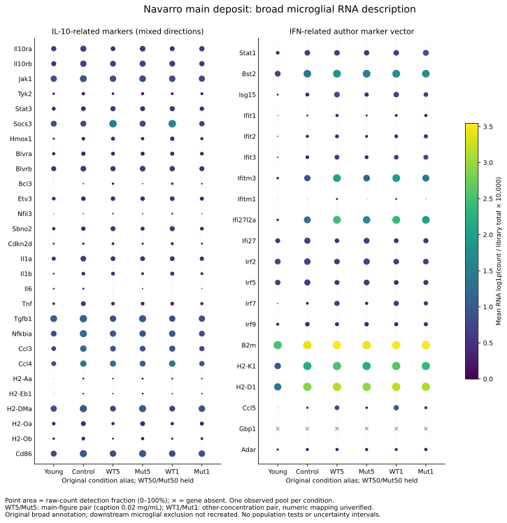
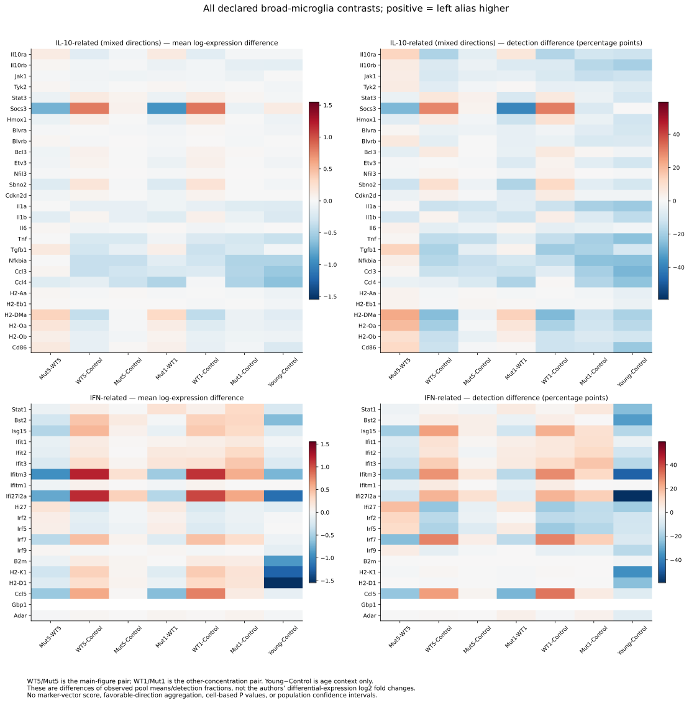
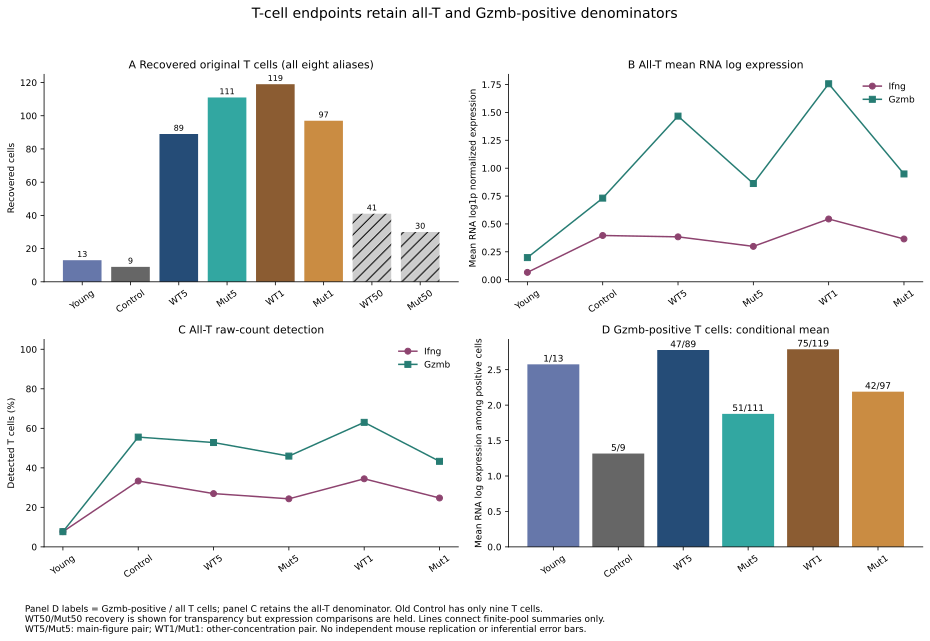
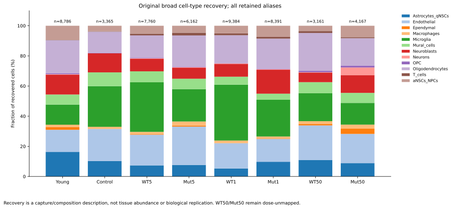
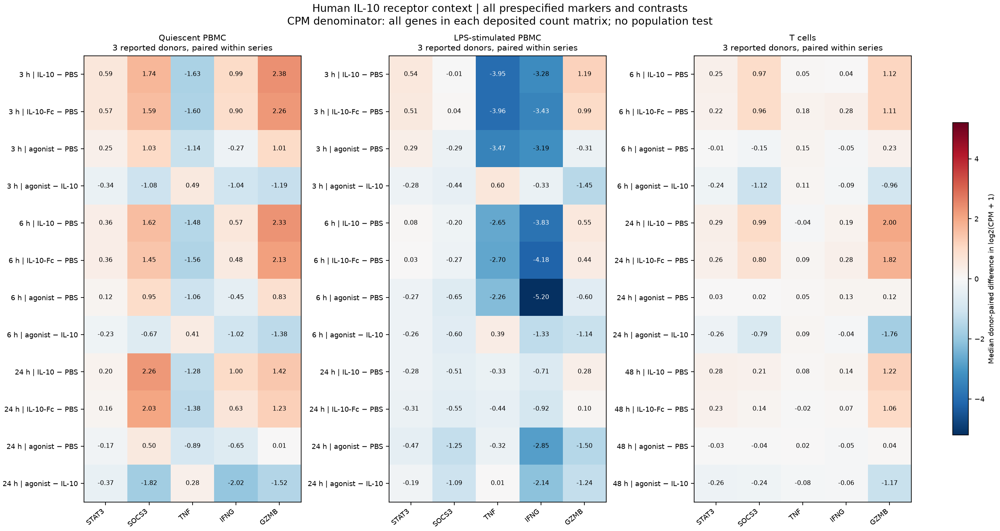
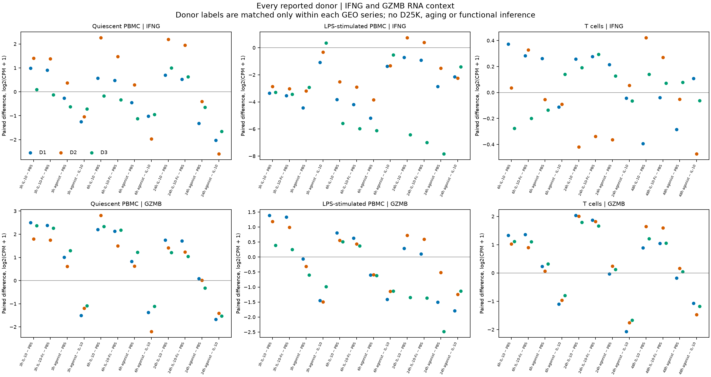

# Navarro Negredo 2026 — figure gallery

[Study overview](README.md) · [RNA results and interpretation](RNA_RESULTS.md) ·
[Animal-outcome results](RESULTS.md) · [Stage ledger](STAGE_STATUS.md) ·
[Validation](VALIDATION.md) · [10 November follow-up](followup_20261110/README.md)

This gallery gathers four original animal-outcome figures, four original pooled
RNA figures and two explicitly separate human-cell context figures. Original
Navarro files and numerical outputs are unchanged. The human figures describe
a different engineered agonist; they do not replicate D25K in aged brain.

## Animal-outcome figures

These retain the frozen **v1** test labels. Use the [animal report](RESULTS.md)
and [residual-statistic follow-up](followup_20261110/README.md#2-residual-animal-test-diagnostics)
for current exact-test reconciliation, source inconsistencies and interpretation.

### Cognition

Direct D25K–vehicle tests remain distinct from tests against chance; no WT
cognition arm or cross-task mouse linkage is invented.

### Neural markers

Region, normalization ambiguity and within-mouse section averaging remain
explicit. These markers do not establish functional integration or lesion repair.

### Nesting

Dose-specific cohorts remain separate from the mixed-dose aggregate; WT is
present only in the high-dose cohort.

### Immune protein measurements

Specific protein/staining endpoints retain their cohort, normalization and
source qualifications; the IFITM3 statistic discrepancy remains unresolved.

## Pooled mouse RNA

The following original figures describe observed RNA pools and capture, without
independent mouse replication or animal-population inference.

### 1. Broad-microglial RNA markers

Mean normalized RNA expression and detection for the declared IL-10-related
and IFN-related markers. Directions are heterogeneous; these measurements do
not establish a uniform suppression response or reproduce the downstream
microglial subset selected by the authors.
[Complete values and denominators](../../analysis/research/runs/nn26_pooled_rna_description_v1/summaries.tsv).

### 2. Broad-microglial RNA contrasts

Supported Mut–WT pairs, treatment–old-control comparisons and young–old-control
context retain the original alias labels and dose qualifications. Differences
describe mean-log expression and detection, not animal-level treatment effects
or an age-by-treatment interaction.
[Complete contrasts](../../analysis/research/runs/nn26_pooled_rna_description_v1/contrasts.tsv).

### 3. T-cell expression and recovery

All-T-cell Ifng/Gzmb summaries remain distinct from expression conditional on
Gzmb positivity. The old-control pool contains only nine recovered T cells;
recovery and positive-cell intensity do not establish T-cell expansion,
secretion or between-mouse precision.
[Endpoint definitions and denominators](RNA_RESULTS.md#endpoints-and-measured-results).

### 4. Recovery by original cell annotation

Observed capture across the original broad annotations and condition aliases.
This is not a tissue cell census. Eight object aliases remain distinct from the
six published main libraries; WT50/Mut50 expression comparisons remain held.
[Complete recovery table](../../analysis/research/runs/nn26_rds_metadata_v2/recovery.tsv).

## External human-cell context

These are new, separately governed GSE318914/GSE318915 descriptions. Three
reported donors are paired only within each series. The complete figures retain
all conditions, times and predefined contrasts. RNA is not secretion, and the
agonist is not D25K. [Results and limits](followup_20261110/README.md#4-donor-paired-rna-results).

### All five prespecified markers

Medians of paired log2(CPM+1) differences; CPM uses the deposited protein-coding
gene matrix. Donor ranges are descriptive, with no inferential test.
[SVG](../../analysis/research/runs/nn26_human_context_description_v1/human_context_medians.svg) ·
[Complete summaries](../../analysis/research/runs/nn26_human_context_description_v1/contrast_summaries.csv).

### Every donor for IFNG and GZMB

GZMB directions are consistent for the displayed T-cell IL-10–PBS and
agonist–IL-10 comparisons; IFNG shows donor disagreement. All other genes and
contrasts remain in the complete tables and median figure.
[SVG](../../analysis/research/runs/nn26_human_context_description_v1/human_context_donors.svg) ·
[Every paired value](../../analysis/research/runs/nn26_human_context_description_v1/paired_contrasts.csv).
