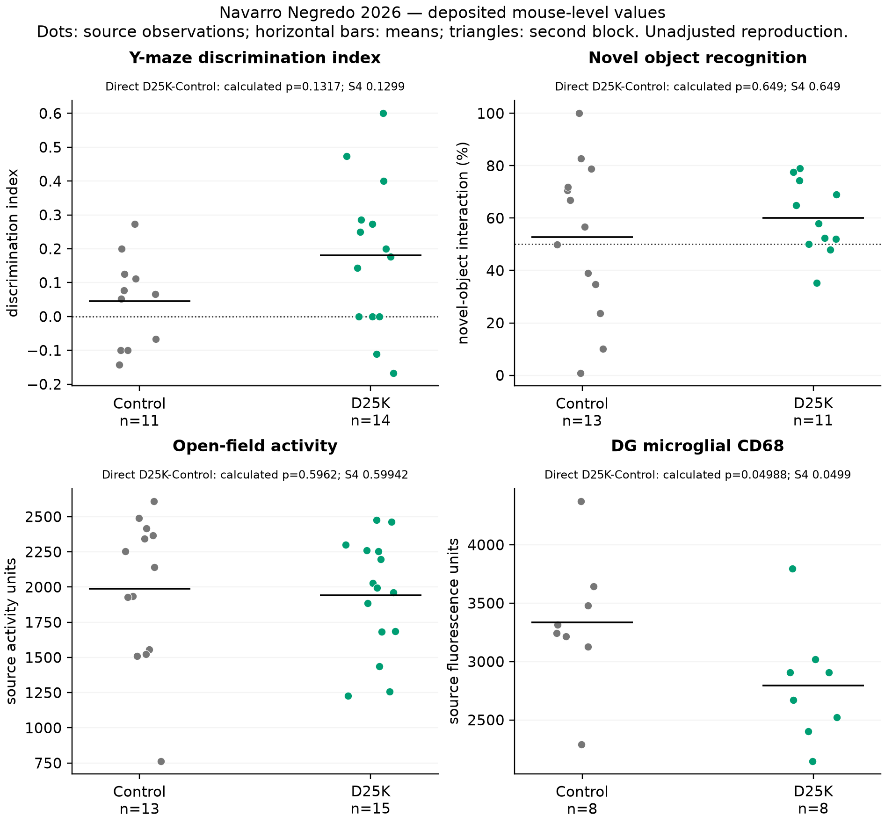
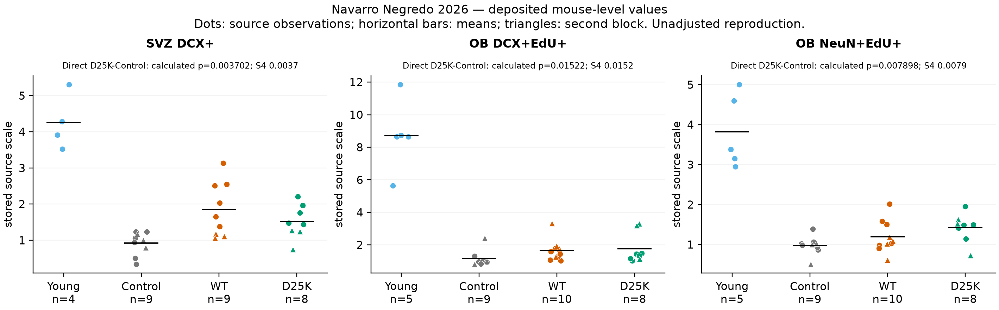
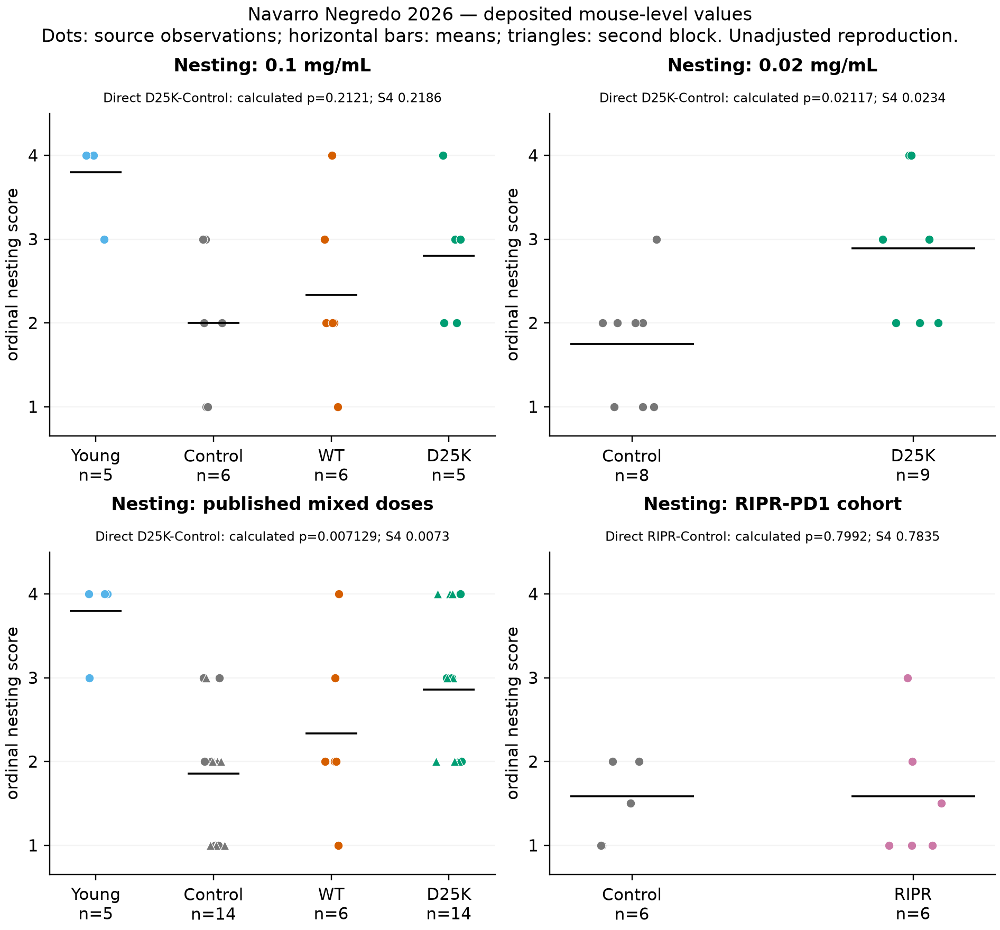
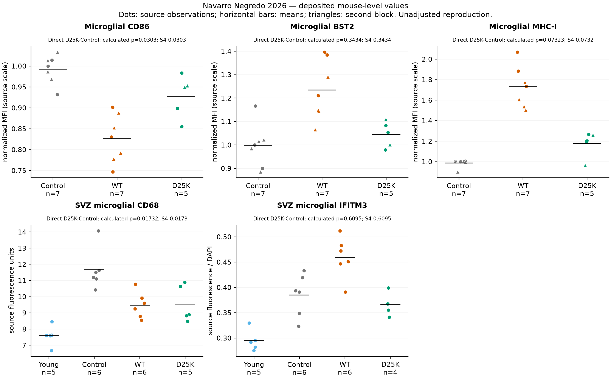

# Nn26-P01 — source and animal-outcome reproduction

**10 November follow-up:** [new residual-statistic diagnostics](followup_20261110/README.md#2-residual-animal-test-diagnostics)
retain the two unmatched comparisons and original values. The source refresh
and distinct public human-cell analysis are in the same dated report. Earlier
RNA-pending and publication statements below describe the original checkpoint.

**RNA addendum (8 November 2026):** [RNA_RESULTS.md](RNA_RESULTS.md) now records completed object qualification and alias-specific description, with dose/source holds. This animal report and its frozen numerical evidence are retained; any later RNA-pending statements describe the earlier checkpoint.

8 November 2026. **Source qualification and the animal-outcome stage executed.**
The subsequent cloud RNA stage is complete; see its addendum above and the
[dated combined interpretation](INTERPRETATION_20261108.md). This is exposed same-source
reproduction, not independent replication or scientific acceptance.
The [candidate dossier](CANDIDATE.md), [plan](ANALYSIS_PLAN.md),
[literature context](LITERATURE_CONTEXT.md) and [stage ledger](STAGE_STATUS.md)
separate purpose, published premises and remaining work.

## Main finding

The deposited tables reproduce the reported neurogenesis comparisons and
most animal-level immune/nesting statistics. They narrow the cognition claim:
**the direct D25K-versus-vehicle tests are not significant for either Y-maze
discrimination or novel-object recognition**, although the D25K groups differ
from chance. Those are different hypotheses. Nonsignificance does not establish
no effect or equivalence, and there is no WT cognition arm.

The combined nesting result pools **0.1 and 0.02 mg/mL** cohorts; WT occurs only
at 0.1 mg/mL. It therefore cannot be interpreted as a single-dose D25K/WT
comparison. Both dose-specific results are retained below.

## Inputs, frozen stages and verification

Primary sources: [paper](https://doi.org/10.1016/j.immuni.2026.01.016),
[correction](https://doi.org/10.1016/j.immuni.2026.06.019), and publisher
[S1](https://ars.els-cdn.com/content/image/1-s2.0-S1074761326000385-mmc2.xlsx) /
[S4](https://ars.els-cdn.com/content/image/1-s2.0-S1074761326000385-mmc5.xlsx).
These public CDN URLs returned valid XLSX archives on 8 November. Earlier
failed PMC/browser routes remain in the historical access records. No challenge
was bypassed. Raw supplements remain ignored, not committed.

| Input | Bytes | SHA-256 |
|---|---:|---|
| S1 | 7,159,661 | `aeba769ca40d1e9b52796078f865bdcacdf2915978df32a8c54b206f7c4a4cda` |
| S4 | 103,671 | `ab39bf7af9e6a7c1278e43fe86d4e5a2a09d16395caaf80500ce482420c3cbc6` |

| Stage | Freeze commit | Contract / immutable receipt | Verification |
|---|---|---|---|
| Source qualification | `68d9311` | [contract](contracts/source_qualification_v1.json), [receipt](../../analysis/research/runs/nn26_source_qualification_v1/receipt.json) | Valid archives; 20 unique runs; 180 S1 cells independently checked against raw OOXML |
| Animal reproduction | `d67b75e` | [contract](contracts/animal_reproduction_v1.json), [receipt](../../analysis/research/runs/nn26_animal_reproduction_v1/receipt.json) | 16 panels; 377 traceable records, **not 377 unique mice**; 657 independent source/arithmetic checks |
| Exact tied-rank diagnostic | `fb85158` | [amendment](ANIMAL_AMENDMENT_V2.md), [contract](contracts/tie_diagnostic_v2.json), [receipt](../../analysis/research/runs/nn26_tie_diagnostic_v2/receipt.json) | All 40 reported direct contrasts; 34 full-enumeration and 34 separate SciPy permutation checks |

Workbook values, reported P values and published outcomes were exposed before
the initial numerical freeze. The diagnostic amendment additionally records
exposure to v1 results. No unexposed confirmation is claimed.

The exact **absolute-tail** tied-rank calculation agrees with 38/40 reported
direct P values within 0.0001, treating the reported `>0.9999` as a bound.
The alternate doubled-smaller-tail results are also retained; several nesting
tests differ between these valid conventions. The original v1 used the declared
normal approximation when ties occurred. No data, rounding or exclusions were
changed to achieve agreement. The
[complete reconciliation](../../analysis/research/runs/nn26_tie_diagnostic_v2/exact_rank_reconciliation.csv)
is the current test-option audit; its agreement is consistent with the
[documented Prism approach](https://www.graphpad.com/support/faq/for-a-mann-whitney-u-test-how-does-prism-handle-ties/),
not proof of the authors' exact panel-specific software settings.

## Cognition and attrition

| Endpoint, final-paper panel | Vehicle / D25K n | D25K minus vehicle mean | Direct test: S4 / exact reconstruction |
|---|---:|---:|---:|
| Y-maze discrimination, 7G | 11 / 14 | +0.13521 index units | 0.1299 / 0.12995 |
| Novel-object interaction, 7H | 13 / 11 | +7.2932 percentage points | 0.649 / 0.64898 |

Source coordinates: S4 `Figure 7!A94:B107` and `G94:H106`; reported direct tests
`I14` and `I19`. S4's Y-maze panel letter is outdated relative to the final
paper. The four two-sided one-sample t tests reproduce: Y-maze vehicle/D25K
P=0.28896/0.009468 against zero; NOR P=0.74579/0.039014 against 50%.
[Chance-test output](../../analysis/research/runs/nn26_animal_reproduction_v1/chance_tests.csv).

The original allocation was 15/15. Two controls died. Y-maze then excluded
two controls and one D25K mouse for insufficient entries; NOR excluded three
D25K mice for insufficient exploration and one for a health problem. No stable
mouse keys identify overlap across analyzed tasks or tissue readouts. These are
attrition-conditioned summaries; no joint task model or causal mediation is fit.

Figure retains the frozen **v1** test labels; see v2 reconciliation above for
exact tied-rank options. Dots are listed mouse observations, mean lines are
descriptive, and dotted lines mark chance only. No new confidence interval or
familywise superiority claim is made. Open-field/DG panels are separate readouts.

## Neural-marker outcomes at 0.1 mg/mL

| Endpoint, final-paper panel | Young / vehicle / WT / D25K n | D25K–vehicle P | WT–vehicle P | D25K–WT P |
|---|---|---:|---:|---:|
| SVZ DCX+, 6G | 4 / 9 / 9 / 8 | 0.003702 | 0.003990 | 0.60584 |
| OB DCX+EdU+, 6I | 5 / 9 / 10 / 8 | 0.015220 | 0.013272 | 0.76183 |
| OB NeuN+EdU+, 6J | 5 / 9 / 10 / 8 | 0.007898 | 0.182316 | 0.23699 |

These unadjusted rank-sum values reproduce the published comparisons. D25K
differs from vehicle for the NeuN/EdU endpoint, but its direct WT comparison
does not establish superiority. The three stored-scale D25K-minus-vehicle means
are +0.59442, +0.60777 and +0.44443, respectively; the full
[summaries](../../analysis/research/runs/nn26_animal_reproduction_v1/summaries.csv) and
[contrast table](../../analysis/research/runs/nn26_animal_reproduction_v1/contrasts.csv)
retain all groups and the separate experiment blocks.

S4's EdU data-block headings incorrectly/ambiguously name SVZ while experiment
descriptions and the paper identify olfactory bulb. S4 includes cm² versus mm²
wording, and final-paper panel letters differ. Values and rank comparisons can
be reproduced, but absolute original-count or density effects are **not
qualified** from these inconsistencies. Stored scale is labeled explicitly.
SVZ uses three sections per mouse and OB six, averaged within mouse; sections
are never independent replicates. No functional integration, long-term survival,
lesion repair or mediation of cognition is established.

## Nesting and immune protein readouts

At 0.1 mg/mL, the direct D25K/vehicle nesting test is P=0.218615 (5/6 mice),
and D25K/WT is P=0.480519 (5/6). At 0.02 mg/mL, D25K/vehicle is P=0.023447
(9/8). Rank-biserial descriptions are +0.4667 and +0.6389 for D25K/vehicle in
the high- and low-dose cohorts. These separate cohorts do not identify a dose
interaction. The mixed-dose aggregate reproduces P=0.007277 (14/14), but the
D25K/WT aggregate P=0.300568 is confounded by dose/cohort coverage. RIPR's
separate nesting comparison remains unfavorable/null (P approximately 0.7835).

Microglial protein values retain the selected suppression/IFN-readout separation:
both ligands reduce CD86 and SVZ CD68 relative to vehicle; WT increases BST2
and MHC-I, while the corresponding D25K/vehicle tests are not significant.
These are specific surface/staining endpoints, not proof of a universal
anti-inflammatory programme. The WT/vehicle IFITM3 P value remains discrepant
(below). Normalized FACS measurements retain their experiment blocks; underlying
unnormalized MFI is unavailable here. Culture wells/primary preparations were
not appended to these animal-level panels.

All four figures were visually checked. Their original v1 labels are preserved;
v2 supplies the current exact-test reconciliation rather than overwriting them.

## Unresolved source discrepancies and interpretation limits

- **Open-field summaries:** S4 `Figure 7!D109:E110` mean/SEM formulas start at
  row **95**, omitting the first listed row 94 in each group. All declared
  13/15 observations give means **1987.0/1940.3333**, not cached
  2022.8333/1918.0. No documented exclusion supports dropping those first rows.
  Direct P=0.59942 in S4 is not exactly reproduced: v1 0.596234; exact
  absolute-tail 0.594163. No locomotor-equivalence claim follows.
- **IFITM3:** S4 `Figure 4!B75:C80` gives WT/vehicle exact P=0.025974,
  versus reported `G17` P=0.0173. Approximation variants do not resolve it.
  D25K has four stored values despite the descriptor saying five. Keep both
  discrepancies; do not omit a value to force agreement. Cite the correction
  for the representative Fig.4J image separately from this table audit.
- **Young neurogenesis n:** four stored SVZ values versus five in one experiment
  descriptor; OB has five. Final-panel denominators differ and no exclusion
  reason is invented. No common-row mouse join is assumed.
- **Optional cohorts:** RIPR second-cohort pool counts differ across S1 (4),
  S4 (5) and Methods (3); separate-WT control age is 27 months in S1 versus 25
  months in S4. Those sources remain unqualified for a new comparison.
- **RNA:** S1 confirms no multiplexing, six main libraries and the old-control
  single mouse. S1 sample/lane order does not match code C1–C8. WT1/WT5 numerical
  dose mapping, extra WT50/Mut50 arms and the filename discrepancy remain
  unresolved until object inspection. Only the main RDS has now been acquired
  and checksum-verified in the owner's cloud chat; it has not been deserialized.
  No FASTQ was downloaded. [Operational evidence](CLOUD_READINESS.md).

The [source crosswalk](../../analysis/research/runs/nn26_source_qualification_v1/source_crosswalk.json)
records ENA low/high mapping to the only two reported doses as a semantic
ordering inference, not a molecular barcode join or verified code-alias mapping.
The author script saves the object before later plot-only WT50/Mut50 exclusion.
No amount of cell resampling supplies absent animal replication.

## Evidence map and next decision

| Published finding | Reproduced measurement | Remaining uncertainty / next informative step |
|---|---|---|
| Improved cognitive performance | D25K differs from chance; direct D25K/vehicle tests are nonsignificant | Precision and attrition remain; no superiority over WT or neurogenesis mediation. Preserve this narrower conclusion |
| Enhanced neural-marker endpoints | Main rank comparisons reproduce, including nonsignificant D25K/WT | Resolve units/labels if absolute density effects are required; no repair or neuronal-integration inference |
| Better nesting | Low-dose and pooled comparisons reproduce | Mixed exposure/cohort prevents treating pooled WT comparison as dose matched |
| Separated immune readouts | Most mouse protein statistics reproduce; one IFITM3 P discrepancy | Specific source reconciliation remains; published Fig.5 mechanism is a premise, not newly inferred here |
| Pooled RNA response separation | Not yet inspected | Qualify only the main RDS on a suitable executor, resolve aliases/layers, then freeze a separate within-dose descriptive contract |

The [cloud readiness record](CLOUD_READINESS.md) confirms runtime/acquisition
readiness; actual object loading and the frozen qualification run remain pending.
No optional auxiliary dataset is justified merely to overcome an
unfavorable result. Young treatment arms, animal replication, defined injury
and appropriate mediation experiments would require new data and a separate
design; they are not supplied by this reanalysis.
