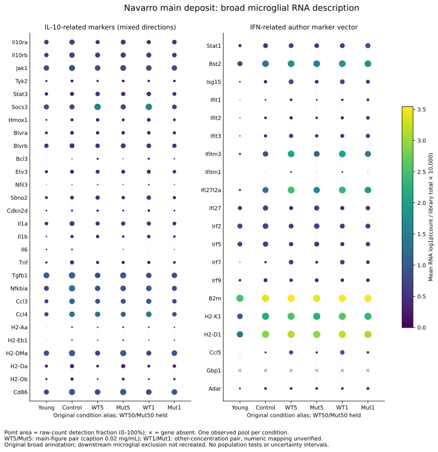
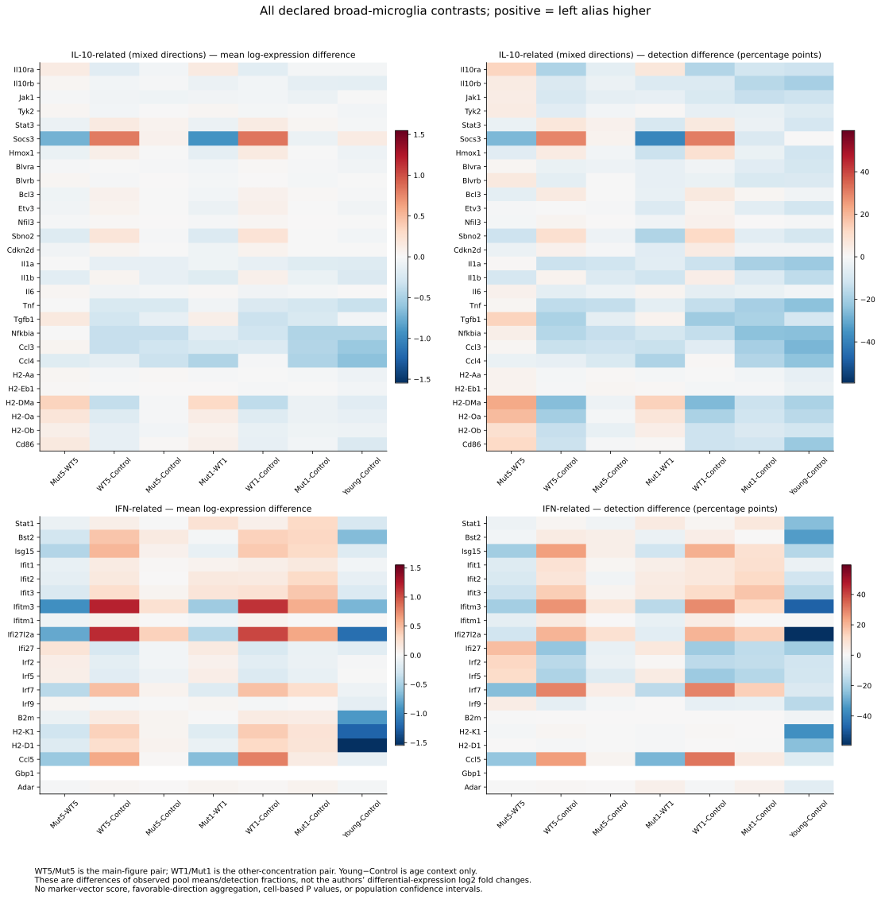
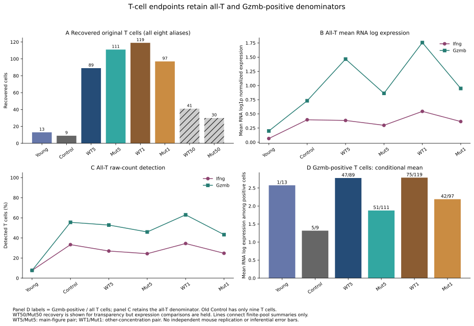
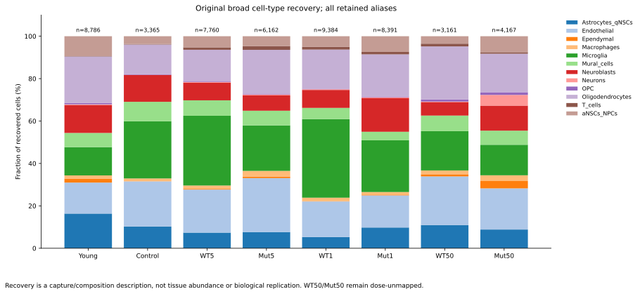

# Nn26-P01 — qualified pooled RNA description

**10 November follow-up:** [refreshed public sources and separate human-cell
context](followup_20261110/README.md) retain the original Navarro dose/pool holds.
New donor-paired human data involve another agonist and do not supply D25K,
aged-brain or mouse-level replication. This original report and its outputs are
otherwise retained; use the combined [Figure gallery](FIGURES.md) for navigation.

8 November 2026. The main deposited object and a separate exposed descriptive
stage have executed under frozen Ravel contracts. **The data support a bounded
description of observed condition aliases, with specific dose/source holds.**
This is neither independent replication nor scientific acceptance.
The [dated interpretation](INTERPRETATION_20261108.md) names the primary
figures already reporting related patterns and the limits of that overlap.

In the main-figure alias pair, WT5 has higher expression than Mut5 for several
microglial IFN markers and T-cell Gzmb. Both have lower microglial Tnf than old
control. The IL-10-related vector is heterogeneous: it does not define a single
suppression direction, and individual exceptions remain visible. WT1/Mut1 gives
a partly similar, partly discordant description. No population treatment effect
or mechanism is estimated from these unreplicated pools.

## Source and population qualification

The authorized `IL10_svz_seurat.rds` contains **51,176 cells, 31,053 RNA genes,
12 original broad cell types and eight actual condition aliases**. RNA counts
and normalized data are aligned sparse matrices. No donor-to-cell assignment
was established. `orig.ident` and barcode prefixes identify conditions; they do
not undo physical pooling. S1 reports one old-control mouse and two pooled mice
in each of the other five reported libraries, with no multiplexing. Those pool
sizes must not be assigned to the two additional aliases without evidence.

| Alias | All retained cells | Broad microglia | T cells | Exposure qualification |
|---|---:|---:|---:|---|
| Young | 8,786 | 1,173 | 13 | Young vehicle context |
| Control | 3,365 | 908 | 9 | Old vehicle context |
| WT5 | 7,760 | 2,553 | 89 | Main-figure WT pair |
| Mut5 | 6,162 | 1,324 | 111 | Main-figure D25K pair |
| WT1 | 9,384 | 3,477 | 119 | Other-concentration WT pair |
| Mut1 | 8,391 | 2,047 | 97 | Other-concentration D25K pair |
| WT50 | 3,161 | 586 | 41 | Numerical dose/accession unresolved; expression held |
| Mut50 | 4,167 | 600 | 30 | Numerical dose/accession unresolved; expression held |

[Full recovery table](../../analysis/research/runs/nn26_rds_metadata_v2/recovery.tsv)
retains every condition/type combination, including zero recovery. Recovery is
a capture/composition measurement, not a tissue cell census.

The original author archive selects WT5/Mut5 for main-figure microglial plots
(`IL10/2.Microglia.R:49–61`). The supplied Fig. 3B caption assigns Figures 3/4
to **0.02 mg/mL**, making this an **indirect code/figure association**, not a
barcode-to-dose or accession join. WT1/Mut1 appear under “other concentrations”
at lines 107–110. The remaining reported 0.1 mg/mL dose is a plausible association,
but its numeric identity is not verified. Results therefore retain alias labels.
Numeric suffix ordering is not used as a dose map. WT50/Mut50 really occur in the
object; their relationship to the six published main libraries remains unresolved.
[Exact crosswalk and evidence grades](../../analysis/research/runs/nn26_qualification_review_v1/alias_crosswalk.json).

The deposited broad `Celltype == Microglia` population lacks the later
`Micro_types` labels. Author code reclusters microglia and removes a downstream
`Micro_types == Remove` group. That plot population was **not** recreated here.
The main object has no retained `Celltype == Remove` cells. Original combined
Astrocytes_qNSCs and aNSCs_NPCs annotations remain intact. The downstream filename
`IL10_svz_seurat_IL10.rds` differs from the deposited filename and is not treated
as proof of identical downstream provenance.

## Endpoints and measured results

Each mean is the arithmetic mean of stored RNA
`log1p(10,000 × count / cell total RNA counts)`, including zeros. Detection is
the fraction with raw counts greater than zero. The stored command records
LogNormalize, scale factor 10,000, margin 1. Reconstruction from raw counts
qualified this scale; no SCT or integrated assay is used.

The frozen vectors are the **28 mixed-direction IL-10-related markers** at
`IL10/2.Microglia.R:295–298` and the **20 IFN-related markers** at line 338.
The [marker manifest](../../analysis/research/runs/nn26_qualification_review_v1/marker_manifest.json)
preserves exact membership, ZIP/file hashes and locators. Every marker is shown
in the complete tables and figures. No combined beneficial or suppression score
is calculated. `Gbp1` is absent from the RNA features and remains NA, not zero.

Illustrative broad-microglial means below are rounded for reading; the
[complete 306-row summary](../../analysis/research/runs/nn26_pooled_rna_description_v1/summaries.tsv)
retains detection fractions, raw totals, denominators and unrounded values.

| Marker | Young | Control | WT5 | Mut5 | WT1 | Mut1 |
|---|---:|---:|---:|---:|---:|---:|
| Stat3 | 0.2786 | 0.3068 | 0.4496 | 0.3566 | 0.4336 | 0.3423 |
| Socs3 | 0.8435 | 0.7154 | 1.5146 | 0.7820 | 1.5475 | 0.6220 |
| Tnf | 0.1370 | 0.4770 | 0.2430 | 0.2427 | 0.2578 | 0.2002 |
| Cd86 | 0.7019 | 0.9253 | 0.7936 | 0.9432 | 0.8014 | 0.8819 |
| Stat1 | 0.2457 | 0.4994 | 0.5900 | 0.4967 | 0.5826 | 0.8034 |
| Bst2 | 0.7207 | 1.3954 | 1.8225 | 1.5377 | 1.7504 | 1.7178 |
| Isg15 | 0.0726 | 0.2662 | 0.7859 | 0.3329 | 0.6737 | 0.5564 |
| Ifitm3 | 0.1343 | 0.8473 | 2.0411 | 1.0869 | 1.9615 | 1.4133 |

For WT5/Mut5, Tnf means are almost equal and lower than control; detection is
18.84%/19.79% versus 34.03% in control. Ifitm3 is lower in Mut5 than WT5 but
remains above control, as do Bst2 and Isg15. Cd86 is slightly higher in Mut5
than control on this broad RNA population, so universal suppression is not
supported. In WT1/Mut1, Stat1 is higher in Mut1 than WT1, despite lower Mut1
Ifitm3 and Isg15. These exceptions prohibit a uniform IFN-response claim.

**Figure 3E source discrepancy:** the published caption names Stat3 while author
code plots Socs3. Both are retained individually. Neither is silently substituted
for the other. RNA values here also do not substitute for the paper's protein
or secretion measurements.

The [357-row contrast table](../../analysis/research/runs/nn26_pooled_rna_description_v1/contrasts.tsv)
contains both Mut–WT contrasts, each treatment–Control contrast, and Young–Control
context for every endpoint. Differences are on the stated mean-log and detection
scales, not the authors' differential-expression log2 fold changes. No marker
selection, cell-based P value or confidence interval was added after exposure.

For T cells, the primary denominator is **all original T cells**. Gzmb-positive
means are conditional summaries reported separately, with the all-T denominator.

| Alias | All T | Ifng mean; detected/all T | Gzmb mean; positive/all T | Gzmb-positive mean |
|---|---:|---|---|---:|
| Young | 13 | 0.0657; 1/13 | 0.1981; 1/13 | 2.5750 |
| Control | 9 | 0.3964; 3/9 | 0.7316; 5/9 | 1.3168 |
| WT5 | 89 | 0.3843; 24/89 | 1.4668; 47/89 | 2.7775 |
| Mut5 | 111 | 0.2987; 27/111 | 0.8624; 51/111 | 1.8769 |
| WT1 | 119 | 0.5443; 41/119 | 1.7569; 75/119 | 2.7876 |
| Mut1 | 97 | 0.3652; 24/97 | 0.9482; 42/97 | 2.1900 |

Mut5 and Mut1 have lower Gzmb means than their WT partners, but both remain above
the nine-cell control mean. WT5 Gzmb detection is 52.81%, below control's 55.56%,
despite its higher mean; positive-cell intensity and prevalence are different
measurements. WT5 Ifng is not higher than control. The young conditional Gzmb
mean comes from one cell. Sparse control recovery and condition-confounded
capture preclude mouse-level uncertainty estimates or T-cell expansion claims.

All four SVGs were rendered and visually inspected. The exact external hallmark
`.rda` is absent from the author ZIP; no current gene-set substitute was fetched.
The explicit marker vector is therefore **not exact reproduction of Fig. 4C's
hallmark score**. Broad annotations also prevent claiming exact downstream plots.

## Verification, warnings and failure preservation

| Stage | Freeze | Verified receipt |
|---|---|---|
| Metadata v1 | d03c72f | Failed serializer execution; [original failed receipt preserved byte-for-byte](../../analysis/research/runs/nn26_failure_preservation_v1/failed_v1/receipt.json) |
| Metadata v2 | a8548c3 | [Successful metadata receipt](../../analysis/research/runs/nn26_rds_metadata_v2/receipt.json) |
| Warning review | fac1630 | [Capture and byte-identity receipt](../../analysis/research/runs/nn26_rds_metadata_review_v1/receipt.json) |
| Failure preservation | fac1630 | [Archive-operation receipt](../../analysis/research/runs/nn26_failure_preservation_v1/receipt.json) |
| Independent qualification | 152ae43 | [Source/arithmetic receipt](../../analysis/research/runs/nn26_qualification_review_v1/receipt.json) |
| Pooled description | bdead21 | [Expression/plot receipt](../../analysis/research/runs/nn26_pooled_rna_description_v1/receipt.json) |
| Completion provenance | 1ef06df | [Source archive and completion receipt](../../analysis/research/runs/nn26_completion_archive_v1/receipt.json) |

In immutable `qc.json`, **`nCount_matches: 0` and `nFeature_matches: 0` are
maximum absolute differences, not numbers of matches**. Zero means exact
agreement with independent count/feature reconstruction. Threshold fields count
violations and are also zero: every retained cell meets nCount > 1,000,
nFeature > 500 and mitochondrial percentage < 10. This does not recover the
number or identity of cells removed before the deposited object was saved.

The metadata review captured **192 identical `simpleWarning` messages**:
“row names were found from a short variable and have been discarded”. They
arose while constructing sampled-normalization rows from a named scalar, dropping
implicit data.frame row names. Explicit gene, cell and condition columns survived.
Inventory, alignment, QC, recovery and normalization outputs were byte-identical
between v2 and warning review. No object-validity or annotation warning was found.
The original v1 failure was a version-serialization recursion/C-stack failure,
not a successful biological stage; its failed receipt is preserved unchanged.

Independent Python arithmetic checked 36,810 metadata sample entries, then
195,506 selected sparse entries for the descriptive stage. All 306 summary rows
and 357 contrast rows passed **4,245 scalar checks**; maximum reconstruction
error was 5.33e-15 and maximum R/Python scalar difference 4.01e-11, within the
frozen magnitude-aware 1e-10 tolerance. Implicit zeros and absent features are
distinct. The [machine-readable completion summary](../../analysis/research/runs/nn26_completion_archive_v1/completion_summary.json)
and [independent checks](../../analysis/research/runs/nn26_pooled_rna_description_v1/independent_verification.json)
preserve exact facts.

The read-only RDS has 2,188,161,276 bytes, MD5
`ce9bf02e41665e00e11cd1b262114506`, SHA-256
`b1fa0ce7c6ff19e5d207caff9548e5ec2dacd5a3cdb4fa0fc01b5874a15d2559`.
A verified disk-backed copy supplied the runner while the original tmpfs copy
was preserved. Runtime: R 4.5.0, Matrix 1.7-3, SeuratObject 5.0.2; full Seurat
was not required. Description peak RSS was 6,708,908,032 bytes; the largest
recorded metadata RSS was 8,632,664,064 bytes. The 16 GiB cgroup limit and frozen
memory/time bounds were respected. No whole-transcriptome dense conversion,
reclustering, integration, new subtype or equal-cell sensitivity was performed.
Matplotlib/fontconfig cache warnings affected writable-cache selection, not
the verified tables or rendered figures.

## Seven-stage synthesis and next informative comparisons

Steps 1–3 remain the earlier source qualification, registered exposed execution
and animal reproduction; their frozen evidence is unchanged. Step 4 is complete
with explicit source/dose and population holds. Step 5 is complete for the two
supported alias pairs. Step 6 has no new eligible acquisition: the separate WT
cohort cannot replicate D25K–WT, RIPR/brain–lung address different designs, and
reused atlases cannot become exchangeable untreated controls. Optional cohort
age/pool conflicts remain. No auxiliary biological object was acquired.

Step 7 combines this description with the [earlier animal audit](RESULTS.md)
without joining group averages across assays. Direct D25K/vehicle cognition
tests remain nonsignificant and no WT cognition arm exists. Neural-marker
comparisons do not establish D25K superiority over WT; combined nesting mixes
doses. RNA describes selected measured responses and their exceptions. It does
not resolve those animal-level qualifications.

The IFN/T-cell mechanism is a **published premise** tested by
[Navarro Negredo et al. (2026)](https://doi.org/10.1016/j.immuni.2026.01.016),
Fig. 5B–I, not a new Ravel discovery. These same-source calculations are distinct
from that perturbation evidence and from direct secretion, tissue markers and
behavior. The supplied correction remains relevant to the original image panels.
No scientific acceptance, global A ID or claim-grade promotion follows.

Resolving the eight-alias/six-library identity and exact downstream cell set
requires an explicit author/source crosswalk, not numeric alias guessing.
Population D25K–WT effects require independent biological units; an age modifier
requires matched young and old treatment contrasts; repair requires a defined
injury/recovery design; mediation requires a suitable perturbation/measurement
design with qualified linkage. None is supplied by further resampling of these
cells, and none was launched here.
