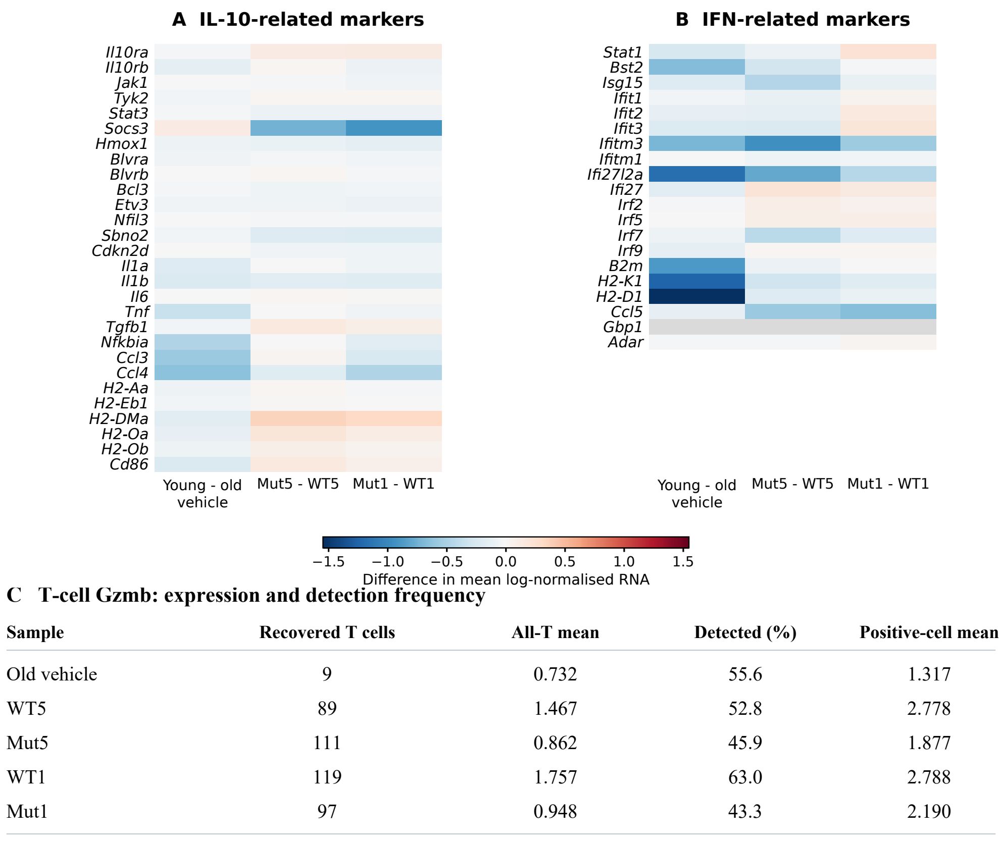
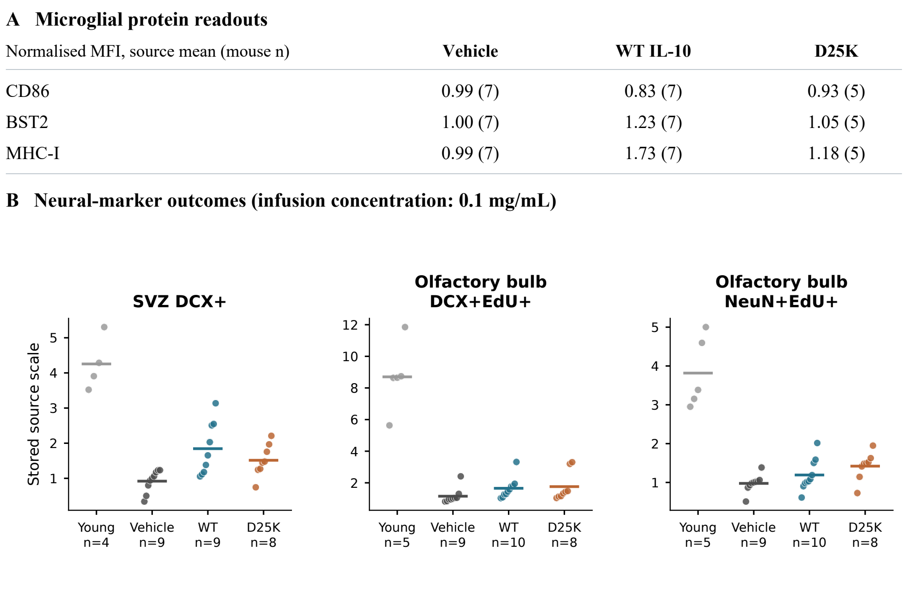
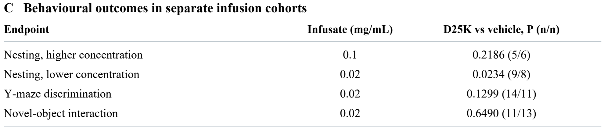
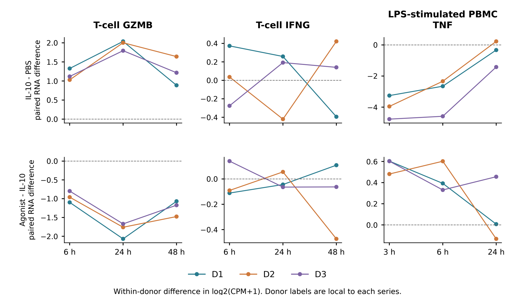

# Approved figure displays — 13 November 2026

These figures preserve approved public-data displays prepared for a research portfolio. They reuse the linked article analyses; they are not independent replication or new scientific acceptance. Numerical results and historical figures are unchanged.

[Article home](../README.md) · [Archive overview](../../../docs/PORTFOLIO_FIGURE_ARCHIVE_20261113.md)

G-SURF microscopy and personal outreach documents are deliberately excluded.

## Microglial and T-cell RNA context

Full 28-gene mixed IL-10-related and 20-gene IFN marker sets; absent Gbp1 remains grey. T-cell Gzmb table separates detection from all-cell and positive-cell means. One library per condition and unresolved mouse pooling prevent mouse-population inference.

[PNG](../../../analysis/research/runs/portfolio_navarro_figures_20261113_v1/aged_brain_rna.png) · [PDF](../../../analysis/research/runs/portfolio_navarro_figures_20261113_v1/aged_brain_rna.pdf) · [Provenance](../../../analysis/research/runs/portfolio_navarro_figures_20261113_v1/manifest.json)

## Immune protein and neural-marker measurements

Source-normalized FACS means and every deposited mouse neural-marker value. Sections are averaged within mouse; density units remain unresolved. These neural markers do not establish functional integration or lesion repair.

[PNG](../../../analysis/research/runs/portfolio_navarro_figures_20261113_v1/aged_brain_neural.png) · [PDF](../../../analysis/research/runs/portfolio_navarro_figures_20261113_v1/aged_brain_neural.pdf) · [Provenance](../../../analysis/research/runs/portfolio_navarro_figures_20261113_v1/manifest.json)

## Separate behavioral cohorts

Exact rank-test summaries for distinct dose-specific infusion cohorts. Cognition has no WT comparator. These endpoints are not a single composite recovery score; original source discrepancies remain documented.

[PNG](../../../analysis/research/runs/portfolio_navarro_figures_20261113_v1/aged_brain_behavior.png) · [PDF](../../../analysis/research/runs/portfolio_navarro_figures_20261113_v1/aged_brain_behavior.pdf) · [Provenance](../../../analysis/research/runs/portfolio_navarro_figures_20261113_v1/manifest.json)

## Human-cell IL-10 context

Selected endpoints from the completed five-marker analysis. Lines retain within-series donor pairs; T-cell and PBMC times differ and donor identifiers do not establish cross-series matching. Canaria uses a different engineered agonist, not D25K or an aged-brain replication.

[PNG](../../../analysis/research/runs/portfolio_navarro_figures_20261113_v1/human_il10_context.png) · [PDF](../../../analysis/research/runs/portfolio_navarro_figures_20261113_v1/human_il10_context.pdf) · [Provenance](../../../analysis/research/runs/portfolio_navarro_figures_20261113_v1/manifest.json)
