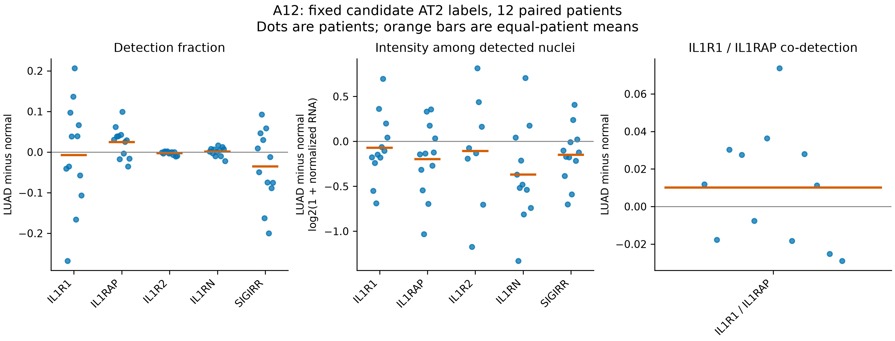
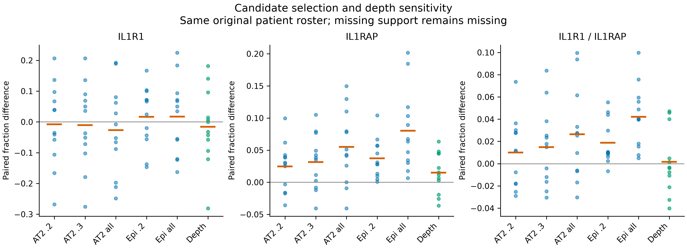
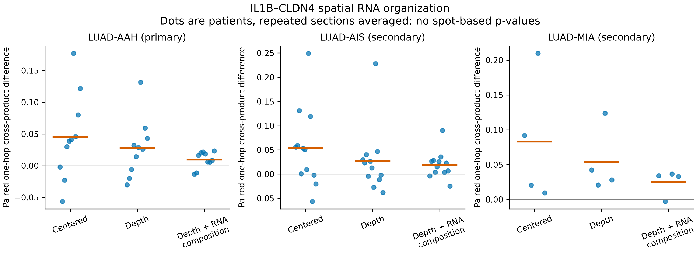
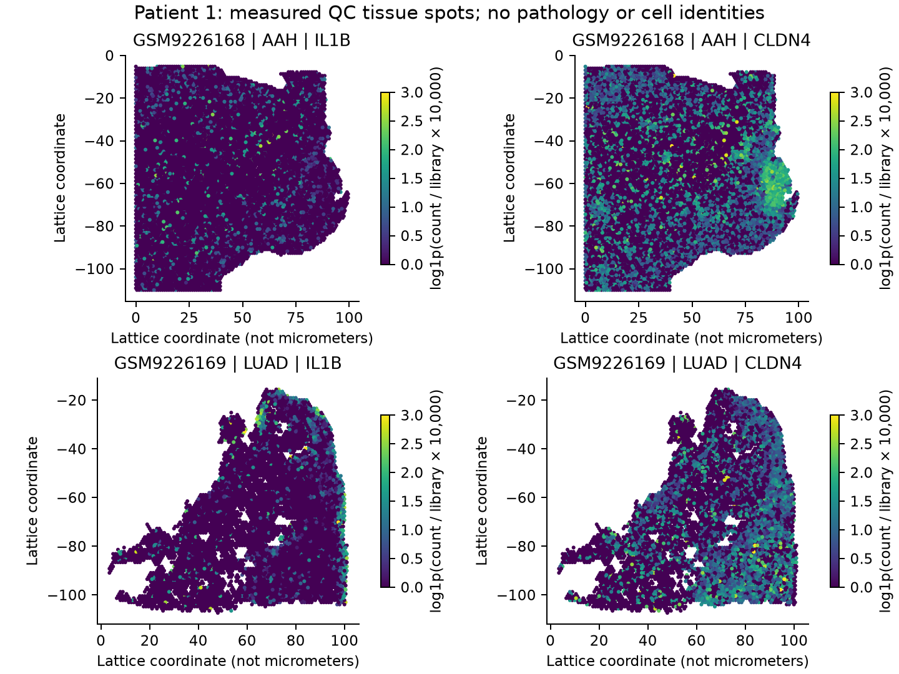

# Public-data measured figures

Measured figures come from the immutable runs below. Biological rationale stays
[in the report text](PUBLIC_DATA_RESULTS.md#biological-rationale-in-text), per the
owner's presentation direction. The actual distributions and spatial maps provide
the visual evidence; text-box rationale diagrams are not displayed.

## Candidate-cell distributions

The original twelve paired patients, with individual values and equal-patient
means. Detection, positive-cell intensity and joint barcode detection have
different denominators. Undetected RNA is not protein absence. Conditional
intensity is missing when there are no positive nuclei; see the complete tables.
[PNG](../../analysis/research/runs/A12_public_cells_v1_20261108/cell_components.png)
· [Vector PDF](../../analysis/research/runs/A12_public_cells_v1_20261108/cell_components.pdf).

Fixed candidate-label/confidence populations and common-depth support, with the
same original patient roster. These show selection dependence rather than a new
state classifier or proof of a biological confounder.
[PNG](../../analysis/research/runs/A12_public_cells_v1_20261108/cell_sensitivity.png)
· [Vector PDF](../../analysis/research/runs/A12_public_cells_v1_20261108/cell_sensitivity.pdf).

## Spatial RNA organization

One-hop IL1B–CLDN4 cross-products, compared within patient. Repeated sections are
averaged before patient summaries. Depth and broad RNA-composition sensitivities
do not independently identify cell proportions, cell contact or signaling.
[PNG](../../analysis/research/runs/Pg1_public_spatial_v3_20261108/spatial_paired.png)
· [Vector PDF](../../analysis/research/runs/Pg1_public_spatial_v3_20261108/spatial_paired.pdf).

Patient 1 and [patient 2](../../analysis/research/runs/Pg1_public_spatial_v3_20261108/spatial_example_P2.png)
were selected by numeric patient ID among AAH/LUAD matches before inspecting
endpoints. These show measured RNA, not inferred pathological regions. All maps
share a 0–3 log1p(count/library × 10,000) color range; higher values saturate the
display, and full values remain in the spot tables. Axes are lattice coordinates,
not micrometers. [All-patient map atlas (PDF)](../../analysis/research/runs/Pg1_public_spatial_v3_20261108/spatial_all_patients.pdf).

## Provenance and interpretation

Source and execution: [cell contract](contracts/public_cells_v1.json),
[cell receipt](../../analysis/research/runs/A12_public_cells_v1_20261108/receipt.json),
[spatial v3 contract](contracts/public_spatial_v3.json),
[spatial receipt](../../analysis/research/runs/Pg1_public_spatial_v3_20261108/receipt.json)
and [targeted literature context](PUBLIC_DATA_CONTEXT.md). Both earlier failed
spatial attempts and all earlier biological evidence remain preserved.

Historical text-box rationale renderings remain in their immutable runs but are
superseded as a presentation choice and intentionally omitted from this gallery.
