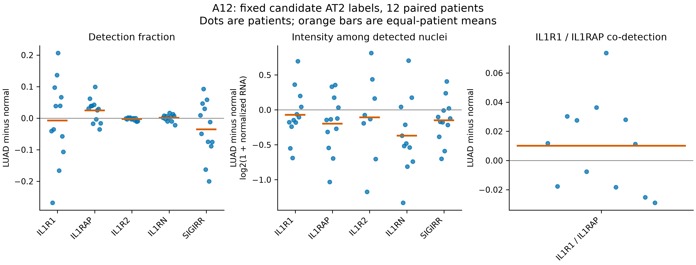
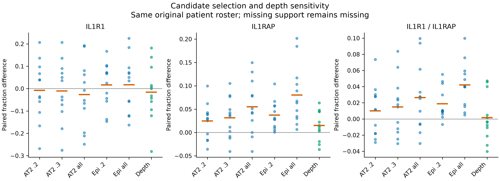

# Public-data results: candidate recipient configuration and spatial RNA

8 November 2026. A12 cell description completed; the separately frozen Visium
branch is executing next. The owner reports the Zenodo access request submitted;
approval remains pending and unverified. No second request was sent.

## A12: detection and intensity are different parts of the aggregate pattern

[Contract](contracts/public_cells_v1.json), freeze `8c22904`,
[immutable receipt](../../analysis/research/runs/A12_public_cells_v1_20261108/receipt.json),
[specification](PUBLIC_CELLS_SPEC_V1.md) and [literature rationale](PUBLIC_DATA_CONTEXT.md).
All 75 libraries, 555,480 QC nuclei and source-index joins qualified. The primary
comparison retains the original 12 patients and 24 normal/LUAD AT2-candidate units
(39,051 nuclei), with exact parity to all 240 prior component primitives.
The independent sparse/scalar verifier passed 7,677 checks (maximum numerical
error 3.56e-15). The nuclei and blocks are nested observations, not extra patients.

| Fixed primary endpoint | Mean LUAD minus normal across 12 patients | Interpretation |
|---|---:|---|
| IL1R1 detection fraction | -0.75 percentage points | Heterogeneous: 6 patients increase and 6 decrease; the mean changes sign under leave-one-patient-out sensitivity. |
| IL1RAP detection fraction | +2.45 percentage points | 8 patients increase; a detection-frequency component accompanies the earlier aggregate increase. |
| IL1R1 positive-cell mean log2(1 + normalized RNA) | -0.071 | Conditional intensity differs from detection and from summed-count CPM. |
| IL1RAP positive-cell mean log2(1 + normalized RNA) | -0.196 | Its aggregate increase is not an increase in average normalized intensity among detected nuclei. |
| IL1R1/IL1RAP joint detection fraction | +1.01 percentage points | 7 patients increase; barcode co-detection is not receptor assembly. |
| IL1RAP detected conditional on detected IL1R1 | +3.33 percentage points | 9 patients increase; denominator is the observed IL1R1-positive barcodes. |

Normalized RNA in positive-cell rows uses each full-library denominator and
10,000 scaling, followed by log2(1+x). The old pseudobulk values use summed
counts/full-library sums and 1,000,000 scaling. They are different estimands;
this analysis does not algebraically attribute the old predictive improvement
or exactly decompose its nonlinear pseudobulk transformation.

The depth common-support sensitivity reduces joint detection from +1.01 to
+0.16 percentage points; IL1RAP detection remains +1.49 points and IL1R1 is
-1.58 points. Common support retains 87.5–100% of normal and 89.0–100% of LUAD
candidate nuclei across patients. This is a sensitivity to the measured depth
and detected-gene distribution, not a causal correction or an equivalence result.

Candidate selection matters: AT2 all-QC gives +5.49 points IL1RAP and +2.65 points
joint detection; the broad Epithelial all-QC view gives +8.01 and +4.21 points.
IL1R1 detection changes from -0.75 points in primary AT2 candidates to +1.68 in
confident broad epithelial candidates (+1.72 in broad all-QC). Equal-block
weighting is close to the primary pooled-block description (-0.88, +2.40 and
+0.98 points for IL1R1, IL1RAP and joint detection respectively). These checks
localize dependence on selection/depth without proving its biological cause.

All ten genes and four fixed pairs are retained in the
[patient gene table](../../analysis/research/runs/A12_public_cells_v1_20261108/patient_gene_components.csv),
[co-detection table](../../analysis/research/runs/A12_public_cells_v1_20261108/patient_codetection.csv),
[all paired summaries](../../analysis/research/runs/A12_public_cells_v1_20261108/paired_summary.csv),
[common-support record](../../analysis/research/runs/A12_public_cells_v1_20261108/depth_support.csv)
and [label/confidence inventory](../../analysis/research/runs/A12_public_cells_v1_20261108/label_confidence_inventory.csv).
IL1R2 and IL1RN have zero detections in some primary units; their conditional
positive-cell means remain missing. No absent gene was imputed as zero.

**Biological consequence:** the earlier IL1RAP-up/IL1R1-down aggregate contrast
cannot be described as uniformly increased receptor expression or signaling.
There is a measured detection-frequency component, heterogeneous IL1R1 behavior,
and sensitivity to candidate population and depth. Transferred labels include
some IL-1 targets, broad cross-lineage RNA persists, and epithelial mixtures are
unresolved. This is candidate-compartment description, not intrinsic within-state
regulation. NFKBIA/TNFAIP3 overlap the old response and supply no independent
validation. The unfavorable fibroblast prediction and old A11/A12/A13 evidence
remain unchanged.

## Visium: bounded lattice branch

[Prospective specification](PUBLIC_SPATIAL_SPEC_V1.md) and
[contract](contracts/public_spatial_v1.json), freeze `8888216`, define the new
spot-level endpoint and its limits. V1 stopped before expression because three non-target symbols have duplicate
Ensembl rows. The [prospective v2 correction](PUBLIC_SPATIAL_SPEC_V2.md) restores
the original C3 symbol aggregation for QC, with unique targets and unchanged
endpoints. Its failed receipt/logs are preserved. Results follow after verification.

## Completed versus deferred work

The source tables and A12 public-cell branch are complete. The new spatial branch
uses public masks/coordinates, not restricted author pathology annotations.
Author-dependent stages 3–6 (state/pathology/ROI alignment, exact 80-micrometer
reproduction, within-state A12 estimation and TMA endpoint transport) remain held.
Stage 7 still needs linked functional outcomes. P6 WES identity, P7 diagnostic
history and S5 date-cell identity remain local holds, not RNA-analysis exclusions.
No new global RQ, accepted claim, independent replication or clinical conclusion.
