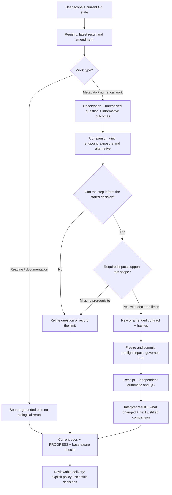

# Agent decisions: proportional design and evidence-preserving execution

Updated 4 November 2026 at the owner's request to prevent screening from becoming
an accumulation of analyses without corresponding question development. The
7 October audit below remains historical context. This describes the repository's
declared workflow and observable checks, not a claim to expose a model's private
reasoning or guarantee that arbitrary tools obey Markdown. Instruction changes
are explicit review material; no human scientific acceptance is inferred.

The [7 October workflow illustration](schematics/agent_decision_workflow_v1.svg)
is retained as history. The current decision sequence is described below.

## What the 7 October instruction audit found

Tracked instruction inventory: root [AGENTS.md](../AGENTS.md) and
[CLAUDE.md](../CLAUDE.md). No nested AGENT/AGENTS file is tracked; CLAUDE.md points
to the same policy. The user-supplied session instructions also govern this task;
this change does not edit personal/global agent settings.

| Rule/source reviewed | Assessment and correction |
|---|---|
| AGENTS: every substantive analysis identifies its strongest rival | Sound intent, overly uniform wording. Now distinguishes purpose/estimand from a mechanistic hypothesis; alternatives may be validity threats and do not imply extra arms. |
| RESEARCH_QUESTIONS: every RQ must propose a process and causal/directional prediction | Overrestrictive for description, faithful replication, prediction and effect estimation. Replaced with fit-for-purpose framing while retaining biological purpose and limits. Earlier 29 September wording remains in Git history. |
| AGENTS: do not select a preferred RQ or expand a failed analysis | Could obstruct a requested single-question task or justified negative-result follow-up. Clarified preservation of the portfolio, owner-directed scope and prohibition of significance-seeking expansion. |
| Literature workflow/template: hypothesis/rival → outcomes | Retained headings for compatibility; non-mechanistic work records its estimand/target and validity threat. Mixed explanations are allowed. Refresh remains triggered by material changes, not every routine edit. |
| Governance examples: population selection, persistence after withdrawal | Useful examples, now explicitly optional. No requirement that every experiment distinguish these routes. |
| Contract schema: required `strongest_rival` and `discriminator` strings | No validator requires two mechanisms, more than two groups, a rescue, lung or Th17. Clarified field meaning without changing the schema or relaxing execution checks. |
| Dossier/guide validator: common headings and hypothesis/SVG hashes | A documentation synchronization requirement, not proof of biological merit. Existing headings can hold a question/estimand and limits; no validator edit was necessary. |
| Evidence, exposure, units, immutable outputs and claim authority | Retained. These protect traceability and interpretation; they are not question-specific assay mandates. |
| Mandatory repository checks and integration review | Retained. Policy edits are visible review material; CI does not substitute for human scientific judgment. Server-side review/protection settings were not changed or certified. |

No tissue, pathway, Th17, lung or A30 assay requirement was found in AGENTS.md or
CLAUDE.md. Actual question-specific choices belong in local plans. A30's inherited
activation-only, regulatory-function and TCR-residency assumptions were corrected
locally rather than generalized into global policy. The Wp joint-experiment note
also receives a clarification: shared preparations are optional and its listed
arms do not form a complete three-factor experiment.

## Mutant versus control is a valid starting design

Example question: does a specified mutation change endpoint Y in population P at
time T? The primary estimand can be the mutant-minus-control difference at the
biological-unit level. The proposed biological role motivates that comparison;
it need not already identify every intermediate mechanism.

The relevant alternative could be background differences, allocation/batch,
off-target perturbation, differential viability or an endpoint artifact. Those
threats may be handled through an appropriate matched control, blocking, design,
measurement or interpretation limit. They are **explanations, not a required
third group**. Whether they need additional measurements depends on the claim.
For animal experiments, this objective-dependent comparator choice is consistent
with [ARRIVE item 1a](https://arriveguidelines.org/arrive-guidelines/study-design/1a/explanation).

| Intended inference | Appropriate planning question |
|---|---|
| Estimate a perturbation effect | Are mutant and control meaningfully comparable; are perturbation, endpoint, unit and precision credible? |
| Establish a specific mechanism or on-target rescue | Which additional control/perturbation or orthogonal assay would discriminate the asserted route? A rescue is an option, not automatic proof. |
| Describe a public dataset | What is being estimated, from which selected population and denominator, with what uncertainty? |
| Reproduce a published contrast | Which author choices and inputs are available; what deviations prevent an exact replay? |
| Predict in a new setting | What is the target, baseline, independent split unit and intended transport domain? |

An imprecise null does not establish equivalence. Cells, wells or repeated
measurements do not become independent animals/donors. An effect on an RNA score
does not establish secretion or function. These limits remain regardless of the
number of groups.

## Screening as question development

Treat screening as an ordered attempt to make the biological question more
specific. The organizing aim, current hypothesis/estimand and next executable
comparison are different levels. Keep their relationship visible in the owning
plan and current README; an available matrix or a fixed score does not silently
become the whole research aim. Explicit replication, descriptive and predictive
tasks remain valid without inventing a mechanism for them.

Before selecting another method, state the following compactly in the existing
question record. Reuse the literature context and contract's purpose,
`strongest_rival` and `discriminator` fields rather than create another checklist
file or add schema requirements.

| Decision | What the record should make clear |
|---|---|
| Starting evidence | What the primary study established, what the repository actually measured, and which observations are shared-source reanalysis |
| Current uncertainty | The next biological link, candidate distinction, descriptive estimand or prediction question; the relevant alternative or validity threat |
| Proposed screen | Why this comparison and measured endpoint can inform that uncertainty, using identified biological units |
| Informative outcomes | How compatible, contrary, mixed and unsupported results would change the candidate set, interpretation or next comparison; no arbitrary winner or effect margin |
| Result and next step | What actually changed after the screen, what remains unresolved, and why another step is justified or no further available analysis would be informative |

For a signaling question, the progression might concern a changed source state,
candidate output, recipient response and secondary consequence. For other work,
it might concern regulatory competence, transition entry versus residence,
prediction beyond a baseline, or state redistribution versus within-state change.
These are examples, not compulsory pathways, experimental arms or mutually
exclusive explanations. A proposed arrow or gene annotation is not evidence that
the corresponding function operates in the studied system.

Technical checks serve a stated biological or measurement decision. A needed
identity, depth or sampling check may be the right next step. Repeating checks
that already answered the relevant concern, or adding methods because they are
available, does not by itself develop the question. A broad category with many
annotations is not necessarily a coherent process; show member disagreements,
role overlap and changed definitions before interpreting an aggregate.

Missing final functional evidence does not close every earlier comparison.
Identify the narrower question the available data can answer and its limits.
Hold only steps whose required inputs are missing; do not invent independent
units, substitute another endpoint or change frozen eligibility to clear them.
Likewise, one inaccessible endpoint or a missing field in one file only describes
the checked route. Follow documented linked source products when that bounded
check can resolve the uncertainty; do not turn a source check into an unlimited
search. An owner-requested halt overrides all continuation routes.

After interpretation, update the current README/context/dossier synthesis with
the narrowed or weakened explanation and the next informative comparison.
Keep historical plans/results accessible and mark supersession rather than
overwrite them. Separate a completed analysis from an unresolved biological
question, and distinguish a proposed refinement from an accepted scientific
decision. Related IDs can share evidence while owning different comparisons;
preserve their identities unless the owner authorizes restructuring.

### Apply the rule proportionately

| Situation | Appropriate application |
|---|---|
| Positive aggregate, opposing component genes | Retain the aggregate result; examine the justified component question before naming a uniformly activated programme |
| A comparison favors one recipient compartment while another is unstable | Make that narrowing and the unfavorable result visible; define the next recipient comparison without refitting the same exposed data as confirmation |
| RNA evidence exists but a later functional measurement is absent | Permit a useful, qualified RNA-context nomination; leave the functional link unresolved |
| New connector or normalization method becomes available | Use it only for a named source, interpretation or measurement gap; do not automatically rerun the portfolio |
| Faithful replication, descriptive estimation or mutant-versus-control effect question | Retain the stated aim and adequate design; do not demand a complete pathway, extra arm or novel mechanism |
| Mixed or uninformative result | Record the remaining uncertainty and any justified next comparison; no automatic expansion merely to produce a positive story |
| User halts research and asks for an instruction revision | Edit and review the requested guidance; keep calculations, source searches and delegated research halted |

## Using skills and connectors

Choose a capability after identifying the question or evidence gap. Verify its
availability and read the applicable skill when using it; the examples below
do not require installation or prove that a connector is present. Keep use
proportionate to the task instead of invoking every available scientific tool.

| Need | Relevant examples, when available | Contribution and limit |
|---|---|---|
| Published premise, closest precedent or competing explanation | Literature-review/citation skills; primary publisher or PubMed access | Recover and inspect the supporting result; search hits and abstracts do not stand in for an unread figure/method |
| Source identity, sample design or missing linked files | NCBI Entrez/GEO, CELLxGENE and BioStudies skills/APIs | Locate metadata and products; independently check the relevant sample/assay joins rather than infer them from a series title |
| Candidate identity or biological role | UniProt/GO source tools | Retain species, aliases, qualifiers, evidence and context; annotation is not measured activity in this experiment |
| Processed single-cell data implementation | Scanpy or a suitable existing repository reader/script | Support the specified matrix/unit/endpoint; changing software does not justify new grouping, normalization or a replacement estimand |
| NGS design, registered execution or result interpretation | NGS design/results/workflow skills and compatible connected workbench | Check actual runtime, inputs and authorization when execution is needed; workflow availability does not establish scientific fit or compute readiness |
| Explanatory biological illustration | Available figure/design tools | Illustrate reviewed premises and proposed links; generated artwork is not additional evidence |

Use a fit-for-purpose connector when sufficient; use a documented API or local
route when the needed capability is unavailable. Record what was actually
retrieved or run and preserve the consequential provenance. A tool's absence,
an access failure and a missing biological measurement are different conditions.
Neither a connector nor a skill supplies missing replicates, grants external
write/compute permissions or overrides an owner-requested halt.

## The workflow an agent should actually follow

1. **Establish scope and current state.** Read user instructions and entrypoints;
   inspect HEAD/upstream/dirty state, fetch the base, preserve unrelated work and
   use a scoped branch. Read the registry's current evidence/amendment before plans.
2. **Classify the work.** Reading/docs, metadata, descriptive/exploratory analysis,
   prediction or confirmation have different requirements. Routine documentation
   does not trigger biological reruns or a full literature search.
3. **Connect the evidence to the next decision.** Identify the observation,
   unresolved link/comparison and the outcomes that would change the next step.
   Apply the screening sequence above before choosing another method or dataset.
4. **Specify only what the purpose needs.** Unit, comparator/estimand, endpoint,
   exposure, major validity threat and interpretation limit. For a hypothesis-driven
   contrast add its prediction. Resolve only decision-relevant uncertainty using
   sufficient existing evidence or a targeted source/check. Record unknowns and
   the exact dependent hold; an explicitly qualified partial comparison can remain
   useful without supplying the entire mechanism.
5. **Route numerical work through its contract.** Register source/code hashes,
   choices, units, exclusions, multiplicity and exposure; freeze/commit, preflight
   inputs and use the runner. Confirmation additionally needs unexposed outcomes
   and justified precision. Amend exposed designs honestly; never overwrite a run.
6. **Verify and interpret.** Verify receipts plus independent arithmetic/QC.
   Report effects, uncertainty and negative/mixed outcomes within the actual
   endpoint, then explain what was narrowed or weakened and why the next comparison
   follows. If nothing changed, say so. A successful run or a small p-value does
   not grant scientific acceptance.
7. **Deliver reviewable work.** Update current summaries and PROGRESS, preserve
   history, run required checks against the current base and present concrete
   limitations. Policy/interpretation changes remain explicit review items.
   Ask for missing essential information or a genuinely required decision only.

## What is enforced, and what is not

- **Instructions:** AGENTS, governance, literature workflow and plans guide a
  compliant agent. They cannot sandbox arbitrary commands.
- **Runtime/CI checks:** schema/registry validation, raw input/code hashing at
  execution, refusing reused run directories, receipts, output hashes and change
  checks detect specified structural/provenance failures.
- **Scientific judgment:** source fidelity, adequate controls, causal identification,
  meaningful precision and claim acceptance require review. Neither CI nor an AI
  reviewer proves them. CODEOWNERS names ownership; enforcement depends on GitHub
  settings and credentials, which were not audited here.

The 7 October session followed the reading/documentation and saved-artifact
verification routes; its Compass/A30 execution statements remain historical.
The 4 November instruction revision changes the declared decision sequence and
current-summary expectations. It introduces no validator/schema change, numerical
run, claim promotion or resumption of the halted research queue.
