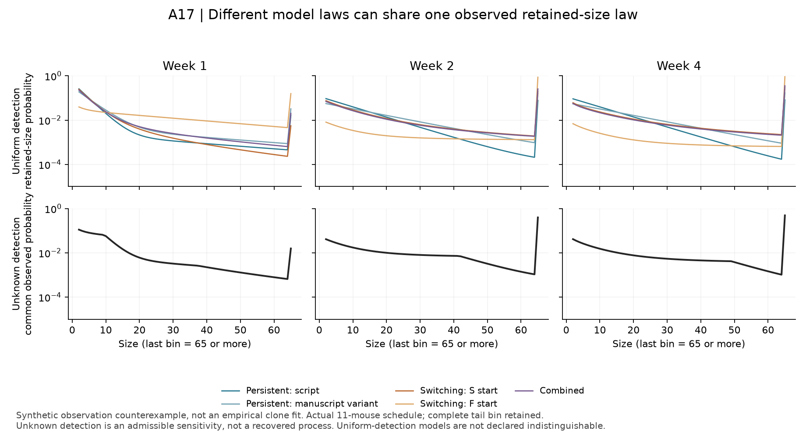

# A17 recoverability: an observation limit, not mechanism selection

3 November 2026. [Frozen specification](EXECUTION_SPEC_V1.md#a17-recoverability-and-observation-specification),
[contract](../../../analysis/cut_fill_20261103/a17_recoverability_v1.json),
[receipt](../../../analysis/research/runs/cut_fill_a17_recoverability_v1_20261103/receipt.json).
Freeze: `bad95f6`. Prior source outcomes and simulator/ascertainment results are
exposed. No England clone-size outcome was fitted.

The new backward PGF solver evaluates persistent-founder, common-S/common-F
switching and combined fixtures on the actual terminal weeks 1/2/4. Both source
parameter variants remain separate; illustrative switching rates are numerical
fixtures, not inferred biology or biologically justified search bounds. The fair
structural domains retain all nonnegative finite rates, founder endpoints and
family overlaps. A justified bounded empirical search domain is still unknown.

With uniform detection, fixed candidate laws differ. With unknown size/time
selection, they can generate the same observed retained-size law. For positive
laws q_i, let h(n)=min_i q_i(n) and w_i(n)=h(n)/q_i(n). Every weight is within
(0,1], and conditioning on detection yields h/sum(h) for every family. This is
an existence result, not a fitted observation process or evidence that the actual
microscopy detection follows those weights. The complete-bin numerical result
agrees to maximum total variation **9.98e-18** across the three observation times.
The pointwise construction also establishes the unbinned mathematical ambiguity
when detection weights are unconstrained. Merger was not simulated or estimated.

[Full laws and uniform-detection KL](../../../analysis/research/runs/cut_fill_a17_recoverability_v1_20261103/recoverability.json)
and [synthetic datasets](../../../analysis/research/runs/cut_fill_a17_recoverability_v1_20261103/synthetic_recoverability.csv)
retain all five fixtures. Two hundred synthetic datasets per family use the actual
11 mouse sample sizes, nested clone counts and equal-mouse scoring; they are
computational replicates. By construction their observed generating distribution
is common, so a family classifier cannot recover the generating family from this
observation model. This does not prove uniform-detection model indistinguishability.

**Disposition:** stop empirical mechanism selection under the currently unqualified
ascertainment. A conditional prediction analysis could be reopened with justified
constraints on detection/merger and bounded model domains; it would need identical
mouse folds and training-only fitting and would remain model-conditional. The
retained-size data do not identify founder incidence or extinction. No founder
model was biologically disproved, and no new molecular class was established.

[Verification](../../../analysis/research/runs/cut_fill_a17_recoverability_v1_20261103/verification.json)
compares size-64 versus size-128 coefficient solutions after exact tail regrouping
and independently composes scalar no-switching PGFs. Maximum error **3.51e-12**,
below frozen numerical tolerance 2e-7. Sizes zero and one remain in the underlying
law; the >=65 tail is retained. The previous stochastic-kernel and denominator
checks were reused rather than rerun.

[SVG](../../../analysis/research/runs/cut_fill_a17_figure_v1_20261103/a17_observation_ambiguity_v1.svg) ·
[render receipt](../../../analysis/research/runs/cut_fill_a17_figure_v1_20261103/receipt.json).
The last plotted bin is the whole >=65 tail; its jump is not a peak at exactly 65.
Visual inspection passed: labels, legend, synthetic framing and tail note readable.
