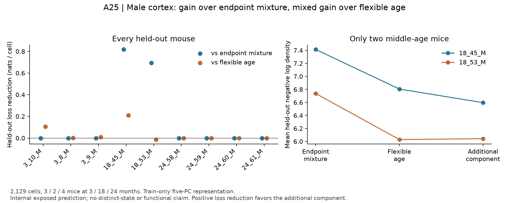

# A25 held-out comparison: endpoint-mixture gain, mixed continuous-age gain

3 November 2026. [Frozen specification](EXECUTION_SPEC_V1.md#a25-supported-exploratory-comparison),
[contract](../../../analysis/cut_fill_20261103/a25_models_v1.json),
[receipt](../../../analysis/research/runs/cut_fill_a25_models_v1_20261103/receipt.json).
Freeze: `bad95f6`. This is exposed internal prediction on reused atlas data, not
independent-study confirmation or human scientific acceptance.

The supported scope contains **2,129 male cortex microglia from nine mice**:
3/2/4 mice at 3/18/24 months. Exact source cell IDs join the official raw integer
read-count layer to the previous bridge, and every full-library total matches
source n_counts. The input was copied from the local cache only after matching
its frozen SHA-256 `73c1b7c4c4045db26df384fd226c6bd248cfbb822d540d9c968bd8ce6f051f66`.
It is not interpreted as UMI counts. Females, other regions and missing old-female
support are not supplied by adjustment.

Each entire mouse is held out. Gene detection/variance selection, scaling and
five-component weighted PCA use training mice only. All three models in a fold
share this representation. The continuous-age Gaussian permits nonmonotone
quadratic mean/log-variance interpolation and is saturated at the three observed
ages; it is not a weak straight-line baseline. The extra model adds one middle-age
Gaussian to the same endpoint components, under the frozen common variance floor.
All nine EM fits converged within the frozen budget; no feature/model sweep followed.

| Model | Equal-mouse mean held-out negative log density |
|---|---:|
| Endpoint mixture | 6.376019 |
| Flexible continuous age | 6.242859 |
| Additional RNA component | 6.208109 |

Units are nats per cell in each fold's standardized five-dimensional projection,
then averaged equally across mice. Absolute density depends on that projection;
this is not full-gene predictive fit or an externally calibrated adequacy threshold.
Within-fold differences share coordinates. Mean extra-component gain is +0.167910
versus endpoint mixture and +0.034750 versus continuous age.

The **two middle-age holdouts determine the important qualification**:

| Held-out mouse | Gain over endpoint mixture | Gain over flexible age |
|---|---:|---:|
| 18_45_M | +0.817752 | +0.209465 |
| 18_53_M | +0.693443 | **-0.013622** |

Extra-component prediction equals the endpoint mixture at other ages by design;
some aggregate gain over continuous age therefore comes from the young endpoint
mixture, not from the new middle-age component. One favorable average cannot erase
the adverse middle-age comparison. Losses and deletion-of-one-mouse aggregation
sensitivities are retained in [summary](../../../analysis/research/runs/cut_fill_a25_models_v1_20261103/summary.json)
and [all predictions](../../../analysis/research/runs/cut_fill_a25_models_v1_20261103/heldout_losses.csv).
Deletion ranges are sensitivity, not confidence intervals or independent fold fits.

The two reconstructed extra-minus-endpoint gene directions have cosine **0.93305**.
Held-out mean extra-component posterior occupancy is **0.80677 / 0.58165**;
training component weights are **0.87473 / 0.64597**. This is conditional coherence,
not independent replication: the two fits share most endpoint training mice, and
each trains on only one middle-age mouse. Gaussian restrictions, age-associated
processing and limited biological units remain consequential alternatives.

**Disposition:** the bounded model comparison is complete and review-ready. It
supports gain over this endpoint-mixture representation, but does not establish
robust gain over flexible continuous age or a distinct middle-age state. No
function, disease mechanism, lineage, trajectory or universal age configuration is
inferred. No retuning or new state label is warranted by this mixed outcome.

[Verification](../../../analysis/research/runs/cut_fill_a25_models_v1_20261103/verification.json)
passed exact source joins/totals, mouse exclusion, equal-mouse duplication
invariance and reconstruction of all 27 losses from saved model parameters
(maximum discrepancy zero). An additional standard-library CSV/math.fsum check
reconstructed all three means and both aggregate gains, also with zero discrepancy.
[Fold models and selected genes](../../../analysis/research/runs/cut_fill_a25_models_v1_20261103/fold_models.json)
retain training identities and parameters. This is numerical verification, not
additional biological replication.

[SVG](../../../analysis/research/runs/cut_fill_a25_figure_v1_20261103/a25_heldout_models_v1.svg) ·
[render receipt](../../../analysis/research/runs/cut_fill_a25_figure_v1_20261103/receipt.json).
Visual inspection passed: all mice, the adverse comparison, units and limits are
visible. Figure originals remain in the immutable run deposit and are embedded
from the owning RQ home.
