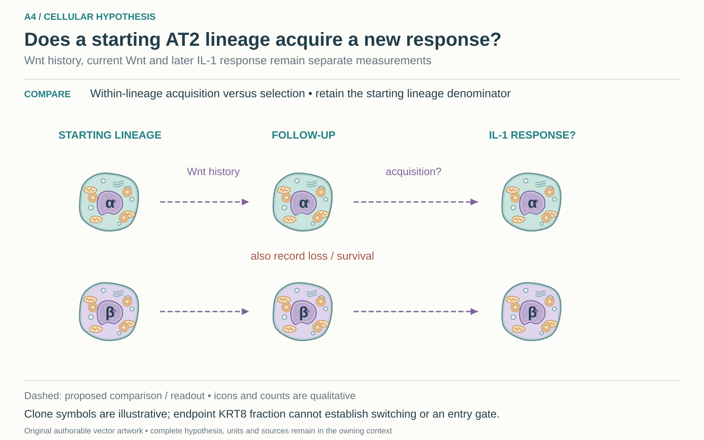

# A4: literature context and hypothesis schematic

Reviewed 3 October 2026. This note connects published findings to the current proposed question. It is a bounded synthesis, not novelty clearance or scientific acceptance.

## Published starting point

Wnt-associated alveolar stem-cell behaviour, changing Wnt responsiveness and inflammatory transitions are published. These findings provide the two ends of the proposed adult sequence.

| Primary source | Inspected locator and access record |
|---|---|
| [Nabhan 2018](https://pmc.ncbi.nlm.nih.gov/articles/PMC5997265/) | Wnt niche and tracing result. [Access / prior review](../NOVELTY_SPECIFICITY_APPLICATION_2026-10-03.md) |
| [Frank 2016](https://pubmed.ncbi.nlm.nih.gov/27880906/) | Developmental Wnt history; Fig. S2G–H. [Access / prior review](../followup_2026-10-03/NOVELTY.md) |
| [Choi 2020](https://pmc.ncbi.nlm.nih.gov/articles/PMC7487779/) | Fig. 7 and Discussion. [Access / prior review](../NOVELTY_SPECIFICITY_APPLICATION_2026-10-03.md) |

Sources above reuse the named review unless the update ledger explicitly records a fresh inspection. Published-source evidence and reanalysis of the same material are not independent replication.

## Repository observation

Nb1 lacks sufficient acute sampling for the proposed switch. AF1 Wnt2 and AF2 Wnt4 expression nominate source contexts but do not demonstrate switching by the same cells.

Exact current result locators:

- [Research Article/gate1_03_nabhan_2018/README.md](../../../Research%20Article/gate1_03_nabhan_2018/README.md)
- [docs/research_dossiers/followup_2026-10-03/NOVELTY.md](../followup_2026-10-03/NOVELTY.md)
- [docs/research_dossiers/followup_2026-10-03/OUTCOMES.md](../followup_2026-10-03/OUTCOMES.md)
- [docs/research_dossiers/continuation_2026-10-03/PACKAGE_REVIEW.md](../continuation_2026-10-03/PACKAGE_REVIEW.md)

## What this question could add

Link Wnt history and a later current IL-1 response to the same starting lineage to separate response acquisition from replacement by an already-responsive subset. This adds an ancestry-linked comparison, not a newly invented Fzd5 entry gate.

## Current hypothesis and rival

Adult AT2 starting lineages with documented Wnt-responsive history can later acquire an IL-1-beta-responsive transitional epithelial state, rather than the apparent sequence arising only from expansion or survival of different pre-existing subsets. Wnt history, current Wnt activity and current IL-1 response must be measured separately. This restores the existing sequence question; it does not adopt the proposed Fzd5-dependent gate on transition entry.

**Strongest rival:** Fixed subsets respond differently; selective expansion, death or reporter history creates an apparent switch.

## What the comparison would teach

Acquisition of the qualified response within tracked starting clones favors the sequential model; stable subset responses with differential growth or death favor selection. Count response, loss and unresolved follow-up over the eligible t0 lineage set. A survivor-only fraction or endpoint KRT8 fraction cannot identify switching or entry.

## Hypothesis schematic

[Editable cellular SVG](../schematics/A4_cellular_v1.svg), source revision `862f3335bad7700ba89ce8d5bcc794c7c9094fbc`. This 2 November 2026 redraw supersedes the [prior illustration](../schematics/A4_v2.svg) for display; that SVG remains unchanged. The working hypothesis, source evidence and scientific disposition are unchanged.

The comparison asks whether a response is acquired within eligible starting AT2 lineages rather than selected by differential expansion or survival. Animals define independent units and clones are nested; retain the starting denominator. Wnt history, current Wnt and IL-1 response are separate readouts.

Class-level glyphs and qualitative geometry are not molecular structures, organelle measurements or evidence of functional assembly. Neutral epithelial/stromal shapes do not assert subtype identity or organelle loss, and icon counts are illustrative. Read locally labelled solid premises/references separately from dashed proposed comparisons; no complete mechanism follows from their juxtaposition.

## Next literature check

Planned query (not reported as newly executed): `adult Wnt history AT2 lineage acquisition IL1 response selection clonal 2025 2026`. Expand to synonyms, nearest source references/citations and conflicting results using the [literature workflow](../../LITERATURE_WORKFLOW.md). Recheck the exact population, comparison, timing, unit and endpoint before making a stronger contribution claim.

**Current unresolved specification:** Within-lineage response flexibility has not been distinguished from replacement or selective survival of pre-existing subsets.

**Interpretation limit:** Ligand-source RNA and reporter positivity cannot establish a reversible cellular switch.

[Current dossier](../A4.md) · [All-question context index](README.md)
