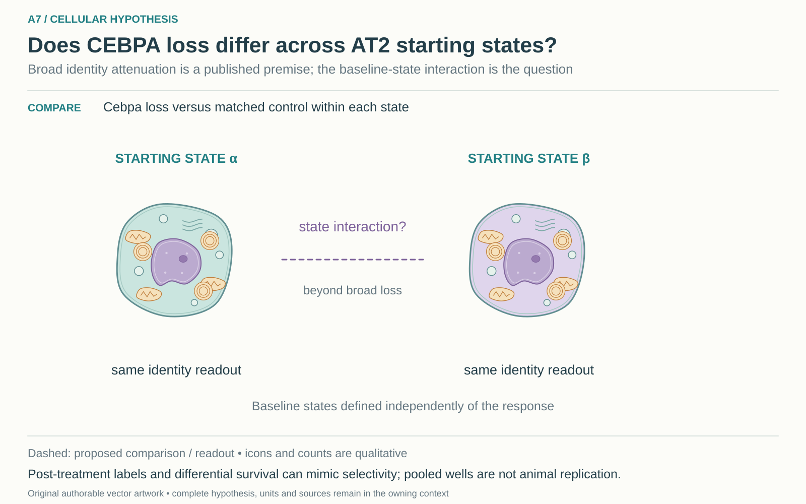

# A7: literature context and hypothesis schematic

Reviewed 3 October 2026. This note connects published findings to the current proposed question. It is a bounded synthesis, not novelty clearance or scientific acceptance.

## Published starting point

CEBPA support of AT2 identity and alternative reparative/defensive programmes are prior knowledge. Broad loss of identity is therefore the premise for a more specific interaction question.

| Primary source | Inspected locator and access record |
|---|---|
| [Hassan and Chen 2024](https://www.nature.com/articles/s41467-024-48632-3) | Results and Figs. 3, 5, 6. [Access / prior review](../review_2026-10-03/SOURCES.md#s02) |
| [Sawhney 2025](https://www.nature.com/articles/s41467-025-64224-1) | Fig. 7 and Discussion. [Access / prior review](../review_2026-10-03/SOURCES.md#s03) |

Sources above reuse the named review unless the update ledger explicitly records a fresh inspection. Published-source evidence and reanalysis of the same material are not independent replication.

## Repository observation

The relevant record is ES1 epithelial-state specificity using the CEBPA source, not the England mutant-clone paper. The shared ES1 resource has six CEBPA-source and four separate AP-1-source condition wells. These support conditional, label-sensitive descriptions; cells and pooled wells do not supply a replicated genotype-by-state interaction at animal level.

Exact current result locators:

- [Research Article/epithelial_state_specificity/README.md](../../../Research%20Article/epithelial_state_specificity/README.md)
- [Research Article/epithelial_state_specificity/results/SUMMARY.md](../../../Research%20Article/epithelial_state_specificity/results/SUMMARY.md)
- [docs/research_dossiers/qualification_2026-10-03/RESULTS.md](../qualification_2026-10-03/RESULTS.md)
- [docs/research_dossiers/followup_2026-10-03/NOVELTY.md](../followup_2026-10-03/NOVELTY.md)
- [docs/research_dossiers/followup_2026-10-03/METADATA.md](../followup_2026-10-03/METADATA.md)

## What this question could add

Determine whether an independently defined starting state modifies a qualified CEBPA contrast. Defining the state after perturbation could instead select survivors or relabel the outcome; pooled units and separate AP-1 sources remain distinct.

## Current hypothesis and rival

CEBPA loss attenuates alveolar identity across AT2 states; the additional candidate is that its effect differs between independently established starting states beyond this broad identity loss. Broad attenuation is the published premise, not the novel claim. The state interaction must be specified before genotype changes the state labels; CEBPA and AP-1 studies remain separate sources.

**Strongest rival:** The apparent breadth or interaction arises from post-genotype state selection, reference enrichment, differential survival or depth-sensitive measurement rather than a difference between starting states.

## What the comparison would teach

Estimate broad attenuation and the additional baseline-state interaction separately. A consistent interaction supports state dependence; precise similarity would weaken it. A nonsignificant interaction is not equivalence, and differential survival can mimic selective loss.

## Hypothesis schematic

[Editable cellular SVG](../schematics/A7_cellular_v1.svg), source revision `862f3335bad7700ba89ce8d5bcc794c7c9094fbc`. This 2 November 2026 redraw supersedes the [prior illustration](../schematics/A7_v2.svg) for display; that SVG remains unchanged. The working hypothesis, source evidence and scientific disposition are unchanged.

A7 separates published broad alveolar identity attenuation from an additional interaction with independently established starting states. Source animals define biological independence; pooled wells/cells do not create it. Post-genotype labels, survival and depth can mimic selectivity; CEBPA and AP-1 sources remain separate.

Class-level glyphs and qualitative geometry are not molecular structures, organelle measurements or evidence of functional assembly. Neutral epithelial/stromal shapes do not assert subtype identity or organelle loss, and icon counts are illustrative. Read locally labelled solid premises/references separately from dashed proposed comparisons; no complete mechanism follows from their juxtaposition.

## Next literature check

Planned query (not reported as newly executed): `CEBPA alveolar baseline cell state interaction identity loss lineage 2025 2026`. Expand to synonyms, nearest source references/citations and conflicting results using the [literature workflow](../../LITERATURE_WORKFLOW.md). Recheck the exact population, comparison, timing, unit and endpoint before making a stronger contribution claim.

**Current unresolved specification:** How much of the apparent reference-versus-transition compression survives independent state definitions and valid biological replication is unresolved. Broad identity change and an additional state interaction can coexist.

**Interpretation limit:** More cells in one well cannot establish genotype replication; a reduced transitional fraction does not establish altered fate.

[Current dossier](../A7.md) · [All-question context index](README.md)
