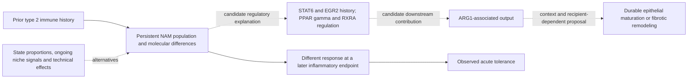

# NAM immune history and repair: proposed analysis sequence

29 October 2026. Paper review and prospective design, based on Ravel main
`78320a186b6f52426e7c7c5349a2f26492b718b7`. This is an article-local proposal;
it creates no canonical RQ, analysis result, claim grade or scientific acceptance.
The companion [literature context](LITERATURE_CONTEXT.md) records precedents,
source access and search coverage. No biological analysis was executed.

## Biological purpose and repository fit

Damani-Yokota et al., [Nature, 2026](https://doi.org/10.1038/s41586-026-11060-y),
adds immune history to the question of how a tissue niche influences repair.
The central extension for Ravel is whether a history-conditioned macrophage niche
changes epithelial recovery competence, beyond reducing acute injury. The first
computational contribution should establish which persistent molecular changes
and subsequent responses can be attributed to comparable NAM states.

Ravel's current registry has 32 canonical questions, 31 article-local candidates,
77 contracts and 72 receipts. These are registration/execution counts, not counts
of accepted mechanisms. The current portfolio retains partial reproductions,
negative transport results and missing functional endpoints. See
[portfolio summary](../../PORTFOLIO_SUMMARY.md) and
[current state](../../../PROGRESS.md).

| Existing question | Connection to this paper | Boundary retained |
|---|---|---|
| [A1](../../research_dossiers/A1.md) | RNA resemblance can conceal regulatory differences; NAMs provide a distinct immune-cell context | Macrophage accessibility does not supply the missing epithelial regulatory-to-fate linkage |
| [A14](../../research_dossiers/A14.md) | Persistence after inflammatory history and the contribution of the niche | A late snapshot does not establish persistence after verified signal cessation |
| [A22](../../research_dossiers/A22.md) | Reciprocal epithelial, stromal and immune communication; within-state response versus selection | Existing broad identity-to-chemokine prediction transported poorly; RNA does not measure secretion |
| [A2](../../research_dossiers/A2.md) | Source, delivery and recipient response are separate measurements | Arg1 or Areg RNA cannot substitute for enzyme activity, metabolite delivery or ligand availability |
| [A8](../../research_dossiers/A8.md), [A19](../../research_dossiers/A19.md) | Mature epithelial output and retained regenerative capacity | Acute survival, KRT5/proSP-C staining and organoid growth are not mature alveolar restoration |

The 27 October Niethamer broad-AT1 description and source-qualification work
remain in separate worktrees/branches. They do not silently alter this main-based
review. The primary checkout's existing PROGRESS additions remain preserved.

## What the paper measures

The mouse functional experiments support a contribution of trained NAMs to
disease tolerance: less pathology and better outcomes without a detected reduction
in viral titres at the sampled times. Depletion/repopulation supports necessity
in the tested setting. The transfer experiment in Fig. 3q,r measures reduced
weight loss under a sublethal challenge; it is not a demonstrated rescue of
lethal-challenge survival by transfer.

The molecular evidence has three distinct sampling designs:

1. Day-35 sorted NAM **bulk RNA-seq and separate bulk ATAC-seq** (Fig. 4a-j,
   Extended Data Fig. 7). These are not paired single-cell multiome measurements.
2. Four-condition mouse scRNA-seq, covering baseline and a later inflammatory
   endpoint with or without prior history (Fig. 4k-p, Extended Data Fig. 8).
   The paper reports 44,098 immune cells, including 1,814 NAMs in six states.
3. Human NAM-like cells from the existing GSE136831 atlas: donor-level frequency,
   limma-voom pseudobulk contrasts, GSEA and mouse-to-human signature mapping
   (Fig. 5h-p). This is observational disease-context comparison, not evidence
   of recorded human immune history or an independent replication of training.

The prominent Stat6 accessibility/RNA discrepancy is between **bulk ATAC and bulk
RNA** in Fig. 4d,g. The single-cell data provide a second question about state
composition and response. Stat6 RNA is lower in the displayed comparison, but its
column lacks a significance star; the direction should not become an unsupported
gene-specific significance claim.

Bulk RNA differential expression used DESeq2; Hallmark GSEA ranked genes by its
Wald statistic and used an exploratory FDR threshold of 0.25. ATAC processing
used seq2science, consensus peaks and DiffBind/DESeq2, with FDR 0.05. Peaks were
annotated to nearby genes. HOMER promoter motif analysis used 543 leading-edge
genes against an expressed-gene background. Thus motif enrichment is not simply
a direct measurement of TF binding at all differentially accessible enhancers.
Published PPARγ ChIP tracks came from other macrophage experiments.

## Proposed questions

**Regulatory question:** Are persistent accessibility changes associated with
PPARγ-RXRA regulation accompanied by history-dependent NAM transcriptional
responses within comparable states, or are population redistribution and
technical differences sufficient explanations?

**ARG1 question:** In which cellular and tissue contexts does an ARG1-associated
program accompany inflammatory resolution versus fibrotic matrix production?
Does it behave as a downstream effector, a correlate of state abundance, or both?

**Longer-term epithelial question:** Does the conditioned immune niche improve
durable epithelial maturation, or mainly acute tolerance while altered epithelial
states remain? The deposited mouse immune-cell data cannot answer this endpoint.

These are related questions with separate estimands. They should not be collapsed
into a claim that STAT6 activates PPARγ, which activates ARG1, which regenerates
alveoli. The paper does not identify that full causal chain.

Dashed connections are proposals. No measured effect sizes or causal estimates
are represented. A registered versioned SVG remains pending formal candidate
development; existing canonical question guides are unchanged.

## Stepwise analysis and decisions

### 0. Qualify the source and biological units

Purpose: metadata recovery. Build the assay-to-sample-to-animal/pool map before
testing biology. The independent unit is an animal only when its identity is
recoverable; an independently collected pool is a pool, not its constituent mice.

Public GEO inspection on 29 October confirmed:

- [GSE280183](https://www.ncbi.nlm.nih.gov/geo/query/acc.cgi?acc=GSE280183): four naive
  and four trained ATAC libraries, GSM8591248-GSM8591255. Processed peak files were
  replaced on 27 July 2026. The paper excludes one naive outlier; recover its
  identity and documented QC rationale rather than guessing from the PCA.
- [GSE343897](https://www.ncbi.nlm.nih.gov/geo/query/acc.cgi?acc=GSE343897): three
  trained and three untrained bulk NAM RNA libraries, four condition-level
  scRNA expression records, and four companion CMO records.
- CMO references contain three tags in each baseline group and six in each
  challenged group. Their `multiplexed_sample` fields name the condition, not an
  animal. Raw hashtag records are a recovery route, not an already verified
  animal-to-cell mapping. Repeated CMO IDs in different libraries are not shared
  animal identifiers.
- [GSE136831](https://www.ncbi.nlm.nih.gov/geo/query/acc.cgi?acc=GSE136831): public
  expression and donor/cell metadata. This source is already used in Ravel's
  Cardoso/A2-related evidence; reuse is not independent replication.

Reconcile main Methods describing individually tagged mice with Extended Data
Fig. 8's pools of 3-6 animals per biological replicate, and bulk RNA pooling of
12-15 animals in the Methods. Also resolve age/processing batch, RNA-ATAC sample
pairing, count matrices, annotation versions and the reported Fig. 5 label issues.
The two Code Ocean capsules returned HTTP 403 here; deposited source code was not
audited. No large expression matrices or sequencing reads were downloaded.

Output: source manifest, unit map, assay availability and an eligibility decision
for each comparison. Missing independence holds inferential tests; it need not
prevent a clearly bounded descriptive reproduction.

### 1. Reproduce the molecular baseline with QC

Purpose: source reproduction, with documented deviations. Reproduce the day-35
bulk RNA and ATAC contrasts, sample PCA and selected Fig. 4/Extended Data Fig. 7
displays. Keep RNA and ATAC replication separate. Review ATAC depth, library
complexity, enrichment, consensus-peak construction, normalization and outlier
sensitivity. The large imbalance between opening and closing peaks warrants
checking these assumptions; it does not by itself invalidate the result.

Output: independently checked gene/peak effect tables with uncertainty and QC.
Do not reproduce the paper's conflicting DAR-associated gene totals as if they
were reconciled. The reported 24,456 increased and 310 decreased regions count
regions, not genes. Stop downstream regulatory interpretation if sample identity
or the accessibility contrast remains unstable.

### 2. Map RNA-accessibility discordance without forcing agreement

Purpose: descriptive cross-assay comparison. Use the complete eligible gene/peak
universe, then highlight Stat6, Egr2, Pparg, Rxra and Arg1. Separate promoter
links from distal candidate links; evaluate alternative peak-to-gene mappings.
Compare effect direction, magnitude, uncertainty and detectability. A nonsignificant
RNA contrast is not proof of unchanged expression or of a poised enhancer.

Use categories such as concordant change, opposite-direction change, and
accessibility change with imprecise RNA evidence. Different assays have different
power, so do not infer priming from a significant ATAC/non-significant RNA split.
Do not correlate unmatched RNA and ATAC samples as if they were paired.

Output: a cross-assay evidence matrix. Stable discordance nominates a regulatory
question; a disappearing discrepancy redirects attention to measurement or mixture.

### 3. Separate NAM state abundance from within-state RNA differences

Purpose: exposed descriptive/exploratory analysis. Recover NAM identity without
defining the population using the same repair genes later tested. Examine both
broad NAM pseudobulks and state-specific pseudobulks within verified units.
Report state fractions using explicit denominators and common-state support.

Compare the observed bulk RNA contrast with an RNA mixture reconstructed from
state proportions and state expression. Decompose the RNA signal into abundance
and within-state components, retaining dependence on the chosen state definition.
State-restricted comparisons condition on a post-history variable and are not
automatically causal direct effects. When a state is absent in a condition,
do not extrapolate an unobserved within-state contrast.

Output: composition and within-state effect estimates with unit coverage.
This can diagnose RNA mixture. **scRNA alone cannot identify the within-state
ATAC component** of separate bulk samples. That remains a specific limitation,
not something a deconvolution score fixes.

### 4. Test the STAT6-EGR2-PPARγ-RXRA model as a regulatory association

Purpose: model discrimination within the available measurements. Keep early
STAT6 signaling, persistent regulatory occupancy and present-day transcription
separate. TF mRNA is not phosphorylation, protein abundance, DNA binding or
transcriptional activity.

Compare accessible regions with independently defined STAT6, EGR2 and PPARγ/RXR
motifs, binding maps and perturbation-supported targets. Use an appropriate
accessible-region background matched for relevant sequence/technical properties;
compare against other enriched TF families. Retain the original promoter/leading-
edge analysis as reproduction, and identify the broader peak analysis as a new
extension. Nearby peaks and shared nuclear-receptor motifs are ambiguous links.

Evaluate target-gene coherence across independent units and after the composition
analysis, rather than treating a high regulon score as demonstrated TF activity.
External binding maps support a candidate mechanism in another context; overlap
does not demonstrate occupancy in trained NAMs. Footprinting, if justified by data
quality, remains supporting inference rather than a substitute for binding data.

The prior PPARγ memory and EGR2 relay literature makes this a NAM-context extension,
not discovery of a new generic pathway. Egr2 and Stat6 RNA are lower at day 35 in
this paper: a transient early relay is plausible, but the deposited late snapshot
does not show it occurring. Recent GRIP1/p300 work provides an alternative
cofactor-dependent explanation worth retaining, not an automatic new screen.

### 5. Ask whether prior history changes the later response

Purpose: exploratory history-by-condition contrast. For supported shared states,
compare the change from baseline to the sampled inflammatory endpoint between
trained and control groups: (trained later - trained baseline) minus (control
later - control baseline), on the specified model scale. These are separate sampled
units, not longitudinal changes in the same animal.

Predefine the target sets from Step 4 and compare their interaction effects with
baseline RNA differences. Retain the population-wide contrast alongside any
state-conditional contrast. Do not learn a signature on all four groups and call
its fit to those groups validation. If condition and processing batch cannot be
separated, retain description instead of a history-effect claim.

Output: response-modification estimates and uncertainty. A day-3 snapshot cannot
distinguish faster induction, larger peak response or delayed resolution. The
bulk ATAC baseline cannot be linked to each animal's later response without a
valid design-level linkage. Cross-dataset consistency is not individual prediction.

### 6. Locate ARG1 within the program and separate mediator claims

Purpose: downstream-effector nomination. Determine whether Arg1 RNA and candidate
regulatory accessibility are broad NAM features or concentrated in a state whose
abundance changes. Examine association with separately defined regulation,
efferocytosis, arginine/ornithine handling and inflammatory programs. Keep Arg1
out of its own validating module to avoid circularity.

Fig. 5's CD169-Cre Arg1 deletion supports a functional contribution by the targeted
macrophage compartment; it does not isolate NAMs from AMs. The displayed functional
comparison includes trained WT, untrained WT and trained Arg1-cKO, without an
untrained Arg1-cKO arm. Trained WT versus trained cKO can estimate a genotype
effect in the trained setting; it cannot alone isolate a training-specific
interaction from a general genotype effect on injury response. That distinction
only requires another comparator if training specificity is the intended claim.
The deletion also does not distinguish establishment, maintenance and execution
of the trained response.
No deposited Arg1-perturbation omics panel was identified in the inspected GEO
records. Therefore do not perform statistical mediation across unlinked omics
and survival cohorts or infer ARG1 dependence from coexpression alone.

Compare this premise with the 2025 ARG1/ornithine lung-fibrosis study. Its myeloid
source and recipient metabolism differ materially, including predominantly
neutrophil ARG1 in the human IPF specimens. Gene expression can nominate substrate
handling; it cannot quantify arginase activity, metabolite export or collagen flux.
The meaningful question is context and output specificity, since both beneficial
and harmful ARG1-associated effects already have primary precedents.

### 7. Test human context while preserving source dependence

Purpose: contextual extension. First reproduce donor-aware NAM-like abundance and
expression contrasts, with annotation sensitivity and donor eligibility. Then
separate candidate immune-resolution/lipid programs from ECM-associated programs
and test whether they vary together or independently across eligible donors.
Map orthologues transparently and report missing/ambiguous genes; do not demand
human ARG1 expression as proof of a mouse NAM analogue.

A same-donor association with epithelial transitional/aberrant states or fibroblast
matrix expression may connect to A1/A22. It is a tissue-level association, not a
spatial interaction, directional signaling result or later recovery endpoint.
Disease group, composition, clinical covariates and sampling can explain coupling.
Require within-disease support before interpreting a pooled disease separation.
Validate in a genuinely separate cohort only if such a source qualifies; reused
GSE136831 observations stay one evidence lineage.

### 8. Decide what biological test remains necessary

Integrate favorable, negative and mixed results. A coherent regulatory signature
can justify testing a candidate; it cannot establish that chromatin stores memory.
The unresolved discriminators are phase-specific regulatory necessity, actual ARG1
activity/output and recipient consequences, and durable epithelial maturation.
Choose only the discriminator needed for the selected question. The repository
does not require an automatic factorial design, rescue or extra experimental arm.

New paired RNA-ATAC measurements could resolve part of cell-state heterogeneity,
but still would not prove temporal persistence, enhancer causality or functional
necessity. The macrophage-to-epithelial bridge additionally needs appropriate
anatomical/recipient attribution and independent lineage/function endpoints;
airway-associated NAMs are not interchangeable with an alveolar AT2 niche.

## Execution contract and stopping rules

Follow [research governance](../../RESEARCH_GOVERNANCE.md) and the
[decision workflow](../../AGENT_DECISION_WORKFLOW.md). Register the selected
article-local candidate before a numerical contract. Record the full prior
exposure to paper figures, slide interpretations and selected loci. Reproduction
and exploratory reanalysis are permissible; a later freeze does not make them
unexposed confirmation.

Use a separate contract for source qualification and each independently decidable
numerical stage. Declare question/purpose, comparison, units, endpoints, exclusions,
input/code hashes, multiplicity, major validity threat, uncertainty limits and
stop rule. Freeze and commit before using preflight, run and receipt verification.
Verify joins and primary arithmetic independently. Amend with a new version;
preserve all earlier outputs and unfavorable results.

Do not proceed with animal-level inference when animal/pool mapping fails; do not
infer within-state ATAC from RNA alone; do not estimate causal mediation from
separate cohorts; do not translate a repair score into restored epithelial fate.
Missing precision, effect margins and laboratory capabilities remain unknown.
No A-series hypothesis, validator, governance file or acceptance record is changed.

The immediate next deliverable is a qualified source/unit map and bounded
reproduction contract. That decision is cheaper and more informative than a broad
regulon or metabolic-flux screen before sample structure is established.
