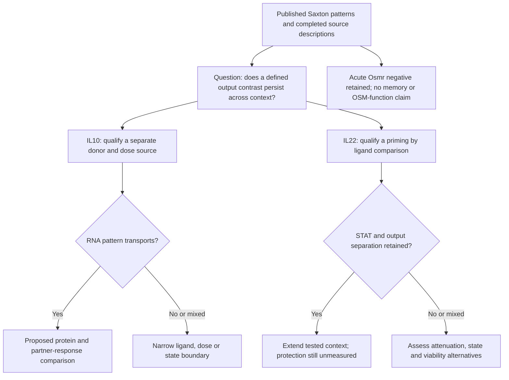

# Where the completed Saxton analyses can lead

**Related aged-niche evidence, 8 November:** the owner-requested
[Navarro Negredo 2026 assessment](../../../Research%20Article/ungated_navarro_negredo_2026_aged_brain_il10/README.md) identifies
Fig. 5's directly tested T-cell/IFN contribution to WT IL-10 responses in
microglia. Treat that loop as a published premise. D25K is not an arm of the
repository's Saxton RNA source, and this study does not supply either held
interaction below. The age-by-ligand and injury-repair comparisons remain
unmeasured; no current hypothesis or numerical result is changed.

8 November 2026. **Article-local development under Sx10-P01 and Sx22-P01; no new
accepted RQ.** The [three-route execution record](EXTENSION_EXECUTION.md) now
supplements the original results at `16627aa` and the
[dated primary-literature review](POST_RESULT_LITERATURE.md). Outcomes were
already exposed. The original rationale below is retained; new versioned
contracts, source amendment and reports own the completed extension work.

**Current narrowing:** the Gorby reported estimates do not reproduce opposing
IFNG/GZMB directions at either dose. All three targets favor the enhanced ligand
at 0.1 nM and WT at 50 nM; high-dose IL18RAP is calculation/omission-sensitive.
This motivates a matched ligand/dose/activation comparison, with source
normalization limits unresolved. Both interaction source screens completed
without a qualified dataset. Their matched response experiments remain proposals.

## What is worth narrowing

The useful organizing problem is **robustness of a particular engineered response
to recipient and exposure context**. "Decouple cytokine functions" is already
established. The current data nominate comparisons, not causal targets.

| Route | Existing observation → remaining question | Plausible contribution / next decision |
|---|---|---|
| IL-10 output separation | Super-10 raises IFNG/IL18RAP relative to WT but lowers GZMB/IL22/SOCS3. Gorby's reported estimates do not retain that split at either tested dose. | Source description completed after a narrower endpoint amendment. Next: matched ligand/dose/activation context and protein outputs; no causal factor identified. |
| IL-10 co-input dependence | IL18RAP RNA nominates a response-capacity question, but IL-10/IL-18 cooperation is old literature. Does ligand choice alter the incremental response to IL-18 in activated human CD8 cells? | A specific variant-by-partner boundary test. Requires matched response data; RNA or a receptor score cannot answer it. |
| IL-22 context dependence | The B3 acute colon result has no stable Osmr induction; the broader transcriptional distinction also includes attenuation. Does B3 retain its STAT/output separation after defined IFN priming? | A priming-by-ligand boundary test, building on Bachmann rather than claiming priming itself is new. No qualified B3/WT priming dataset found in this bounded pass. |

These are recommendations within the requested Saxton scope, not a ranking or
retirement of the repository's canonical portfolio.

## 1. First computational comparison: transport of IL-10 output separation

**Question/estimand:** in a separately collected activated-human-CD8 source,
what are the paired, within-source high-affinity-dimer minus WT-dimer RNA
contrasts at each deposited dose for IFNG, GZMB and IL18RAP? Preserve each
ligand-minus-unstimulated contrast to distinguish increased induction from
weaker repression. Timing and activation must be read from the source, not
assumed equal to Saxton's 24-hour protocol.

**Candidate source:** Gorby 2020/GSE146438, linked by the primary paper. Its
CD8 experiment and monocyte experiment are separate compartments; the latter
does not replicate a CD8 endpoint. Source intake must establish donor IDs,
within-donor allocation, doses, processing, an unselected gene matrix and any
sample overlap before describing external evidence as independent.
Do not derive independence from filename suffixes. Published S1/S2 are
WT-selected lists and need explicit selection limits if used.

**Target roles:** IFNG and GZMB are contrasting output transcripts; IL18RAP is a
candidate response component, requiring IL18R1/surface-complex qualification
before an IL-18 response claim. SOCS3 is a feedback-associated context readout,
not a demonstrated driver. IL22 is an additional discordant transcript, not
evidence of secreted IL-22 action. Preserve CCL1's unstable direction. CCL17/CCL22
could later motivate a separate repression/output question, but are not a reason
to expand this first comparison. No omnibus "inflammation" score is proposed.

**Unit and method:** independent donor/preparation, with paired comparisons only
where the source crosswalk establishes pairing. A descriptive fallback may retain
unknown units; population inference may not. Freeze eligibility, contrast and
scale sensitivity before calculation. No combined cross-study effect size:
ligands, doses and protocols differ. The 2026 model's reuse of these sources
must be recorded in any claim of external validation.

**Informative outcomes:** concordant IFNG/GZMB separation would motivate testing
its transportability at protein level. Dose-specific or reversed relationships
would narrow the context and challenge a universal amplification story. Missing
or weakly measured targets would limit the screen, not justify replacement
genes. None identifies a STAT mechanism. This is the most concrete next Ravel
source qualification, not an instruction to rerun either completed Saxton job.

## 2. Biological extension: ligand choice changes the IL-18 response increment

**Proposed comparison:** activated human CD8 preparations exposed to WT, super-10
or 10-DE, each with and without IL-18 and with appropriate no-IL-10 controls.
Estimate the IL-18 response increment under each ligand, then compare increments.
Independent donors, common activation state and matched collection timing are
required; dose/timing and precision are not yet qualified.

**Hypothesis:** the larger IL18RAP RNA response under super-10 accompanies a
larger IL-18-associated IFNγ increment, without requiring a parallel GZMB increase.
**Rival:** direct IL-10 effects, altered survival/state or protein trafficking
could produce the RNA pattern without altered IL-18 competence. Published
coactivation is a premise, not a finding of this repository.

Measure surface receptor components and per-viable-cell IFNγ/protein output;
GZMB abundance remains distinct from actual killing. A larger increment supports
partner-dependent response, not IL18RAP mediation. Receptor perturbation is
needed only if pursuing that mediation claim. No increment despite RNA induction
would weaken this target route; broad viability/state changes would limit the
within-cell interpretation. Existing GSE160332 cannot execute this comparison.

## 3. Biological extension: does B3 selectivity survive inflammatory priming?

**Proposed comparison:** one defined epithelial population/model, unprimed versus
IFNα-primed, receiving PBS, WT IL-22 or B3, with a priming-only control. Human
colon organoids are a candidate model, not a qualified local capability. Unit:
independent donor-derived preparation; wells are nested measurements. Species
compatibility, dose/time and priming schedule remain to be qualified from sources.

**Hypothesis:** priming changes the B3-versus-WT contrast for STAT1-associated
responses. **Rival:** general changes in effective signal strength, viability or
cell composition explain the contrast. Read pSTAT1 and pSTAT3 separately with
within-analyte controls and a short response time course; do not divide raw
fluorescence across antibody channels. Compare CXCL10 secretion alongside a
separately defined epithelial endpoint. Receptor protein helps interpret exposure
response but does not substitute for it.

Loss of separation after priming would identify a context boundary; preserved
separation would extend the tested domain. General loss of both outputs would
support attenuation or measurement failure, not selective protection. A barrier
function assay would be needed before making a repair/protection claim.

Osmr is a **conditional downstream checkpoint**, not a primary positive lead:
the acute repository result weakens retained induction. A later OSM-response
test is justified only by new evidence of epithelial receptor availability or a
clearly specified chronic exposure question. Do not extend dose/time searches
simply to rescue the unfavorable acute finding. Existing withdrawal data do
not justify an IL-22 memory claim.

## Cross-check against the repository's prior analyses

| Current precedent | Lesson used here; scope preserved |
|---|---|
| [DuPage target screen](../../../Research%20Article/gate3_09_dupage_2015/TARGET_SCREEN_RESULT.md) and A33–A35 | Separate source/annotation qualification, target roles and functional discriminators. A target list is not a mechanism. No transfer of Treg conclusions to CD8/colon. |
| [A9 recipient competence](../../research_dossiers/A9.md) | Its completed receptor-transcript screen does not measure competence. Saxton provides an analogous reasoning problem, not new evidence for AREG responsiveness. |
| [A14 withdrawal](../../research_dossiers/A14.md) and [Arozamena results](../../../Research%20Article/ungated_arozamena_2026_inflammatory_memory/RQ_CONNECTIONS.md) | History needs verified cessation and linked later endpoints. RNA/accessibility findings and QC sensitivity do not supply a Saxton persistence experiment. |
| [DY1 cross-assay follow-up](../../../Research%20Article/gate2_DY1_damani_yokota_2026/rq_discordance/README.md) | Separate assay cohorts cannot be treated as matched cells/animals. Apply the same rule to Saxton RNA, phosphoflow and secretion. |
| [Wagner model results](../../../Research%20Article/gate2_W1_wagner_th17_autoimmunity/MODEL_RESULTS.md) | Where animal identity permits an identifiable blocked model it can be used; missing Saxton donor identity cannot be filled in by analogy. |

## Qualitative decision map

Qualitative proposals only. Unknown donor identity, mismatched assays and source
selection can leave either comparison unsupported. No numerical thresholds,
sample sizes or human retain/reject decisions are inferred from this diagram.

## Reading and execution boundary

For RQ development, read the complete **biological Results argument**, relevant
legends and assay methods in Saxton; structural methods can wait unless receptor
engineering becomes the question. Then read the closest paper for the selected
route: Gorby Figs. 3–6 for transport/dose; Freeman for co-inputs; Bachmann plus
Cineus/Luo for epithelial context. The 2026 TYK2 paper is necessary context for
any new myeloid-selectivity proposal; the modeling preprint must be assessed
before proposing another threshold model. Abstract-only coverage is insufficient
for final experimental specification.

**Completed:** literature/source-overlap review, cross-paper synthesis, plans for
all three routes, source qualification/screens and the fixed Gorby reported-estimate
description. **Held:** both numerical interactions and laboratory execution for
the missing evidence stated in their plans. No broader gene screen, model, atlas
or structure prediction was added. The parent technical audit of the earlier
handoff and human scientific adoption remain separate from this execution.
